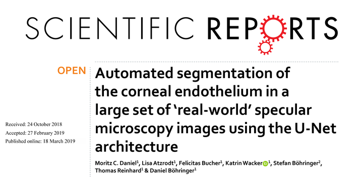
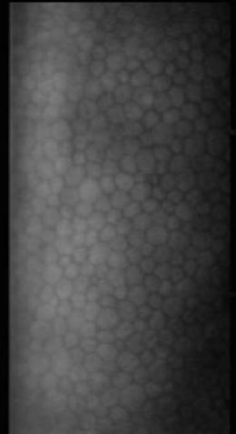

# ASCE

<div align="center">
    <a href="https://github.com/openmedlab/"></a>
</div>
<p style="text-align:center;font-size:10px;"><em></em></p>

## Dataset Information

ASCE (Automated Segmentation of the Corneal Endothelium) contains 385 anonymized specular microscopy images acquired using a Topcon SP-3000 microscope. The corpus includes healthy, diseased and postoperative corneas, with varying image quality. Experts annotated cell centers and reviewed the annotations, supporting cell localization, segmentation method development and cell density estimation.

The published archive contains 385 TIFF images of width 260 and height 477 pixels, together with 385 coordinate files. Of these, 324 files contain annotated cell coordinates and 61 contain no cell coordinates. The annotations are center points rather than manually drawn pixel-level cell boundary masks.

## Dataset Meta Information

| Dimensions | Modality            | Task Type                       | Anatomical Structures | Anatomical Area | Number of Categories | Data Volume | File Format |
|------------|---------------------|---------------------------------|-----------------------|-----------------|----------------------|-------------|-------------|
| 2D         | Specular Microscopy | Cell Localization, Segmentation | Corneal Endothelium   | Eye             | 1                    | 385         | .tiff, .txt |

### Resolution Details

| Dataset Statistics | size    |
|--------------------|---------|
| min                | 477*260 |
| median             | 477*260 |
| max                | 477*260 |

Size is reported as (height, width). The official archive images have width 260 and height 477 pixels.

## Label Information Statistics

| Metric     | Corneal Endothelium |
|------------|---------------------|
| Case Count | 324                 |
| Coverage   | 84.16%              |

## Visualization

<div align="center">
    <a href="https://github.com/openmedlab/"></a>
</div>
<p style="text-align:center;font-size:10px;"><em>Corneal endothelial microscopy image.</em></p>

<div align="center">
    <a href="https://github.com/openmedlab/"></a>
</div>
<p style="text-align:center;font-size:10px;"><em>Annotated cell center points.</em></p>

## File Structure

``` 
CornealRndothelialCell/
│
└── images_and_labels/
    ├── 71866.tiff
    ├── 71866.txt
    ├── 71867.tiff
    ├── 71867.txt
    ├── 71868.tiff
    ├── 71868.txt
    ├── ...
```

## Authors and Institutions

Moritz C. Daniel (Eye Center, Medical Center, University of Freiburg, Freiburg, Germany)

Lisa Atzrodt (Eye Center, Medical Center, University of Freiburg, Freiburg, Germany)

Felicitas Bucher (Eye Center, Medical Center, University of Freiburg, Freiburg, Germany)

Katrin Wacker (Eye Center, Medical Center, University of Freiburg, Freiburg, Germany)

Stefan Böhringer (Department of Biomedical Data Sciences, Leiden University Medical Center, Leiden, The Netherlands)

Thomas Reinhard (Eye Center, Medical Center, University of Freiburg, Freiburg, Germany)

Daniel Böhringer (Eye Center, Medical Center, University of Freiburg, Freiburg, Germany)

## Source Information

Official Website: https://github.com/daboe01/SREP-18-33533B

Download Link: https://github.com/daboe01/SREP-18-33533B

Article Address: https://pubmed.ncbi.nlm.nih.gov/30894636/

Publication Date: 2019-03

Verified Image Archive: https://github.com/daboe01/SREP-18-33533B/blob/master/images_and_labels.zip

## Citation

``` 
@article{daniel2019automated,
  title={Automated segmentation of the corneal endothelium in a large set of ‘real-world’ specular microscopy images using the U-Net architecture},
  author={Daniel, Moritz C and Atzrodt, Lisa and Bucher, Felicitas and Wacker, Katrin and B{\"o}hringer, Stefan and Reinhard, Thomas and B{\"o}hringer, Daniel},
  journal={Scientific reports},
  volume={9},
  number={1},
  pages={4752},
  year={2019},
  publisher={Nature Publishing Group UK London}
}
```

Original introduction article is [here](https://zhuanlan.zhihu.com/p/7730995029).
