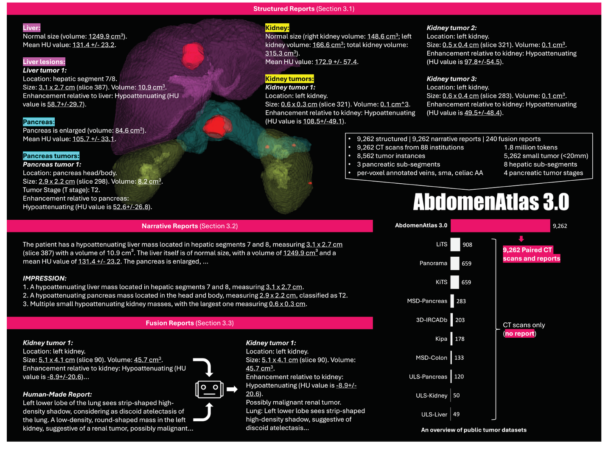
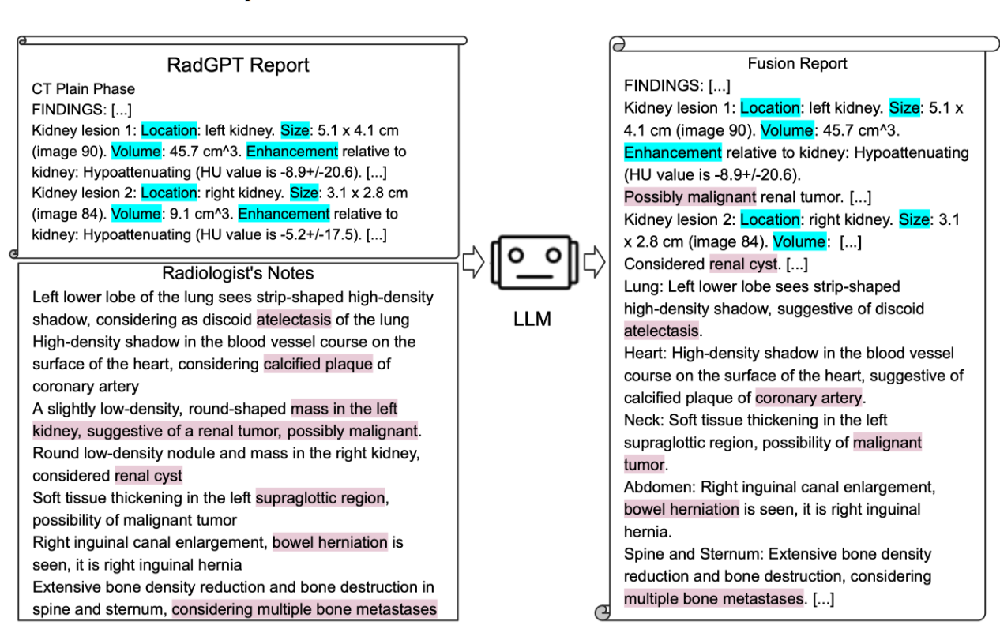
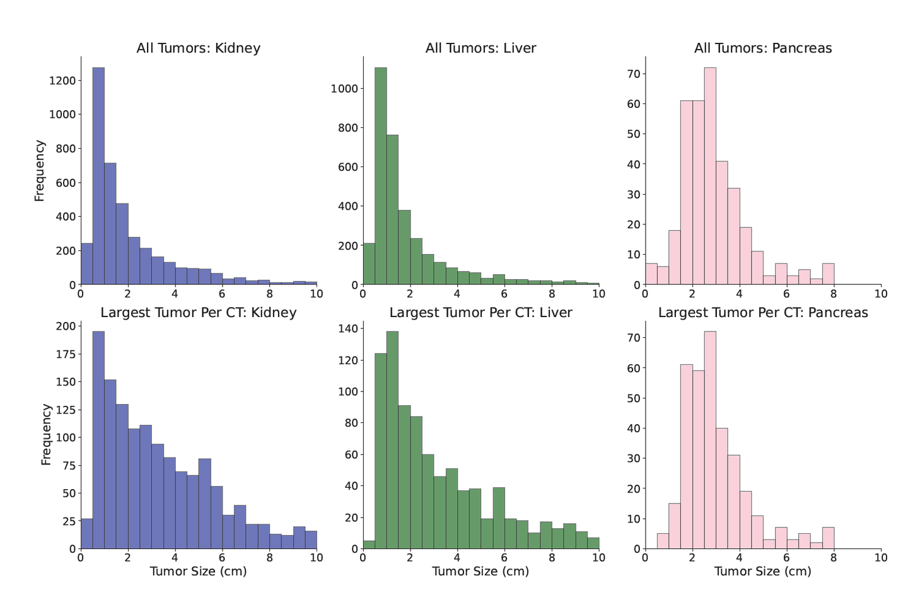
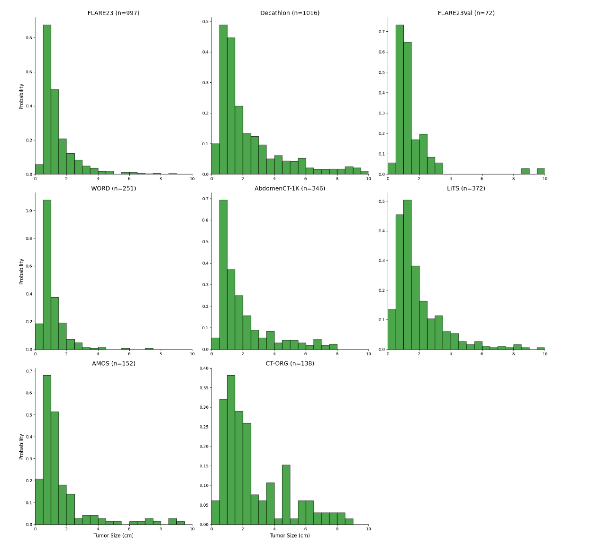
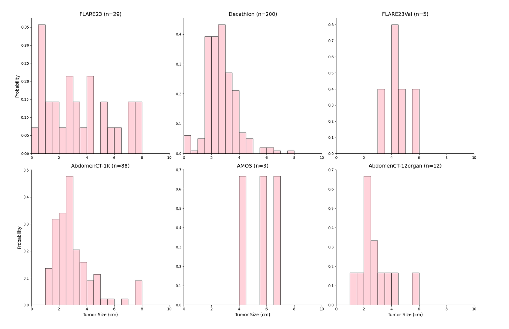
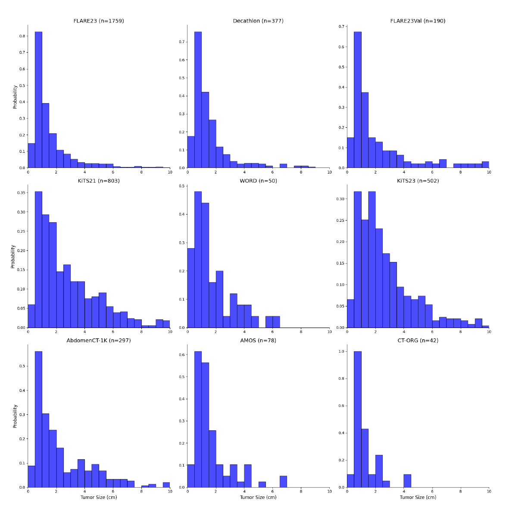
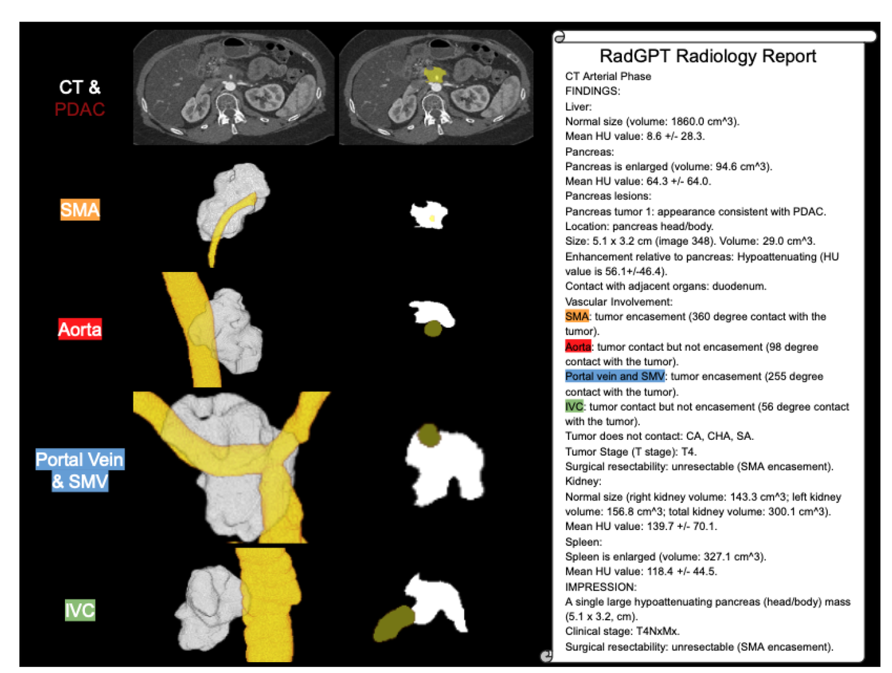
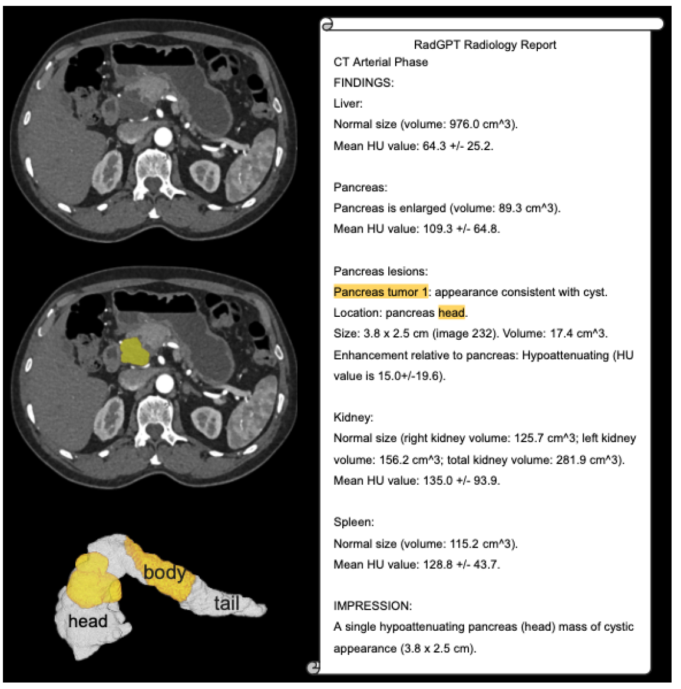
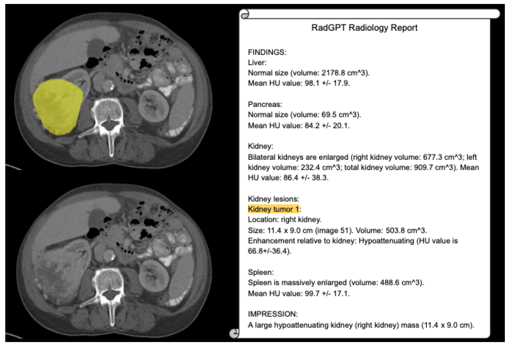
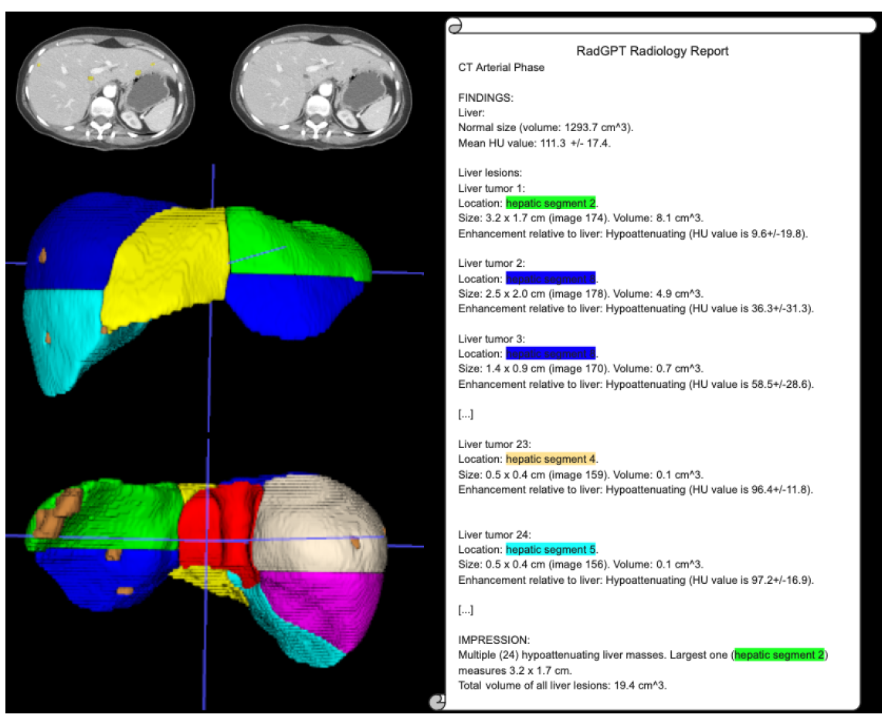

# AbdomenAtlas 3.0

## Dataset Information

AbdomenAtlas 3.0 pairs abdominal CT scans with per-voxel tumor masks and detailed radiology reports. The January 2025 release described by the source introduction contains 9,262 scans from 17 public datasets, spanning 88 institutions in 19 countries. The reports describe liver, pancreatic and kidney tumors, including their location, size, shape, volume and relationships with surrounding vessels and organs.

The dataset provides eight liver sub-segments, three pancreatic sub-segments and pancreatic tumor staging information. RadGPT converts segmentation information into structured reports and narrative reports, with radiologist review. The source introduction also describes 240 human-AI fusion reports that combine clinical notes with quantitative measurements. Statistics below refer to the January 2025 version summarized by the introduction; the paper was subsequently revised.

## Dataset Meta Information

| Task Type                       | Language | Data Volume    | File Format  |
|---------------------------------|----------|----------------|--------------|
| Report Generation, Segmentation | English  | 9,262 CT Scans | NIfTI, DICOM |

## Dataset Information Statistics

| Statistic                        | January 2025 Source Version |
|----------------------------------|-----------------------------|
| CT Scans                         | 9,262                       |
| Public Source Datasets           | 17                          |
| Institutions                     | 88                          |
| Countries                        | 19                          |
| Pancreatic Tumor Staging Reports | 260                         |
| Human-AI Fusion Reports          | 240                         |
| Liver Sub-segments               | 8                           |
| Pancreatic Sub-segments          | 3                           |

The source version describes approximately 2.8 million 2D images and 1.8 million text tokens. Report types include structured reports, narrative reports and human-AI fusion reports.

## Dataset Example

<div align="center">
    <a href="https://github.com/openmedlab/"></a>
</div>
<p style="text-align:center;font-size:10px;"><em>Overview of AbdomenAtlas 3.0.</em></p>

<div align="center">
    <a href="https://github.com/openmedlab/"></a>
</div>
<p style="text-align:center;font-size:10px;"><em>Combining quantitative RadGPT reports with clinical insights from human reports.</em></p>

<div align="center">
    <a href="https://github.com/openmedlab/"></a>
</div>
<p style="text-align:center;font-size:10px;"><em>Tumor size distributions in AbdomenAtlas 3.0.</em></p>

<div align="center">
    <a href="https://github.com/openmedlab/"></a>
</div>
<p style="text-align:center;font-size:10px;"><em>Liver tumor size distributions across constituent datasets.</em></p>

<div align="center">
    <a href="https://github.com/openmedlab/"></a>
</div>
<p style="text-align:center;font-size:10px;"><em>Pancreatic tumor size distributions across constituent datasets.</em></p>

<div align="center">
    <a href="https://github.com/openmedlab/"></a>
</div>
<p style="text-align:center;font-size:10px;"><em>Kidney tumor size distributions across constituent datasets.</em></p>

<div align="center">
    <a href="https://github.com/openmedlab/"></a>
</div>
<p style="text-align:center;font-size:10px;"><em>Example T4 pancreatic ductal adenocarcinoma staging report.</em></p>

<div align="center">
    <a href="https://github.com/openmedlab/"></a>
</div>
<p style="text-align:center;font-size:10px;"><em>Two pancreatic tumors (yellow) and pancreatic sub-segments.</em></p>

<div align="center">
    <a href="https://github.com/openmedlab/"></a>
</div>
<p style="text-align:center;font-size:10px;"><em>Large kidney tumor (yellow) and its diagnostic report.</em></p>

<div align="center">
    <a href="https://github.com/openmedlab/"></a>
</div>
<p style="text-align:center;font-size:10px;"><em>CT example with 24 liver tumors (brown).</em></p>

## File Structure

The source introduction does not provide a directory layout.

## Authors and Institutions

Pedro R. A. S. Bassi (Johns Hopkins University; University of Bologna; Italian Institute of Technology)

Mehmet Can Yavuz (University of California, San Francisco)

Kang Wang (University of California, San Francisco)

Xiaoxi Chen (University of Illinois Urbana-Champaign)

Wenxuan Li (Johns Hopkins University)

Sergio Decherchi (Italian Institute of Technology)

Andrea Cavalli (Italian Institute of Technology; University of Bologna; École Polytechnique Fédérale de Lausanne)

Yang Yang (University of California, San Francisco)

Alan Yuille (Johns Hopkins University)

Zongwei Zhou* (Johns Hopkins University)

## Source Information

Official Website: https://www.zongweiz.com/dataset

Download Link: https://www.zongweiz.com/dataset#:~:text=lesion%20instances-,AbdomenAtlas%203.0,-Status%3A%20Beta%2DTest

Article Address: https://arxiv.org/abs/2501.04678

Publication Date: 2025-01-08

January 2025 Paper Version: https://arxiv.org/abs/2501.04678v1

## Citation

``` 
@article{bassi2025radgpt,
  title={RadGPT: Constructing 3D Image-Text Tumor Datasets},
  author={Bassi, Pedro RAS and Yavuz, Mehmet Can and Wang, Kang and Chen, Xiaoxi and Li, Wenxuan and Decherchi, Sergio and Cavalli, Andrea and Yang, Yang and Yuille, Alan and Zhou, Zongwei},
  journal={arXiv preprint arXiv:2501.04678},
  year={2025}
}
```

Original introduction article is [here](https://zhuanlan.zhihu.com/p/19339643417).
