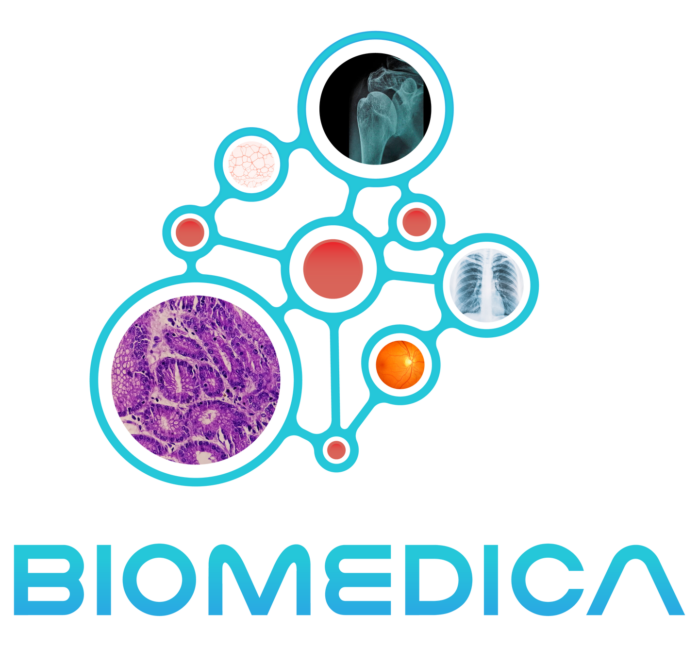
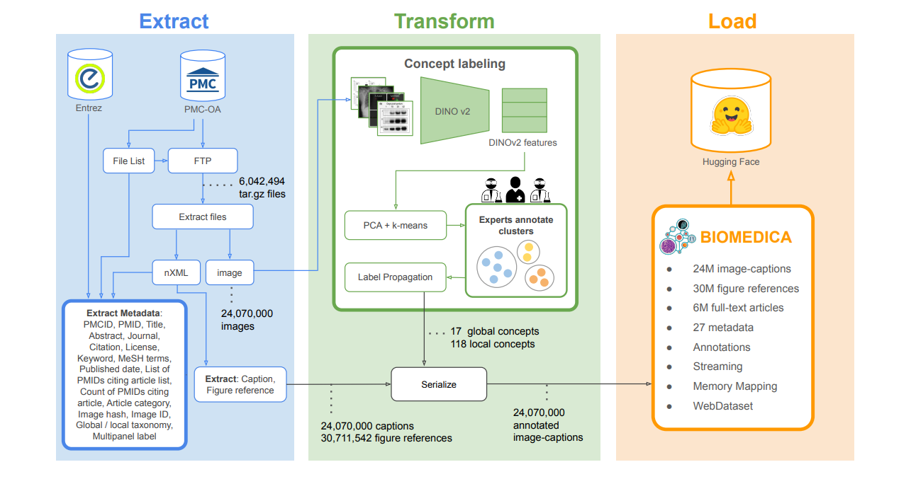
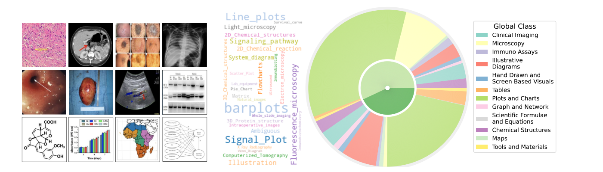

# BIOMEDICA

<div align="center">
    <a href="https://github.com/openmedlab/"></a>
</div>
<p style="text-align:center;font-size:10px;"><em>BIOMEDICA biomedical image-caption archive.</em></p>

## Dataset Information

BIOMEDICA is an open biomedical image-caption archive and a framework for extracting, annotating, and serializing data from the PubMed Central Open Access subset. The paper describes more than 24 million image-text pairs from over six million articles, together with 30 million in-text figure references and 27 metadata fields.

The extraction stage collects images, captions, references in article text, and article metadata such as titles, abstracts, keywords, and publication dates. Image features from DINOv2 are reduced using PCA and grouped with K-means. Seven experts annotate 2,000 clusters using a taxonomy of 12 global and 170 local concepts, and these labels are propagated to the images.

<div align="center">
    <a href="https://github.com/openmedlab/"></a>
</div>
<p style="text-align:center;font-size:10px;"><em>BIOMEDICA extraction, transformation, annotation, and loading pipeline.</em></p>

## Dataset Meta Information

| Task Type                                | Language | Image-text Pairs | Source Articles | Metadata Fields | File Format               |
|------------------------------------------|----------|------------------|-----------------|-----------------|---------------------------|
| Vision-language Pre-training / Retrieval | English  | More than 24M    | More than 6M    | 27              | .parquet, WebDataset .tar |

## Dataset Information Statistics

The archive includes clinical imaging, microscopy, data plots, scientific formulas, and chemical structures. Data plots are the largest category, comprising approximately 57% of the archive. Parquet supports filtering and querying metadata, while WebDataset supports streaming image-text data for model training.

The pipeline illustration reproduced in the introduction shows an earlier taxonomy of 17 global and 118 local concepts; the paper's updated taxonomy described above contains 12 global and 170 local concepts.

<div align="center">
    <a href="https://github.com/openmedlab/"></a>
</div>
<p style="text-align:center;font-size:10px;"><em>Examples and distribution of BIOMEDICA image categories.</em></p>

## Dataset Example

The visual examples include histopathology, CT, dermatology, chest radiography, endoscopy, fundus photography, ultrasound, assays, chemical structures, charts, maps, and diagrams.

The accompanying BMC-CLIP models are continuously pre-trained on BIOMEDICA. The paper evaluates them across 40 tasks, including pathology, radiology, ophthalmology, dermatology, surgery, and molecular and cell biology. It reports an average 6.56% zero-shot classification improvement, with larger gains in dermatology and ophthalmology. These results describe the original study.

## File Structure

The archive is serialized into WebDataset TAR shards and Parquet files and is distributed through the BIOMEDICA Hugging Face organization. Records retain article-level metadata and image-level concept annotations. The introduction provides these formats but does not specify a single directory tree. The license of each source article must be retained; the ETL code license does not determine the permissions of every image.

## Authors and Institutions

Alejandro Lozano, Min Woo Sun, James Burgess, Liangyu Chen, Jeffrey J. Nirschl, Jeffrey Gu, Ivan Lopez, Josiah Aklilu, Austin Wolfgang Katzer, Collin Chiu, Anita Rau, Xiaohan Wang, Yuhui Zhang, Alfred Seunghoon Song, Robert Tibshirani, and Serena Yeung-Levy (Stanford University, USA)

## Source Information

Official Website: https://github.com/minwoosun/biomedica-etl

Download Link: https://huggingface.co/BIOMEDICA

Article Address: https://arxiv.org/abs/2501.07171

Publication Date: 2025-01

## Citation

``` 
@misc{lozano2025biomedicaopenbiomedicalimagecaption,
  title={BIOMEDICA: An Open Biomedical Image-Caption Archive, Dataset, and Vision-Language Models Derived from Scientific Literature},
  author={Alejandro Lozano and Min Woo Sun and James Burgess and Liangyu Chen and Jeffrey J. Nirschl and Jeffrey Gu and Ivan Lopez and Josiah Aklilu and Austin Wolfgang Katzer and Collin Chiu and Anita Rau and Xiaohan Wang and Yuhui Zhang and Alfred Seunghoon Song and Robert Tibshirani and Serena Yeung-Levy},
  year={2025},
  eprint={2501.07171},
  archivePrefix={arXiv},
  primaryClass={cs.CV},
  url={https://arxiv.org/abs/2501.07171}
}
```

Original introduction article is [here](https://zhuanlan.zhihu.com/p/18464481429).
