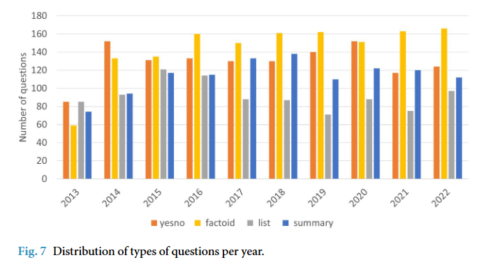
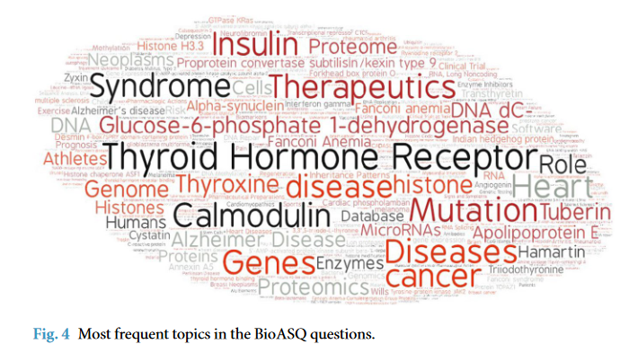
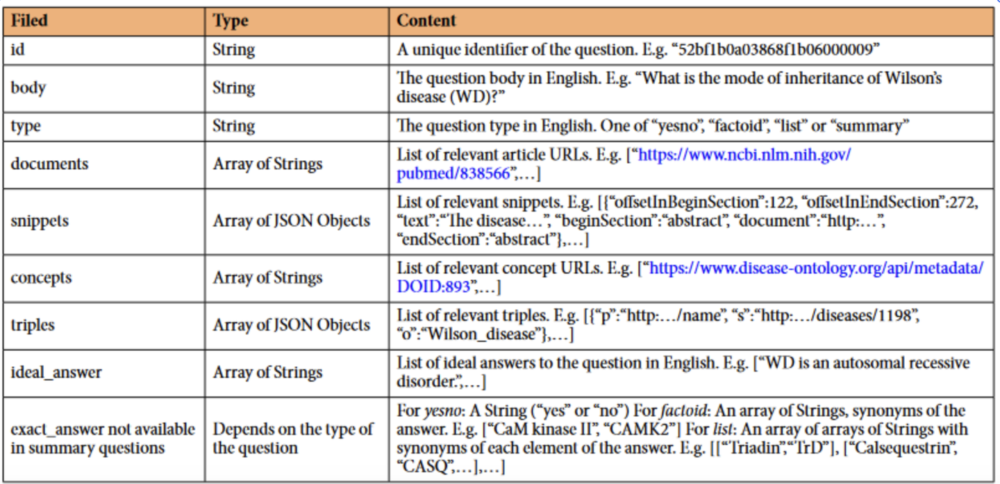

# BioASQ-QA

<div align="center">
    <a href="https://github.com/openmedlab/"></a>
</div>
<p style="text-align:center;font-size:10px;"><em></em></p>

## Dataset Information

BioASQ-QA is a manually curated biomedical question-answering corpus from the BioASQ challenge. Questions in English are accompanied by reference answers and supporting material, including documents, text snippets, and biomedical concepts. The corpus supports question answering, document/passage retrieval, and summarization.

The introduction describes the BioASQ11 training release, with 4,719 questions in training11b.json. Question types include yes/no, factoid, list, and summary questions. Exact answers support concise factual evaluation; ideal answers provide summary-style responses. The challenge continuously adds new questions, so these counts refer to the named historical release.

## Dataset Meta Information

| Task Type     | Language | Train                            | Val | Test | File Format | Size                     |
|---------------|----------|----------------------------------|-----|------|-------------|--------------------------|
| Biomedical QA | English  | 4719 (BioASQ11 training release) | -   | -    | .json       | 35.8MB (source-reported) |

## Dataset Information Statistics

The source figures describe historical question-type counts and topic frequencies. The downloadable file is named training11b.json; it is not a 4,719-question test split.

<div align="center">
    <a href="https://github.com/openmedlab/"></a>
</div>
<p style="text-align:center;font-size:10px;"><em>Question counts by type and year in the source paper.</em></p>

<div align="center">
    <a href="https://github.com/openmedlab/"></a>
</div>
<p style="text-align:center;font-size:10px;"><em>Biomedical topic frequencies.</em></p>

## Dataset Example

A record includes its question type and body, relevant documents and snippets, concepts, and exact and/or ideal reference answers.

<div align="center">
    <a href="https://github.com/openmedlab/"></a>
</div>
<p style="text-align:center;font-size:10px;"><em>An annotated biomedical question and supporting material.</em></p>

## File Structure

```
BioASQ-QA/
├── training11b.json
└── README
```

## Authors and Institutions

Anastasia Krithara (National Center for Scientific Research “Demokritos”)

Anastasios Nentidis (Aristotle University of Thessaloniki)

Konstantinos Bougiatiotis (National Center for Scientific Research “Demokritos”)

Georgios Paliouras (National Center for Scientific Research “Demokritos”)

## Source Information

Official Website: http://www.bioasq.org/

Download Link: https://zenodo.org/records/7655130

Article Address: https://www.nature.com/articles/s41597-023-02068-4

Publication Date: 2022-12

## Citation

```
@article{krithara2023bioasq,
  title={BioASQ-QA: A manually curated corpus for Biomedical Question Answering},
  author={Krithara, Anastasia and Nentidis, Anastasios and Bougiatiotis, Konstantinos and Paliouras, Georgios},
  journal={Scientific Data},
  volume={10},
  number={1},
  pages={170},
  year={2023},
  publisher={Nature Publishing Group UK London}
}
```

Original introduction article is [here](https://zhuanlan.zhihu.com/p/696317794).
