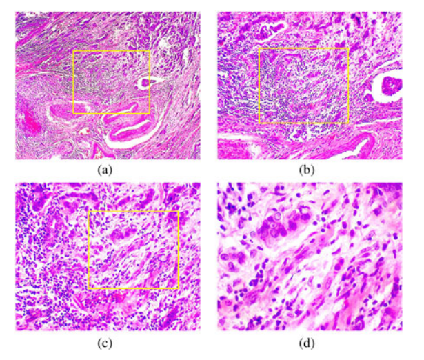

# BreakHis

<div align="center">
    <a href="https://github.com/openmedlab/"></a>
</div>
<p style="text-align:center;font-size:10px;"><em></em></p>

## Dataset Information

BreakHis contains digital breast tissue images acquired with an Olympus BX-50 microscope at 40×, 100×, 200×, and 400× magnification, using 4×, 10×, 20×, and 40× objectives, respectively. Images were captured in 24-bit RGB, with 8 bits per channel, using automatic exposure and manual focus assessed on a computer display. Effective pixel size is calculated from the camera's 6.5 μm physical pixels, the 3.3× relay lens, and the objective magnification.

Black side borders and the text annotation in the upper-left corner were cropped from the original images. The resulting images are 700 × 460 pixels and stored as lossless three-channel PNG files, without normalization or color standardization. The collection has 7,909 images: 2,480 benign and 5,429 malignant.

Magnification and digital resolution of the acquisition system:

| Visual Magnification | Objective Magnification | Pixel Size (μm) |
|----------------------|-------------------------|-----------------|
| 40×                  | 4×                      | 0.49            |
| 100×                 | 10×                     | 0.20            |
| 200×                 | 20×                     | 0.10            |
| 400×                 | 40×                     | 0.05            |

## Dataset Meta Information

| Dimensions | Modality       | Task Type      | Anatomical Structures | Anatomical Area | Number of Categories | Data Volume | File Format |
|------------|----------------|----------------|-----------------------|-----------------|----------------------|-------------|-------------|
| 2D         | Histopathology | Classification | Breast                | Chest           | 2                    | 7909        | .png        |

### Resolution Details

|        | size      |
|--------|-----------|
| min    | 700 × 460 |
| median | 700 × 460 |
| max    | 700 × 460 |

## Label Information Statistics

| Magnification | Benign | Malignant | Total |
|---------------|--------|-----------|-------|
| 40×           | 625    | 1370      | 1995  |
| 100×          | 644    | 1437      | 2081  |
| 200×          | 623    | 1390      | 2013  |
| 400×          | 588    | 1232      | 1820  |
| Total         | 2480   | 5429      | 7909  |

## Visualization

<div align="center">
    <a href="https://github.com/openmedlab/"></a>
</div>
<p style="text-align:center;font-size:10px;"><em>Hematoxylin-and-eosin-stained malignant breast tissue at (a) 40×, (b) 100×, (c) 200×, and (d) 400× magnification.</em></p>

## File Structure

The source introduction shows the following file structure:

``` 
Breakhis Dataset
├── Breakhis_40x
│   ├── images
│   │   ├── benign
│   │   │      ├── xxx.png
│   │   │      ├── ....
│   │   ├── malignant
│   │   │      ├── xxx.png
│   │   │      ├── ....
├── Breakhis_100x
│   ├── images
│   │   ├── benign
│   │   │      ├── xxx.png
│   │   │      ├── ....
│   │   ├── malignant
│   │   │      ├── xxx.png
│   │   │      ├── ....
├── Breakhis_200x
│   ├── images
│   │   ├── benign
│   │   │      ├── xxx.png
│   │   │      ├── ....
│   │   ├── malignant
│   │   │      ├── xxx.png
│   │   │      ├── ....
├── Breakhis_400x
│   ├── images
│   │   ├── benign
│   │   │      ├── xxx.png
│   │   │      ├── ....
│   │   ├── malignant
│   │   │      ├── xxx.png
│   │   │      ├── ....
```

## Authors and Institutions

Fabio A. Spanhol, Luiz S. Oliveira, Caroline Petitjean, and Laurent Heutte (authors of the dataset paper). The source introduction does not specify their institutional affiliations.

## Source Information

Official Website: https://opendatalab.com/OpenDataLab/BreakHis

Download Link: https://opendatalab.com/OpenDataLab/BreakHis

Article Address: https://ieeexplore.ieee.org/stamp/stamp.jsp?tp=&arnumber=7312934

Publication Date: 2016

## Citation

``` 
@article{spanhol2016dataset,
  title={A dataset for breast cancer histopathological image classification},
  author={Spanhol, Fabio A and Oliveira, Luiz S and Petitjean, Caroline and Heutte, Laurent},
  journal={IEEE Transactions on Biomedical Engineering},
  volume={63},
  number={7},
  pages={1455--1462},
  year={2016},
  doi={10.1109/TBME.2015.2496264},
  publisher={IEEE}
}
```

Original introduction article is [here](https://zhuanlan.zhihu.com/p/15357227351).
