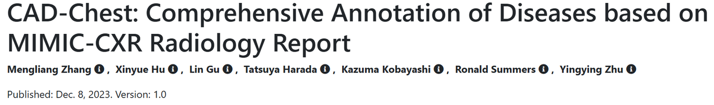
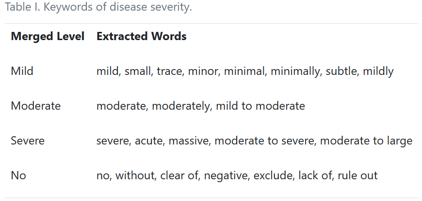
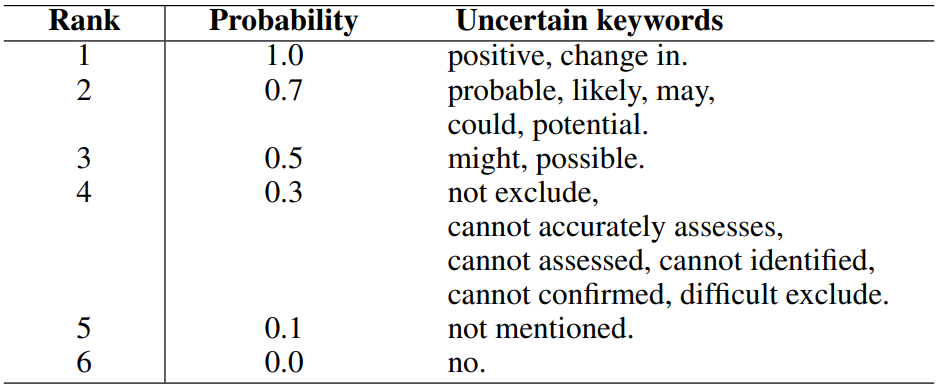
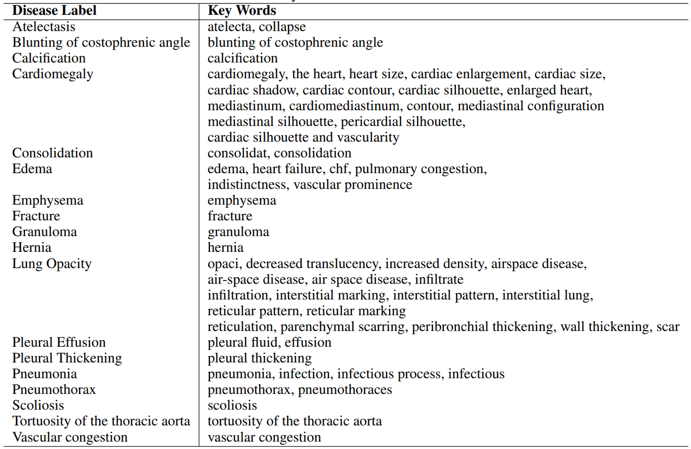
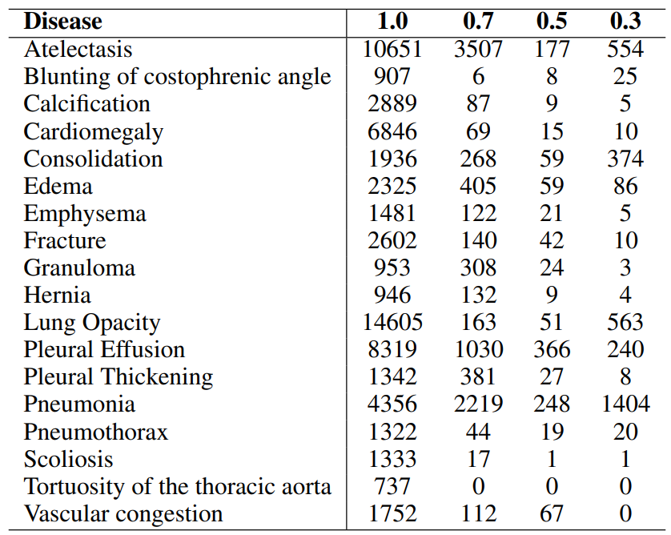
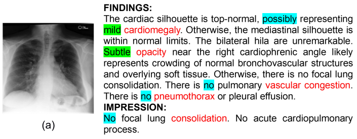
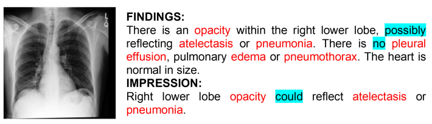

# CAD-Chest

<div align="center">
    <a href="https://github.com/openmedlab/"></a>
</div>
<p style="text-align:center;font-size:10px;"><em>CAD-Chest disease, uncertainty, and severity annotations.</em></p>

## Dataset Information

CAD-Chest adds disease uncertainty, severity, and location annotations to chest radiology reports from MIMIC-CXR. It includes 227,827 reports from 65,379 patients and covers 18 disease categories. The annotations support chest X-ray classification with richer supervision than binary present-or-absent labels.

The dataset distinguishes descriptions of definite findings from uncertain or negated findings, and assigns uncertainty levels according to the wording of the report. It also records severity attributes. These annotations allow models to retain information that would be lost when uncertain descriptions are collapsed into a negative class.

## Dataset Meta Information

| Task Type      | Language | Train           | Val            | Test           | File Format               | Size                    |
|----------------|----------|-----------------|----------------|----------------|---------------------------|-------------------------|
| Classification | English  | 182,262 reports | 22,783 reports | 22,782 reports | .json; source images .dcm | MIMIC-CXR images: 621GB |

## Dataset Information Statistics

Severity levels are defined using expressions found in reports. The illustrated uncertainty scheme assigns scores of 1, 0.7, 0.5, 0.3, 0.1, and 0: 1 indicates a positive finding, 0 a negative finding, and 0.1 a finding that is not mentioned.

<div align="center">
    <a href="https://github.com/openmedlab/"></a>
</div>
<p style="text-align:center;font-size:10px;"><em>Severity categories and associated report expressions.</em></p>

<div align="center">
    <a href="https://github.com/openmedlab/"></a>
</div>
<p style="text-align:center;font-size:10px;"><em>Uncertainty expressions and their assigned probability levels.</em></p>

<div align="center">
    <a href="https://github.com/openmedlab/"></a>
</div>
<p style="text-align:center;font-size:10px;"><em>The 18 disease categories and associated keywords.</em></p>

<div align="center">
    <a href="https://github.com/openmedlab/"></a>
</div>
<p style="text-align:center;font-size:10px;"><em>Disease counts at uncertainty levels 1.0, 0.7, 0.5, and 0.3 as illustrated in the introduction.</em></p>

## Dataset Example

Each example combines a chest radiograph, its report, and highlighted disease or uncertainty expressions.

<div align="center">
    <a href="https://github.com/openmedlab/"></a>
</div>
<p style="text-align:center;font-size:10px;"><em>Example radiograph and report with disease and uncertainty annotations.</em></p>

<div align="center">
    <a href="https://github.com/openmedlab/"></a>
</div>
<p style="text-align:center;font-size:10px;"><em>Additional annotated report example.</em></p>

## File Structure

The CAD-Chest release provides `cad_disease.json`. The radiographs are inherited from MIMIC-CXR 2.0 and must be obtained separately under that dataset's access conditions. The following example shows their patient and study organization alongside the annotation file.

``` 
.
├── cad_disease.json
└── files
    └── p10
        └── p10000032
            ├── s50414267
            │   ├── 02aa804e-bde0afdd-112c0b34-7bc16630-4e384014.dcm
            │   └── 174413ec-4ec4c1f7-34ea26b7-c5f994f8-79ef1962.dcm
            ├── s53189527
            │   ├── 2a2277a9-b0ded155-c0de8eb9-c124d10e-82c5caab.dcm
            │   └── e084de3b-be89b11e-20fe3f9f-9c8d8dfe-4cfd202c.dcm
            └── ...
```

## Authors and Institutions

Mengliang Zhang, Xinyue Hu, and Yingying Zhu (University of Texas at Arlington, USA)

Liangchen Liu and Ronald M. Summers (Clinical Center, National Institutes of Health, USA)

Lin Gu and Tatsuya Harada (The University of Tokyo, Japan)

Kazuma Kobayashi (National Cancer Center, Japan)

## Source Information

Official Website: https://github.com/MengRes/Uncertain-Label

Download Link: https://physionet.org/content/cad-chest/1.0/

Article Address: https://arxiv.org/abs/2309.03331

Publication Date: 2023-09

## Citation

``` 
@article{zhang2023expert,
  title={Expert Uncertainty and Severity Aware Chest X-Ray Classification by Multi-Relationship Graph Learning},
  author={Zhang, Mengliang and Hu, Xinyue and Gu, Lin and Liu, Liangchen and Kobayashi, Kazuma and Harada, Tatsuya and Summers, Ronald M and Zhu, Yingying},
  journal={arXiv preprint arXiv:2309.03331},
  year={2023}
}
```

Original introduction article is [here](https://zhuanlan.zhihu.com/p/693690517).
