# CBLUE

<div align="center">
    <a href="https://github.com/openmedlab/">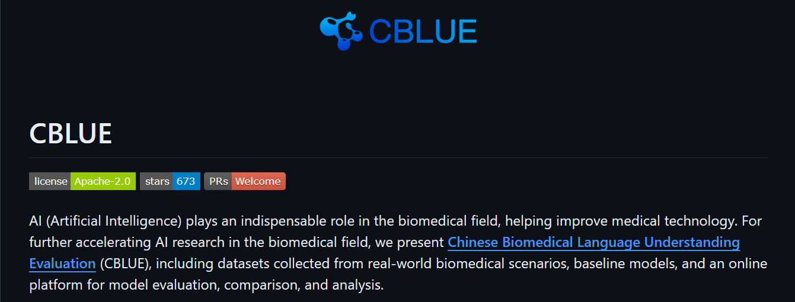</a>
</div>
<p style="text-align:center;font-size:10px;"><em></em></p>

## Dataset Information

CBLUE (Chinese Biomedical Language Understanding Evaluation) is a Chinese biomedical natural language understanding benchmark. The original eight-task release contains 195,870 records: 120,406 training, 28,735 development, and 46,729 test records. It covers entity recognition, relation extraction, diagnosis normalization, sentence similarity, eligibility-criteria classification, query-intent classification, query-document relevance, and query-query relevance.

The benchmark provides real-world biomedical datasets, baseline implementations, and an online evaluation platform. The counts below describe the original eight-task version rather than later CBLUE extensions.

## Dataset Meta Information

| Task Type                         | Language | Train  | Val   | Test  | File Format | Size                    |
|-----------------------------------|----------|--------|-------|-------|-------------|-------------------------|
| Biomedical Language Understanding | Chinese  | 120406 | 28735 | 46729 | .json       | 190MB (source-reported) |

## Dataset Information Statistics

| Task      | Purpose                                            |
|-----------|----------------------------------------------------|
| CMeEE     | Medical named entity recognition                   |
| CMeIE     | Medical relation extraction                        |
| CHIP-CDN  | Clinical diagnosis normalization                   |
| CHIP-STS  | Medical sentence similarity                        |
| CHIP-CTC  | Clinical-trial eligibility-criteria classification |
| KUAKE-QIC | Medical query-intent classification                |
| KUAKE-QTR | Query-title relevance                              |
| KUAKE-QQR | Query-query relevance                              |

<div align="center">
    <a href="https://github.com/openmedlab/">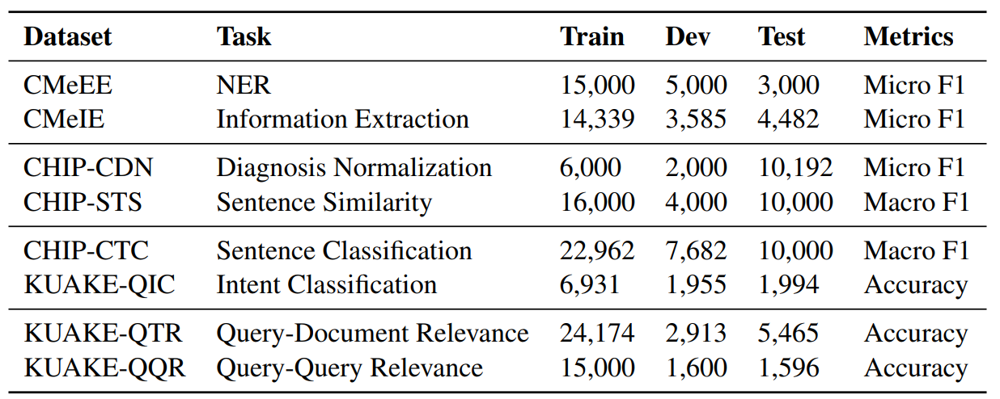</a>
</div>
<p style="text-align:center;font-size:10px;"><em>Task splits and evaluation metrics.</em></p>

<div align="center">
    <a href="https://github.com/openmedlab/">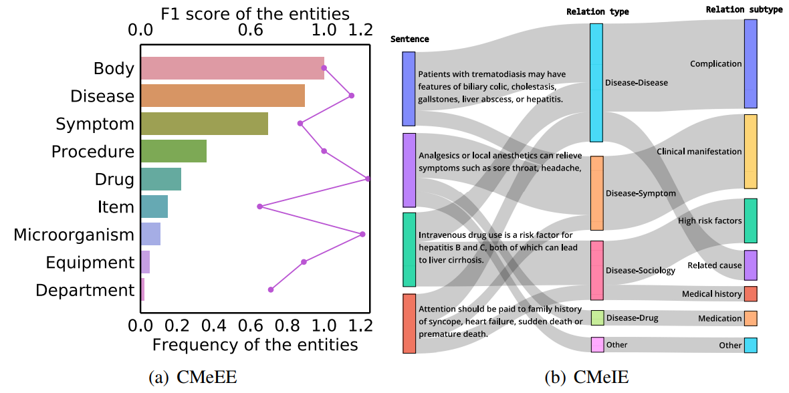</a>
</div>
<p style="text-align:center;font-size:10px;"><em>Entity and relation distributions.</em></p>

<div align="center">
    <a href="https://github.com/openmedlab/">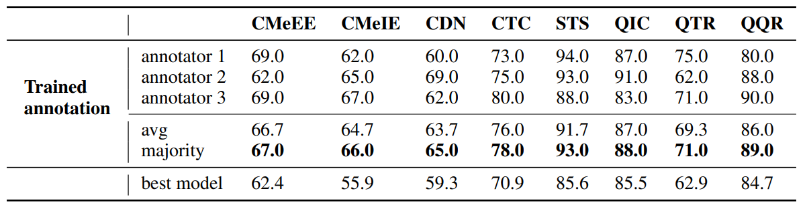</a>
</div>
<p style="text-align:center;font-size:10px;"><em>Historical human and model performance.</em></p>

## Dataset Example

The original task examples are shown below. Chinese text and official task labels are retained in the figures.

<div align="center">
    <a href="https://github.com/openmedlab/">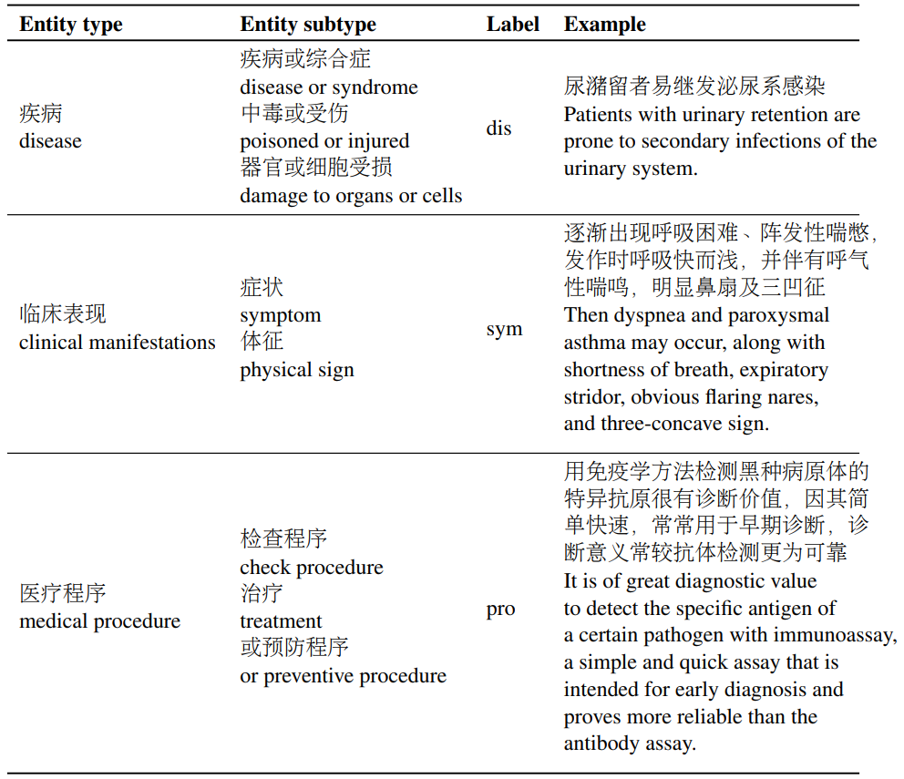</a>
</div>
<p style="text-align:center;font-size:10px;"><em>CMeEE example.</em></p>

<div align="center">
    <a href="https://github.com/openmedlab/">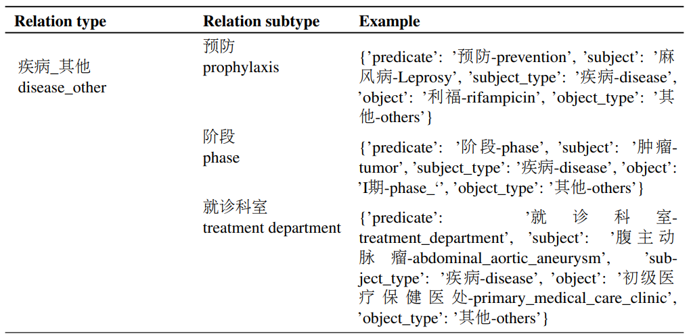</a>
</div>
<p style="text-align:center;font-size:10px;"><em>CMeIE example.</em></p>

<div align="center">
    <a href="https://github.com/openmedlab/">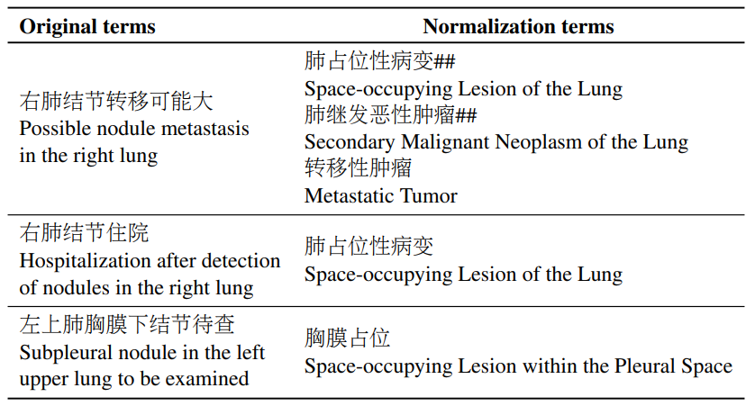</a>
</div>
<p style="text-align:center;font-size:10px;"><em>CHIP-CDN example.</em></p>

<div align="center">
    <a href="https://github.com/openmedlab/">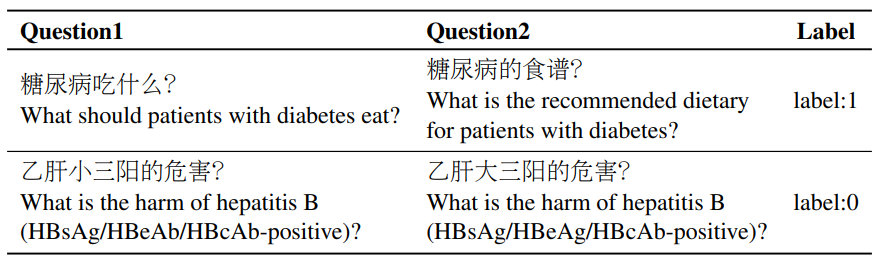</a>
</div>
<p style="text-align:center;font-size:10px;"><em>CHIP-STS example.</em></p>

<div align="center">
    <a href="https://github.com/openmedlab/">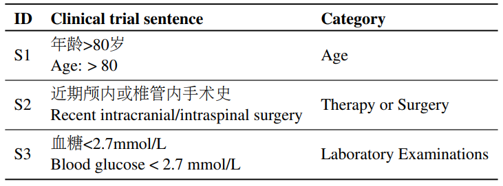</a>
</div>
<p style="text-align:center;font-size:10px;"><em>CHIP-CTC example.</em></p>

<div align="center">
    <a href="https://github.com/openmedlab/">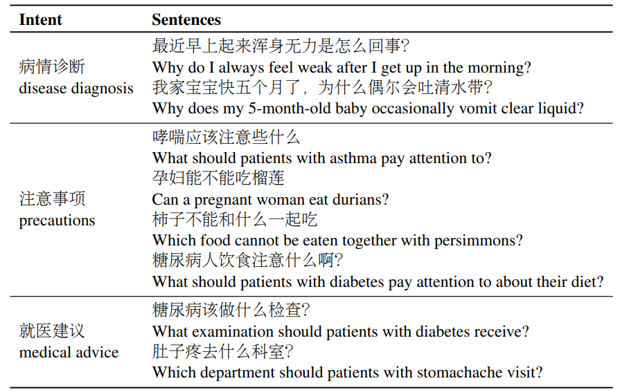</a>
</div>
<p style="text-align:center;font-size:10px;"><em>KUAKE-QIC example.</em></p>

<div align="center">
    <a href="https://github.com/openmedlab/">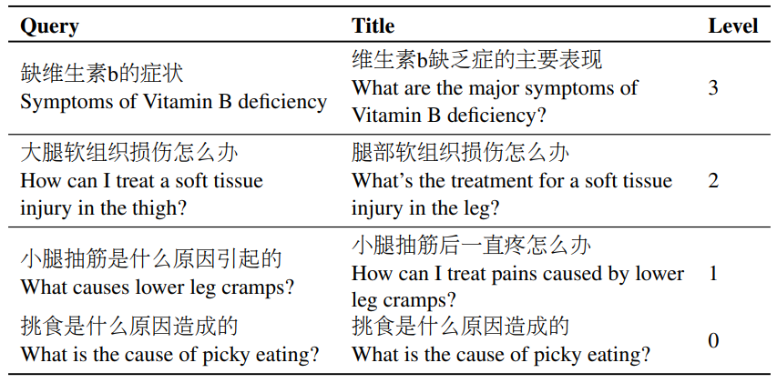</a>
</div>
<p style="text-align:center;font-size:10px;"><em>KUAKE-QTR example.</em></p>

<div align="center">
    <a href="https://github.com/openmedlab/">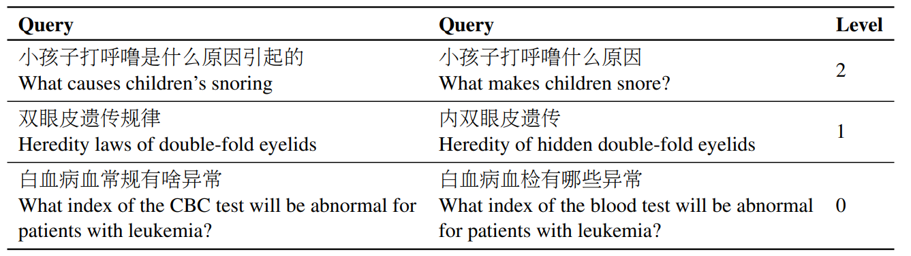</a>
</div>
<p style="text-align:center;font-size:10px;"><em>KUAKE-QQR example.</em></p>

## File Structure

```
├── CBLUE         
|  └── baselines
|     └── run_classifier.py
|     └── ...
|  └── examples
|     └── run_qqr.sh
|     └── ...
|  └── cblue
|  └── CBLUEDatasets
|     └── KUAKE-QQR
|     └── ...
|  └── data
|     └── output
|     └── model_data
|        └── bert-base
|        └── ...
|     └── result_output
|        └── KUAKE-QQR_test.json
|        └── ...
```

```
├── {Task}
|  └── {Task}_train.json
|  └── {Task}_test.json
|  └── {Task}_dev.json
|  └── example_gold.json
|  └── example_pred.json
|  └── README.md
```

## Authors and Institutions

Selected co-first and corresponding authors from the introduction:

Ningyu Zhang (Alibaba-Zhejiang University Joint Research Institute of Frontier Technologies, Zhejiang University, Peng Cheng Laboratory, China)

Mosha Chen (Alibaba-Zhejiang University Joint Research Institute of Frontier Technologies, Zhejiang University, China)

Zhen Bi (Alibaba-Zhejiang University Joint Research Institute of Frontier Technologies, Zhejiang University, China)

Xiaozhuan Liang (Alibaba-Zhejiang University Joint Research Institute of Frontier Technologies, Zhejiang University, China)

Lei Li (School of Mathematical Science, Zhejiang University, China)

Buzhou Tang (Harbin Institute of Technology (Shenzhen), Peng Cheng Laboratory, China)

Qingcai Chen (Harbin Institute of Technology (Shenzhen), Peng Cheng Laboratory, China)

## Source Information

Official Website: https://github.com/CBLUEbenchmark/CBLUE

Download Link: https://tianchi.aliyun.com/dataset/95414

Article Address: https://arxiv.org/abs/2106.08087

Publication Date: 2021-06

## Citation

```
@inproceedings{zhang-etal-2022-cblue,
    title = "{CBLUE}: A {C}hinese Biomedical Language Understanding Evaluation Benchmark",
    author = "Zhang, Ningyu  and
      Chen, Mosha  and
      Bi, Zhen  and
      Liang, Xiaozhuan  and
      Li, Lei  and
      Shang, Xin  and
      Yin, Kangping  and
      Tan, Chuanqi  and
      Xu, Jian  and
      Huang, Fei  and
      Si, Luo  and
      Ni, Yuan  and
      Xie, Guotong  and
      Sui, Zhifang  and
      Chang, Baobao  and
      Zong, Hui  and
      Yuan, Zheng  and
      Li, Linfeng  and
      Yan, Jun  and
      Zan, Hongying  and
      Zhang, Kunli  and
      Tang, Buzhou  and
      Chen, Qingcai",
    booktitle = "Proceedings of the 60th Annual Meeting of the Association for Computational Linguistics (Volume 1: Long Papers)",
    month = may,
    year = "2022",
    address = "Dublin, Ireland",
    publisher = "Association for Computational Linguistics",
    url = "https://aclanthology.org/2022.acl-long.544",
    pages = "7888--7915",
}
```

Original introduction article is [here](https://zhuanlan.zhihu.com/p/695193769).
