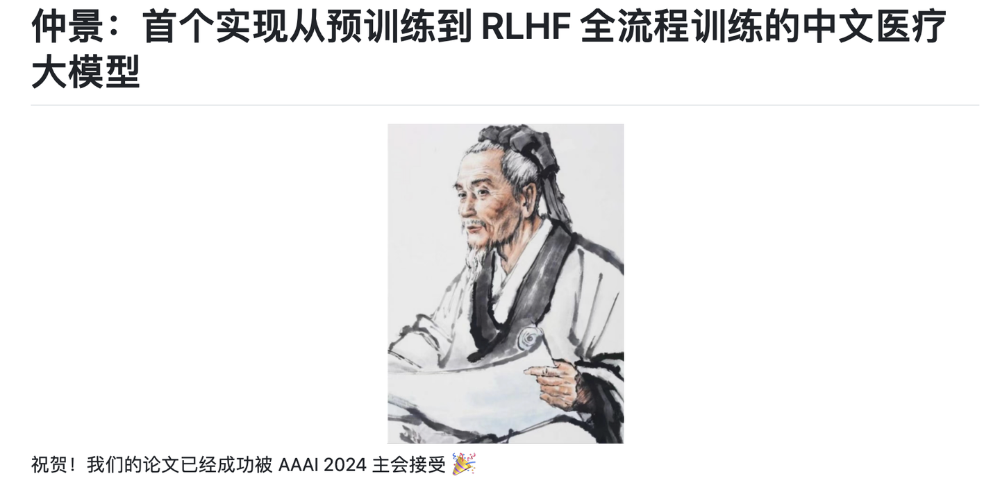
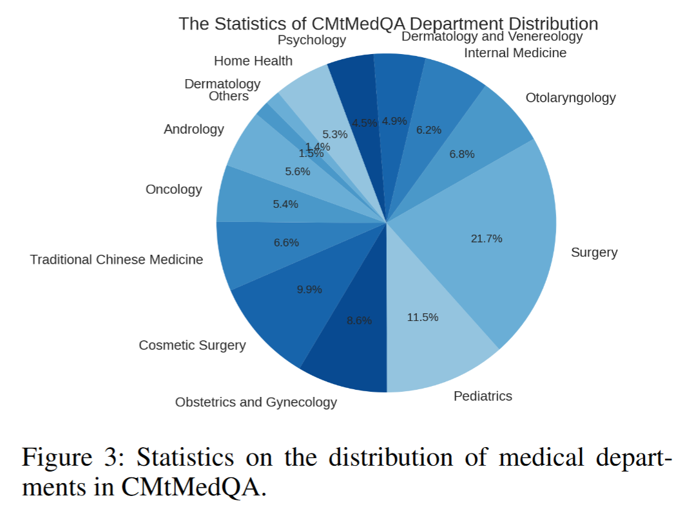
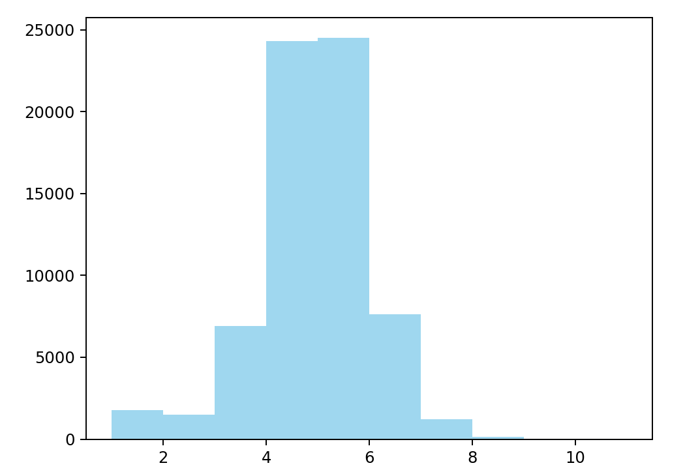

# CMtMedQA

<div align="center">
    <a href="https://github.com/openmedlab/"></a>
</div>
<p style="text-align:center;font-size:10px;"><em></em></p>

## Dataset Information

CMtMedQA is a Chinese multi-turn medical dialogue dataset developed by Zhengzhou University for the Zhongjing language model. It is based on approximately 70,000 real doctor-patient dialogues across 14 medical departments and more than ten consultation scenarios. In addition to responses to patient questions, it includes doctors asking follow-up questions to clarify the consultation.

The original introduction reports approximately 68,000 training records and 1,000 held-out test dialogues. It also describes 200 safety-oriented questions involving provocative, ethical, or misleading prompts. Dialogue histories and department categories accompany the instruction, input, and output fields. The dataset supports research on contextual medical dialogue and proactive questioning.

## Dataset Meta Information

| Task Type             | Language | Train | Val | Test | File Format | Size                    |
|-----------------------|----------|-------|-----|------|-------------|-------------------------|
| Multi-turn Medical QA | Chinese  | 68K   | -   | 1K   | .json       | 156MB (source-reported) |

## Dataset Information Statistics

The source-reported dialogue distribution is concentrated around four to six turns, with comparatively few dialogues exceeding eight turns. Department and turn-count distributions are shown below.

<div align="center">
    <a href="https://github.com/openmedlab/"></a>
</div>
<p style="text-align:center;font-size:10px;"><em>Medical department distribution.</em></p>

<div align="center">
    <a href="https://github.com/openmedlab/"></a>
</div>
<p style="text-align:center;font-size:10px;"><em>Dialogue turn-count distribution.</em></p>

## Dataset Example

The source sample contains id, cate1, cate2, instruction, input, output, and history. The history field stores earlier patient-doctor exchanges; cate1 and cate2 identify department categories.

## File Structure

```
CMtMedQA
|__ CMtMedQA.json
|__ README.md
CMtMedQA_test_v1
|__ CMtMedQA_test.json
|__ README.md
```

## Authors and Institutions

Songhua Yang (Zhengzhou University)

Hanjie Zhao (Zhengzhou University)

Senbin Zhu (Zhengzhou University)

Guangyu Zhou (Zhengzhou University)

Hongfei Xu (Zhengzhou University)

Yuxiang Jia (Zhengzhou University)

Hongying Zan (Zhengzhou University)

## Source Information

Official Website: https://github.com/SupritYoung/Zhongjing

Download Link: https://huggingface.co/datasets/Suprit/CMtMedQA
https://huggingface.co/datasets/Suprit/CMtMedQA_test_v1/tree/main

Article Address: https://arxiv.org/abs/2308.03549

Publication Date: 2023-08

## Citation

```
@article{yang2023zhongjing,
  title={Zhongjing: Enhancing the Chinese Medical Capabilities of Large Language Model through Expert Feedback and Real-world Multi-turn Dialogue},
  author={Yang, Songhua and Zhao, Hanjie and Zhu, Senbin and Zhou, Guangyu and Xu, Hongfei and Jia, Yuxiang and Zan, Hongying},
  journal={arXiv preprint arXiv:2308.03549},
  year={2023}
}
```

Original introduction article is [here](https://zhuanlan.zhihu.com/p/698713381).
