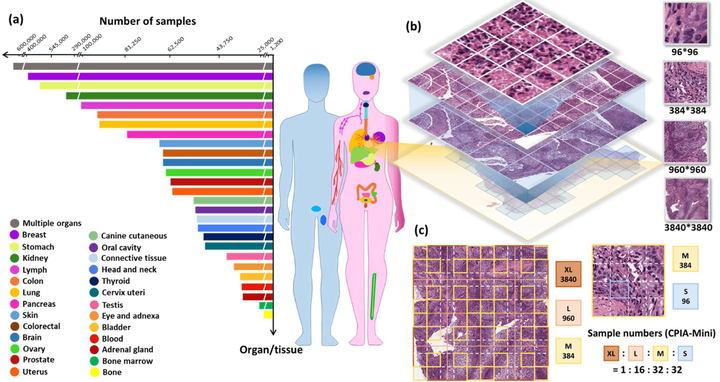
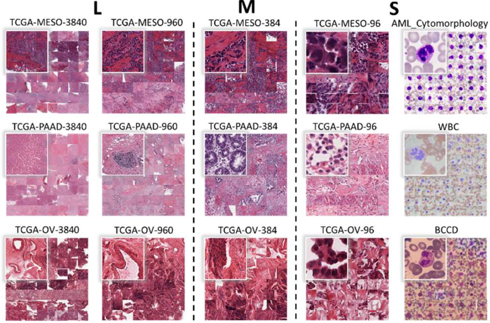

# CPIA

<div align="center">
    <a href="https://github.com/openmedlab/"></a>
</div>
<p style="text-align:center;font-size:10px;"><em></em></p>

## Dataset Information

CPIA (Comprehensive Pathological Image Analysis) combines 103 public datasets for self-supervised pre-training in pathology. The 2023 release described in the original introduction contains 21,427,877 standardized images, covering more than 48 organs or tissues and approximately 100 diseases. It includes whole-slide images (WSIs) and regions of interest (ROIs). WSI patches are organized at four scales with standardized microns-per-pixel resolution; ROI images are organized at three scales. Experienced pathologists supervised the standardization strategy.

The dataset supports pre-training without sample-level annotations and evaluation on downstream pathology tasks. CPIA-Mini provides a smaller, balanced subset. The statistics below refer to the 2023 release; the current official repository reports an expanded collection of 148,962,586 images and 3,383,970 CPIA-Mini images.

## Dataset Meta Information

| Dimensions | Modality  | Task Type                | Anatomical Structures       | Anatomical Area | Data Volume                      | File Format |
|------------|-----------|--------------------------|-----------------------------|-----------------|----------------------------------|-------------|
| 2D         | Pathology | Self-supervised Learning | More than 48 organs/tissues | Entire body     | 21,427,877 images (2023 release) | .jpg        |

### Resolution Details

| Scale | size        |
|-------|-------------|
| XL    | 3840 × 3840 |
| L     | 960 × 960   |
| M     | 384 × 384   |
| S     | 96 × 96     |

## Label Information Statistics

CPIA is intended for self-supervised pre-training. Organ/tissue and source-dataset information describe the collection; the pre-training task does not require a class annotation for every image.

The XL patches are cropped from standardized WSIs after blank regions are excluded. L and M patches are sampled from XL patches, and S patches are sampled from M patches. CPIA-Mini uses an XL:L:M:S sampling ratio of 1:16:32:32.

<div align="center">
    <a href="https://github.com/openmedlab/"></a>
</div>
<p style="text-align:center;font-size:10px;"><em>Organ/tissue composition and multi-scale sampling strategy.</em></p>

## Visualization

<div align="center">
    <a href="https://github.com/openmedlab/"></a>
</div>
<p style="text-align:center;font-size:10px;"><em>Examples of the L, M, and S image scales.</em></p>

## File Structure

```
CPIA/
├── L/
│   ├── ROI/
│   │   └── L.zip
│   └── WSI/
│       ├── CAM163840.zip
│       └── ...
├── M/
│   ├── ROI/
│   └── WSI/
└── S/
    ├── ROI/
    └── WSI/
```

## Authors and Institutions

Nan Ying (Beihang University)

Yanli Lei (Beihang University)

Tianyi Zhang (Beihang University)

Shangqing Lyu (Beihang University)

Chunhui Li (A*STAR)

Sicheng Chen (Nanjing University)

Zeyu Liu (Beihang University)

Yu Zhao (Peking Union Medical College Hospital)

Guanglei Zhang (Beihang University)

## Source Information

Official Website: https://github.com/zhanglab2021/CPIA_Dataset

Download Link: https://github.com/zhanglab2021/CPIA_Dataset#download

Article Address: https://arxiv.org/abs/2310.17902

Publication Date: 2023-10

## Citation

```
@article{ying2023cpia,
  title={CPIA Dataset: A Comprehensive Pathological Image Analysis Dataset for Self-supervised Learning Pre-training},
  author={Ying, Nan and Lei, Yanli and Zhang, Tianyi and Lyu, Shangqing and Li, Chunhui and Chen, Sicheng and Liu, Zeyu and Zhao, Yu and Zhang, Guanglei},
  journal={arXiv preprint arXiv:2310.17902},
  year={2023}
}
```

Original introduction article is [here](https://zhuanlan.zhihu.com/p/15471132045).
