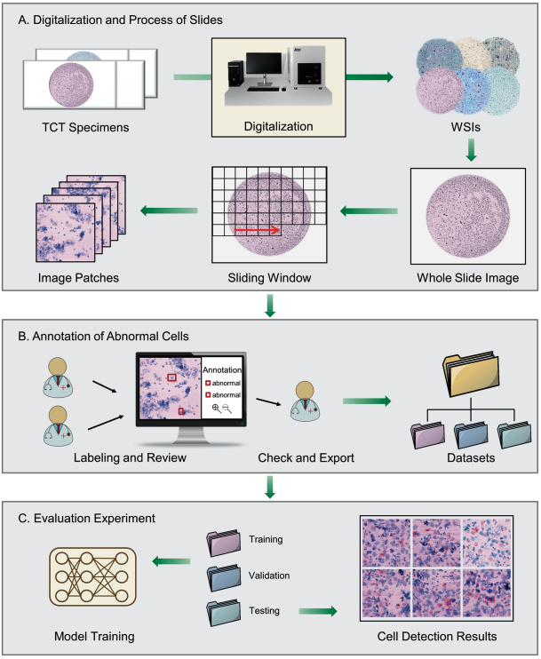
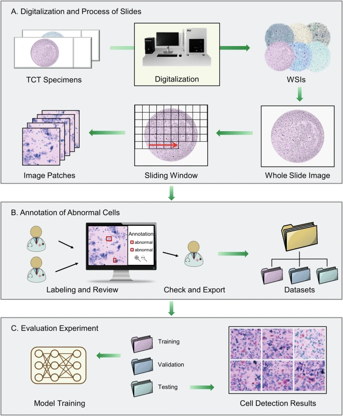
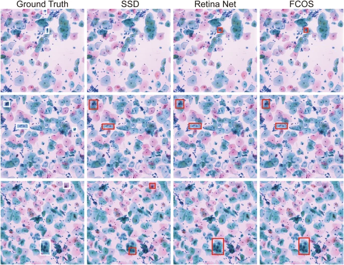
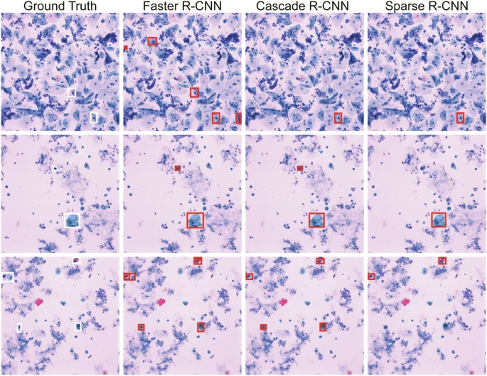
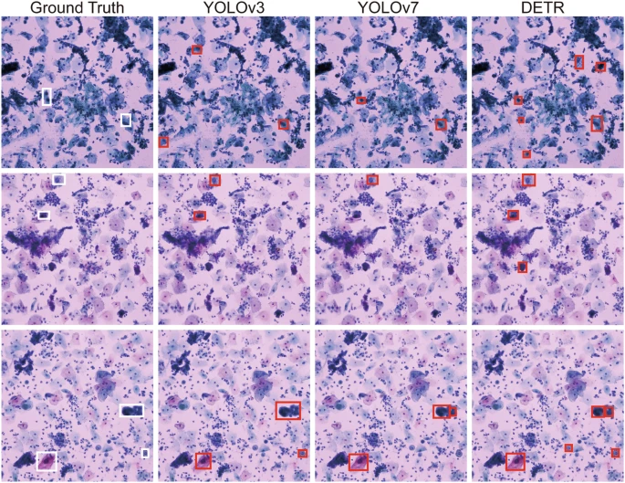

# Annotated Cervical Cytology Images

<div align="center">
    <a href="https://github.com/openmedlab/"></a>
</div>
<p style="text-align:center;font-size:10px;"><em></em></p>

## Dataset Information

This annotated cervical cytology dataset contains 8,037 digital image tiles for abnormal-cell detection. ThinPrep cytology specimens were digitized as whole-slide images and divided into 2048 × 2048-pixel tiles. Each tile was annotated, reviewed by two pathologists, and checked by an experienced pathologist.

The dataset provides 15,761 bounding boxes for abnormal cells. Images and annotations use matching patient-number/image-number identifiers, enabling patient-aware grouping. The associated study evaluates representative one-stage, two-stage, and end-to-end detection methods.

## Dataset Meta Information

| Dimensions | Modality         | Task Type        | Anatomical Structures   | Anatomical Area | Number of Categories | Data Volume                            | File Format |
|------------|------------------|------------------|-------------------------|-----------------|----------------------|----------------------------------------|-------------|
| 2D         | Digital Cytology | Object Detection | Abnormal cervical cells | Cervix          | 1                    | 8037 image tiles; 15761 bounding boxes | .png; .xml  |

### Resolution Details

| Dataset Statistics | size        |
|--------------------|-------------|
| min                | 2048 × 2048 |
| median             | 2048 × 2048 |
| max                | 2048 × 2048 |

## Label Information Statistics

| Item                         | Count |
|------------------------------|-------|
| Image tiles                  | 8037  |
| Annotation files             | 8037  |
| Abnormal-cell bounding boxes | 15761 |

<div align="center">
    <a href="https://github.com/openmedlab/"></a>
</div>
<p style="text-align:center;font-size:10px;"><em>Whole-slide digitization, image tiling, annotation review, and detector evaluation workflow.</em></p>

## Visualization

<div align="center">
    <a href="https://github.com/openmedlab/"></a>
</div>
<p style="text-align:center;font-size:10px;"><em>Example predictions from one-stage detectors.</em></p>

<div align="center">
    <a href="https://github.com/openmedlab/"></a>
</div>
<p style="text-align:center;font-size:10px;"><em>Example predictions from two-stage detectors.</em></p>

<div align="center">
    <a href="https://github.com/openmedlab/"></a>
</div>
<p style="text-align:center;font-size:10px;"><em>Example predictions from YOLOv3, YOLOv7, and DETR.</em></p>

## File Structure

```
data
├── Annotations.zip
├── JPEGImages.zip
├── JPEGImages.z01
├── JPEGImages.z02
├── ...
```

## Authors and Institutions

Xuan Zhang, Jianxin Ji, Qi Zhang, Xiaohan Zheng, Kaiyuan Ge, Menglei Hua, Lei Cao (Department of Biostatistics, School of Public Health, Harbin Medical University)

Liuying Wang (Department of Health Management, Harbin Medical University)

## Source Information

Official Website: https://www.nature.com/articles/s41597-025-04374-5

Download Link: https://springernature.figshare.com/articles/dataset/A_large_annotated_cervical_cytology_images_dataset_for_AI_models_to_aid_cervical_cancer_screening/27901206

Article Address: https://www.nature.com/articles/s41597-025-04374-5

Publication Date: 2025-01

## Citation

```
@article{zhang2025large,
  title={A large annotated cervical cytology images dataset for AI models to aid cervical cancer screening},
  author={Zhang, Xuan and Ji, Jianxin and Zhang, Qi and Zheng, Xiaohan and Ge, Kaiyuan and Hua, Menglei and Cao, Lei and Wang, Liuying},
  journal={Scientific Data},
  volume={12},
  number={1},
  pages={23},
  year={2025},
  publisher={Nature Publishing Group UK London}
}
```

Original introduction article is [here](https://zhuanlan.zhihu.com/p/17948305895).
