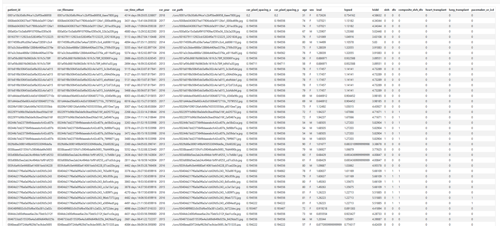
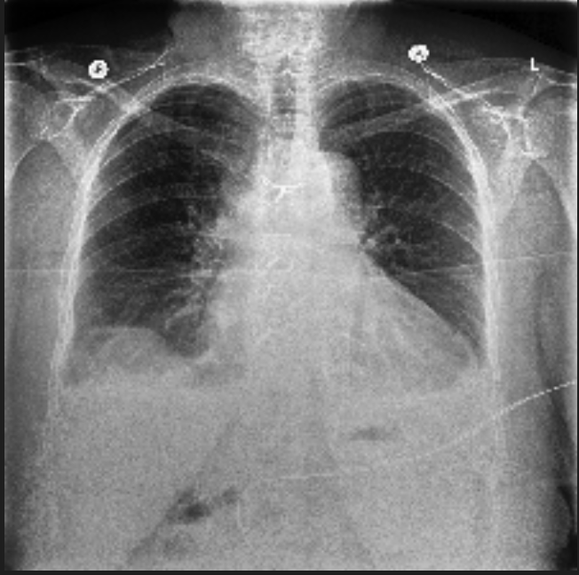

# CheXchoNet

<div align="center">
    <a href="https://github.com/openmedlab/"></a>
</div>
<p style="text-align:center;font-size:10px;"><em></em></p>

## Dataset Information

CheXchoNet contains 71,589 chest radiographs from 24,689 patients paired with echocardiographic measurements related to left ventricular hypertrophy and dilated left ventricle. Age, sex, relative timing, and other patient metadata accompany the images. The dataset supports investigation of whether a chest radiograph can reveal structural heart abnormalities using echocardiography as a higher-fidelity reference.

The annotations include severe left ventricular hypertrophy, dilated left ventricle, and their composite, together with metadata concerning prior heart/lung transplantation and pacemaker or implantable cardioverter-defibrillator implantation. The released radiographs are 224 × 224-pixel JPEG files.

## Dataset Meta Information

| Dimensions | Modality | Task Type      | Anatomical Structures | Anatomical Area | Number of Categories    | Data Volume | File Format |
|------------|----------|----------------|-----------------------|-----------------|-------------------------|-------------|-------------|
| 2D         | Xray     | Classification | Heart                 | Chest           | Multiple cardiac labels | 71,589      | jpg, csv    |

### Resolution Details

|        | size       |
|--------|------------|
| min    | [224, 224] |
| median | [224, 224] |
| max    | [224, 224] |

## Label Information Statistics

The metadata includes continuous echocardiographic measurements (IVSd, LVPWd, and LVIDd), binary severe left ventricular hypertrophy and dilated left ventricle labels, their composite, and transplantation and pacemaker/ICD indicators. These labels are described on the [official dataset page](https://physionet.org/content/chexchonet/1.0.0/).

## Visualization

<div align="center">
    <a href="https://github.com/openmedlab/"></a>
</div>
<p style="text-align:center;font-size:10px;"><em>Example metadata table shown in the source introduction.</em></p>

<div align="center">
    <a href="https://github.com/openmedlab/"></a>
</div>
<p style="text-align:center;font-size:10px;"><em>Example chest radiograph shown in the source introduction.</em></p>

## File Structure

The source introduction shows the following file structure:

``` 
└── metadata.csv
|-----images
|---------XXX.jpg
```

## Authors and Institutions

Bhave S, Rodriguez V, Poterucha T, Mutasa S, Aberle D, and Capaccione KM (selected authors of the companion paper named in the source introduction)

Pierre Elias and Shreyas Bhave (PhysioNet dataset authors)

The data were collected at Columbia University Irving Medical Center.

## Source Information

Official Website: https://physionet.org/content/chexchonet/1.0.0/

Download Link: https://physionet.org/content/chexchonet/1.0.0/

Article Address: https://academic.oup.com/eurheartj/article-lookup/doi/10.1093/eurheartj/ehad782

Publication Date: 2024-03-20

## Citation

``` 
@article{PhysioNet-chexchonet-1.0.0,
  author = {Elias, Pierre and Bhave, Shreyas},
  title = {CheXchoNet: A Chest Radiograph Dataset with Gold Standard Echocardiography Labels},
  journal = {PhysioNet},
  year = {2024},
  month = mar,
  note = {Version 1.0.0},
  doi = {10.13026/kp08-ws25},
  url = {https://doi.org/10.13026/kp08-ws25}
}
```

Original introduction article is [here](https://zhuanlan.zhihu.com/p/16294224681).
