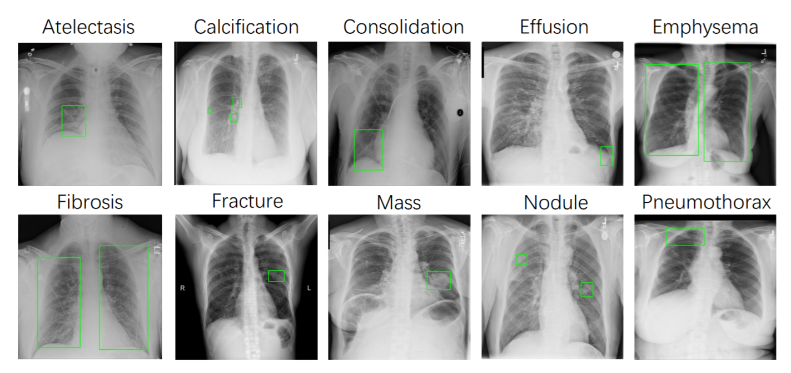
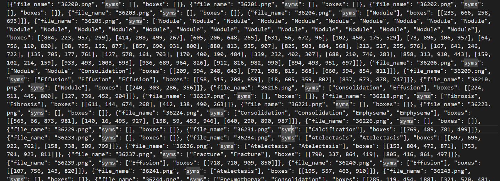
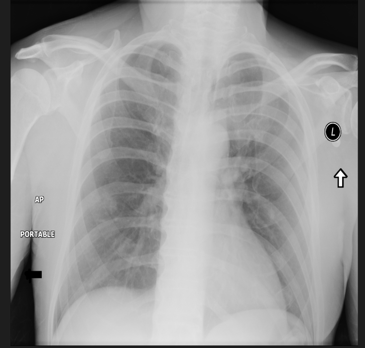

# ChestX-Det10

<div align="center">
    <a href="https://github.com/openmedlab/"></a>
</div>
<p style="text-align:center;font-size:10px;"><em></em></p>

## Dataset Information

ChestX-Det10 is a subset of NIH ChestX-ray14 containing 3,543 chest radiographs with instance-level bounding-box annotations. Three board-certified radiologists annotated ten thoracic diseases or abnormalities: atelectasis, calcification, consolidation, effusion, emphysema, fibrosis, fracture, mass, nodule, and pneumothorax. The annotations support development and evaluation of automatic disease detection methods. The challenge paper reports a split of 3,001 training images and 542 test images.

## Dataset Meta Information

| Dimensions | Modality | Task Type          | Anatomical Structures | Anatomical Area | Number of Categories | Data Volume | File Format |
|------------|----------|--------------------|-----------------------|-----------------|----------------------|-------------|-------------|
| 2D         | X-ray    | Instance detection | Chest                 | Chest           | 10                   | 3,543       | png         |

### Resolution Details

|        | size         |
|--------|--------------|
| min    | [1024, 1024] |
| median | [1024, 1024] |
| max    | [1024, 1024] |

## Label Information Statistics

| Disease Category | Number of Regions |
|------------------|-------------------|
| Effusion         | 2092              |
| Pneumothorax     | 211               |
| Atelectasis      | 340               |
| Mass             | 160               |
| Consolidation    | 2537              |
| Fracture         | 661               |
| Fibrosis         | 738               |
| Emphysema        | 298               |
| Nodule           | 955               |
| Calcification    | 347               |

## Visualization

<div align="center">
    <a href="https://github.com/openmedlab/"></a>
</div>
<p style="text-align:center;font-size:10px;"><em>Bounding-box annotations for thoracic abnormalities.</em></p>

<div align="center">
    <a href="https://github.com/openmedlab/"></a>
</div>
<p style="text-align:center;font-size:10px;"><em>Example per-image JSON annotations with disease labels and bounding-box coordinates.</em></p>

<div align="center">
    <a href="https://github.com/openmedlab/"></a>
</div>
<p style="text-align:center;font-size:10px;"><em>Original chest radiograph.</em></p>

## File Structure

The source introduction shows the following file structure:

``` 
└──train-old
|-----------XXX.png
|-----test_data
|-----------XXX.png
|-----test.json
|-----train.json
```

## Authors and Institutions

Deepwise AI Lab (dataset and challenge organizer)

Jie Lian, Jingyu Liu, Yizhou Yu, Mengyuan Ding, Yaoci Lu, Yi Lu, Jie Cai, Deshou Lin, Miao Zhang, Zhe Wang, Kai He, and Yijie Yu (authors of the challenge results paper)

## Source Information

Official Website: https://github.com/Deepwise-AILab/ChestX-Det10-Dataset

Download Link: https://github.com/Deepwise-AILab/ChestX-Det10-Dataset

Article Address: https://arxiv.org/abs/2010.10298

Publication Date: 2020

## Citation

``` 
@article{lian2020chestxdet10,
  title={The Detection of Thoracic Abnormalities ChestX-Det10 Challenge Results},
  author={Lian, Jie and Liu, Jingyu and Yu, Yizhou and Ding, Mengyuan and Lu, Yaoci and Lu, Yi and Cai, Jie and Lin, Deshou and Zhang, Miao and Wang, Zhe and He, Kai and Yu, Yijie},
  journal={arXiv preprint arXiv:2010.10298},
  year={2020}
}
```

Original introduction article is [here](https://zhuanlan.zhihu.com/p/16294889908).
