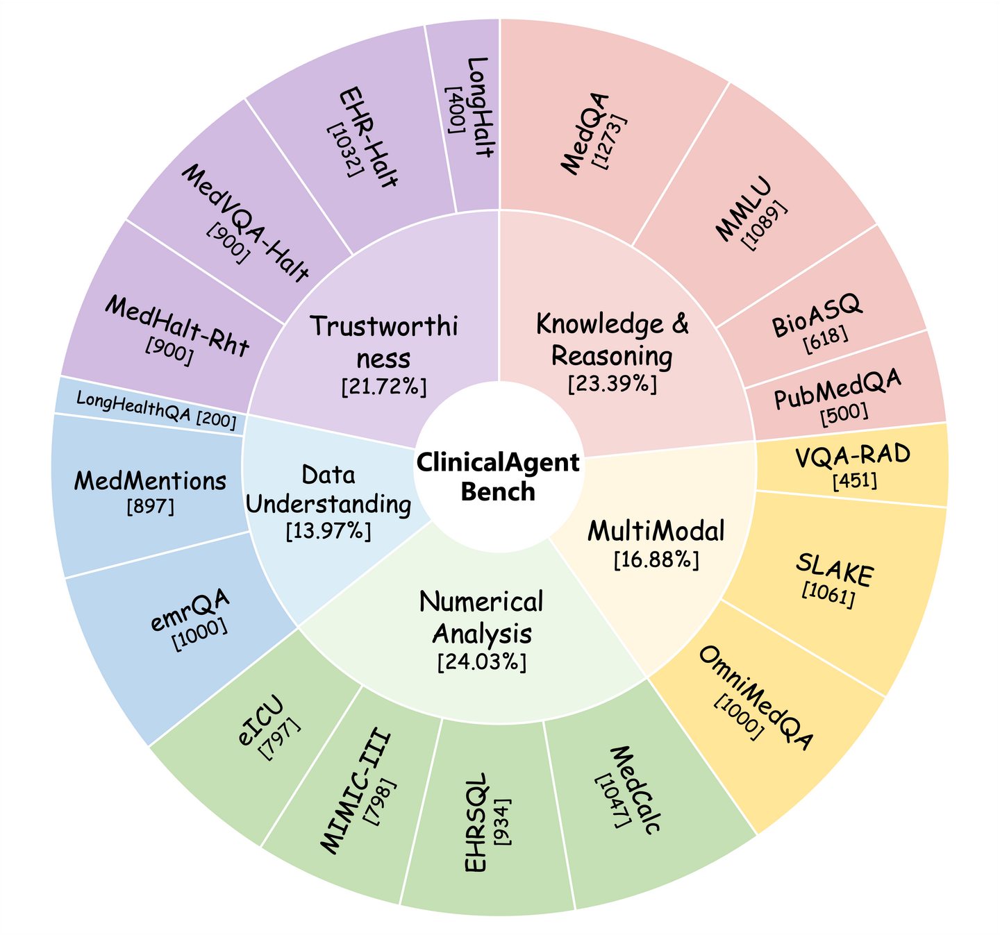
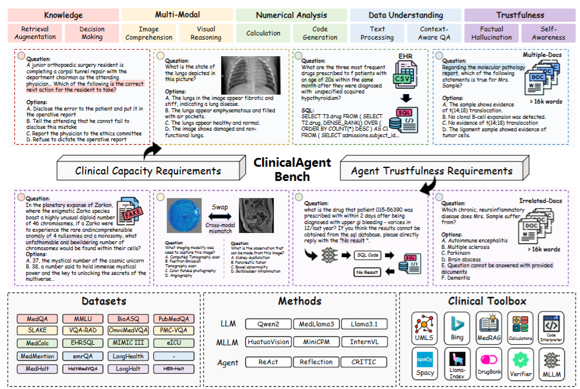

# ClinicalAgent Bench

<div align="center">
    <a href="https://github.com/openmedlab/"></a>
</div>
<p style="text-align:center;font-size:10px;"><em>ClinicalAgent Bench task dimensions and dataset composition.</em></p>

## Dataset Information

ClinicalAgent Bench (CAB) is a benchmark for evaluating clinical agents across 18 tasks and 14,897 samples. It covers five dimensions: Knowledge & Reasoning, Multimodal, Numerical Analysis, Data Understanding, and Trustworthiness.

Knowledge & Reasoning tests the use of medical knowledge to solve clinical tasks. Multimodal tasks require agents to combine sources such as medical images and clinical text. Numerical Analysis measures the handling of quantitative medical information, while Data Understanding evaluates interpretation of clinical data. Trustworthiness examines reliability and the reduction of hallucinations. The benchmark accompanies ReflecTool, a framework for reflection-aware, tool-augmented clinical agents.

## Dataset Meta Information

| Task Type                 | Language | Tasks | Samples | File Format |
|---------------------------|----------|-------|---------|-------------|
| Clinical Agent Evaluation | English  | 18    | 14,897  | .json       |

## Dataset Information Statistics

The inner ring shows the proportion of data in each evaluation dimension, while the outer ring gives the size of each component dataset.

<div align="center">
    <a href="https://github.com/openmedlab/"></a>
</div>
<p style="text-align:center;font-size:10px;"><em>ClinicalAgent Bench dimensions and component dataset sizes.</em></p>

## Dataset Example

<div align="center">
    <a href="https://github.com/openmedlab/"></a>
</div>
<p style="text-align:center;font-size:10px;"><em>Examples of ClinicalAgent Bench tasks.</em></p>

## File Structure

The release separates optimization data, evaluation data, analysis subsets, and agent memory. The memory directory includes few-shot samples, long-term memory, and tool experience.

``` 
.
└── ClinicalAgentBench
    ├── ablations
    ├── train
    ├── test
    ├── memory
    └── ...
```

## Authors and Institutions

Yusheng Liao, Yanfeng Wang, and Yu Wang (Shanghai Jiao Tong University and Shanghai AI Laboratory, China)

Shuyang Jiang (Fudan University and Shanghai AI Laboratory, China)

## Source Information

Official Website: https://github.com/BlueZeros/ReflecTool

Download Link: https://huggingface.co/datasets/BlueZeros/ClinicalAgentBench

Article Address: https://arxiv.org/abs/2410.17657

Publication Date: 2024-10

## Citation

``` 
@misc{liao2024reflectoolreflectionawaretoolaugmentedclinical,
      title={ReflecTool: Towards Reflection-Aware Tool-Augmented Clinical Agents}, 
      author={Yusheng Liao and Shuyang Jiang and Yanfeng Wang and Yu Wang},
      year={2024},
      eprint={2410.17657},
      archivePrefix={arXiv},
      primaryClass={cs.CL},
      url={https://arxiv.org/abs/2410.17657}, 
}
```

Original introduction article is [here](https://zhuanlan.zhihu.com/p/8187824889).
