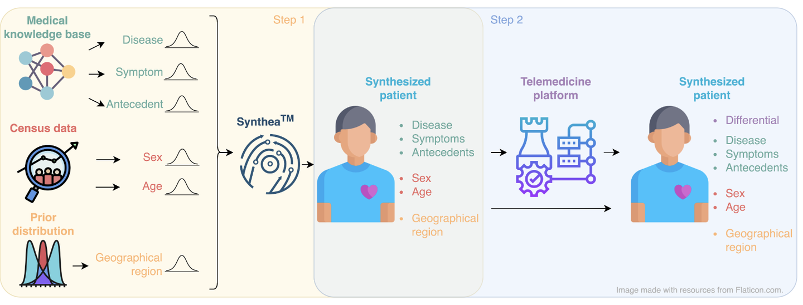
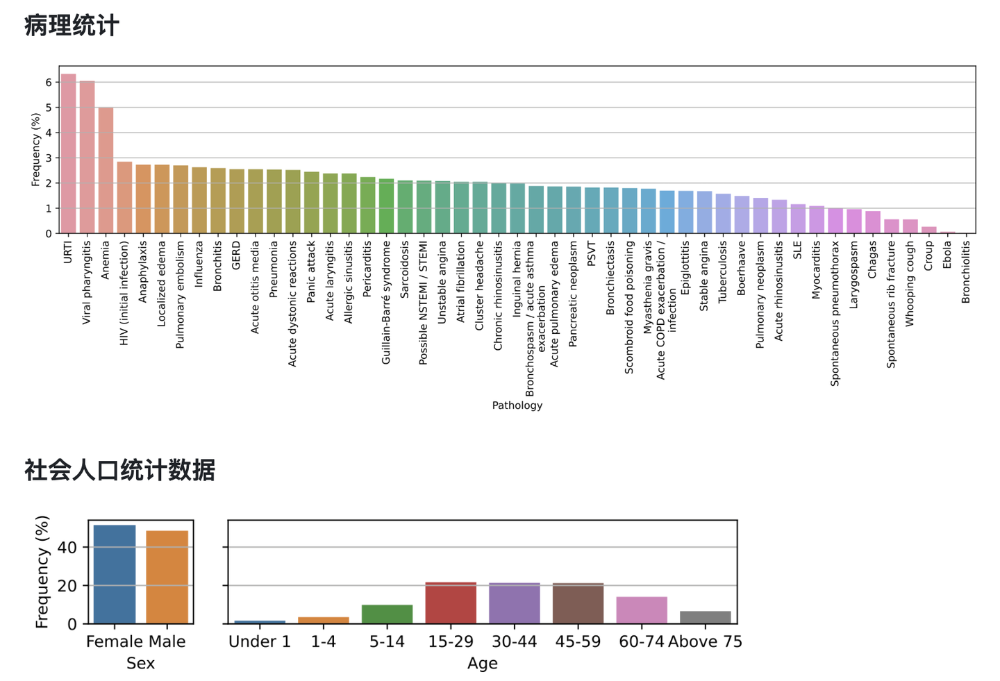
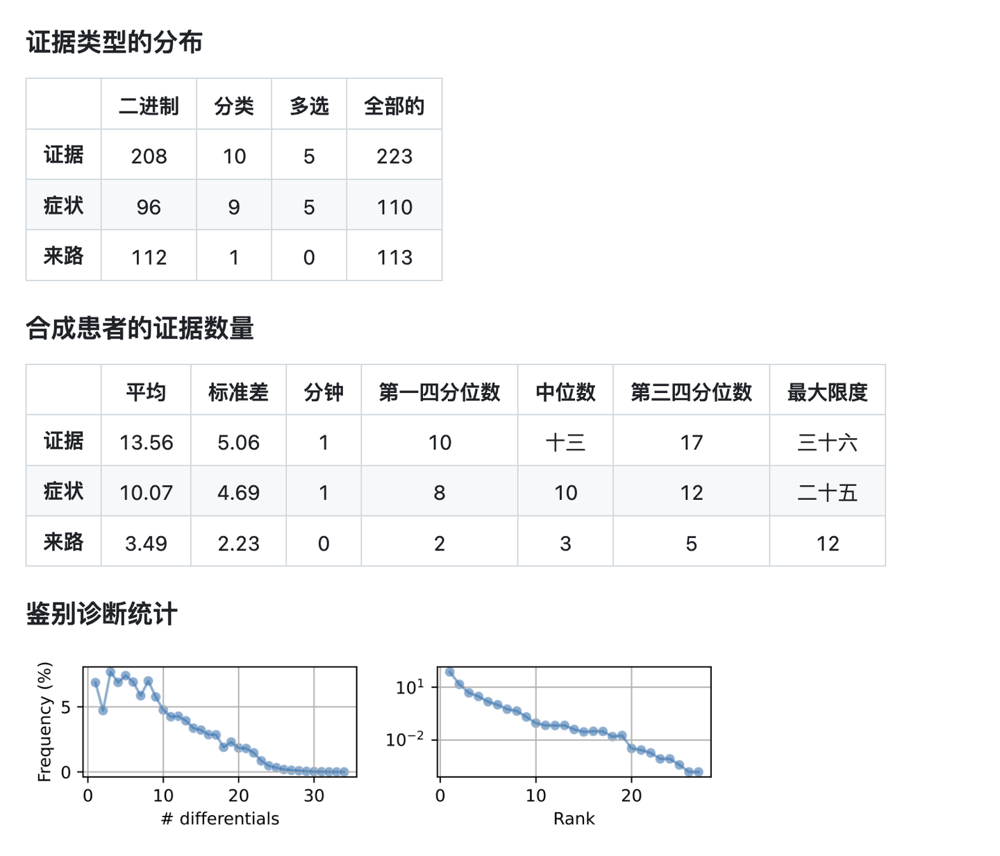

# DDXPlus

## Dataset Information

DDXPlus is a synthetic patient dataset for automatic symptom detection and diagnosis. It contains roughly 1.3 million patients with demographic characteristics, a ground-truth pathology, symptoms, antecedents, and a differential diagnosis. A proprietary medical knowledge base, census statistics, and Synthea are used to synthesize patients; a commercial rule-based diagnosis system produces the differential diagnoses.

The dataset covers 49 pathologies, 110 symptoms, and 113 antecedents. Evidence can be binary, categorical, or multiple-choice, and related symptoms may be organized hierarchically. This supports systems that collect evidence through dialogue and predict a distribution over plausible pathologies. The original French release and the English version contain the same data in the same format; the English version was made available in May 2023.

<div align="center">
    <a href="https://github.com/openmedlab/"></a>
</div>
<p style="text-align:center;font-size:10px;"><em>Synthetic patient generation and differential diagnosis construction.</em></p>

## Dataset Meta Information

| Task Type                                   | Language        | Train           | Val             | Test            | File Format                  |
|---------------------------------------------|-----------------|-----------------|-----------------|-----------------|------------------------------|
| Symptom Collection / Differential Diagnosis | English, French | 80% of patients | 10% of patients | 10% of patients | .json; .csv in .zip archives |

## Dataset Information Statistics

Patients are split by stratified sampling over the simulated pathology. Evidence types and counts are summarized below.

| Evidence     | Binary | Categorical | Multiple-choice | Total |
|--------------|--------|-------------|-----------------|-------|
| All Evidence | 208    | 10          | 5               | 223   |
| Symptoms     | 96     | 9           | 5               | 110   |
| Antecedents  | 112    | 1           | 0               | 113   |

<div align="center">
    <a href="https://github.com/openmedlab/"></a>
</div>
<p style="text-align:center;font-size:10px;"><em>Pathology and demographic distributions of synthetic patients.</em></p>

| Per-patient Count | Mean  | Standard Deviation | Minimum | First Quartile | Median | Third Quartile | Maximum |
|-------------------|-------|--------------------|---------|----------------|--------|----------------|---------|
| Evidence          | 13.56 | 5.06               | 1       | 10             | 13     | 17             | 36      |
| Symptoms          | 10.07 | 4.69               | 1       | 8              | 10     | 12             | 25      |
| Antecedents       | 3.49  | 2.23               | 0       | 2              | 3      | 5              | 12      |

<div align="center">
    <a href="https://github.com/openmedlab/"></a>
</div>
<p style="text-align:center;font-size:10px;"><em>Evidence and differential diagnosis statistics.</em></p>

## Dataset Example

An evidence record identifies its question, its relationship to other evidence, whether it is an antecedent, its type, and the possible values. In the English release, evidence identifiers use `E` codes and categorical values use `V` codes. `B`, `C`, and `M` denote binary, categorical, and multiple-choice evidence, respectively. The following categorical evidence example is supplied in the introduction.

``` 
{
    "name": "E_130",
    "code_question": "E_129",
    "question_fr": "De quelle couleur sont les lésions?",
    "question_en": "What color is the rash?",
    "is_antecedent": false,
    "default_value": "V_11",
    "value_meaning": {
        "V_11": {"fr": "NA", "en": "NA"},
        "V_86": {"fr": "foncée", "en": "dark"},
        "V_107": {"fr": "jaune", "en": "yellow"},
        "V_138": {"fr": "pâle", "en": "pale"},
        "V_156": {"fr": "rose", "en": "pink"},
        "V_157": {"fr": "rouge", "en": "red"}
    },
    "possible-values": ["V_11", "V_86", "V_107", "V_138", "V_156", "V_157"],
    "data_type": "C"
}
```

Patient records include `AGE`, `SEX`, `PATHOLOGY`, `EVIDENCES`, `INITIAL_EVIDENCE`, and `DIFFERENTIAL_DIAGNOSIS`. A differential diagnosis is a list of pathology-probability pairs. Condition metadata supplies the pathology name, ICD-10 identifier, severity, symptoms, and antecedents.

## File Structure

The official dataset release contains two JSON metadata files and three ZIP archives, each containing patient CSV data.

``` 
DDXPlus
├── release_evidences.json
├── release_conditions.json
├── release_train_patients.zip
├── release_validate_patients.zip
└── release_test_patients.zip
```

## Authors and Institutions

Arsène Fansi Tchango, Rishab Goel, Zhi Wen, and Joumana Ghosn (Mila-Quebec AI Institute, Canada)

Julien Martel (work conducted at Dialogue Health Technologies Inc., Canada)

## Source Information

Official Website: https://github.com/mila-iqia/ddxplus

Download Link: https://figshare.com/articles/dataset/DDXPlus_Dataset_English_/22687585

Article Address: https://arxiv.org/abs/2205.09148

Publication Date: 2022-09

## Citation

``` 
@misc{tchango2022ddxplusnewdatasetautomatic,
      title={DDXPlus: A New Dataset For Automatic Medical Diagnosis}, 
      author={Arsene Fansi Tchango and Rishab Goel and Zhi Wen and Julien Martel and Joumana Ghosn},
      year={2022},
      eprint={2205.09148},
      archivePrefix={arXiv},
      primaryClass={cs.CL},
      url={https://arxiv.org/abs/2205.09148}, 
}
```

Original introduction article is [here](https://zhuanlan.zhihu.com/p/17983327718).
