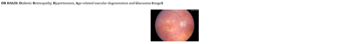
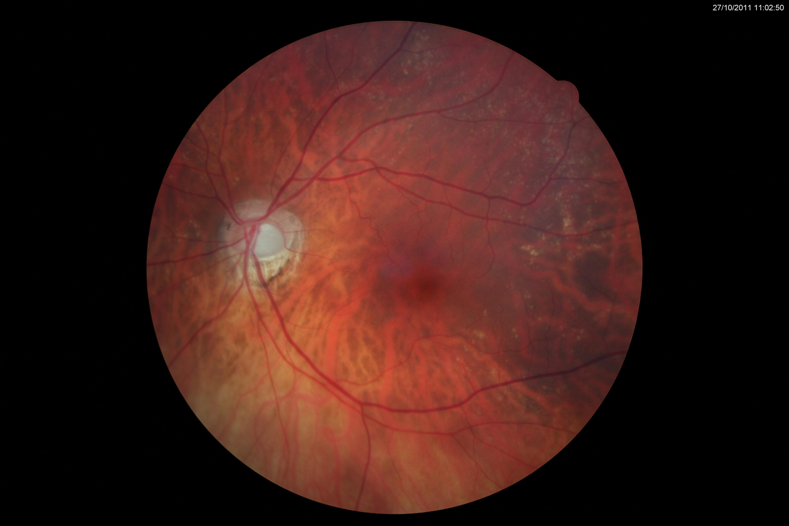
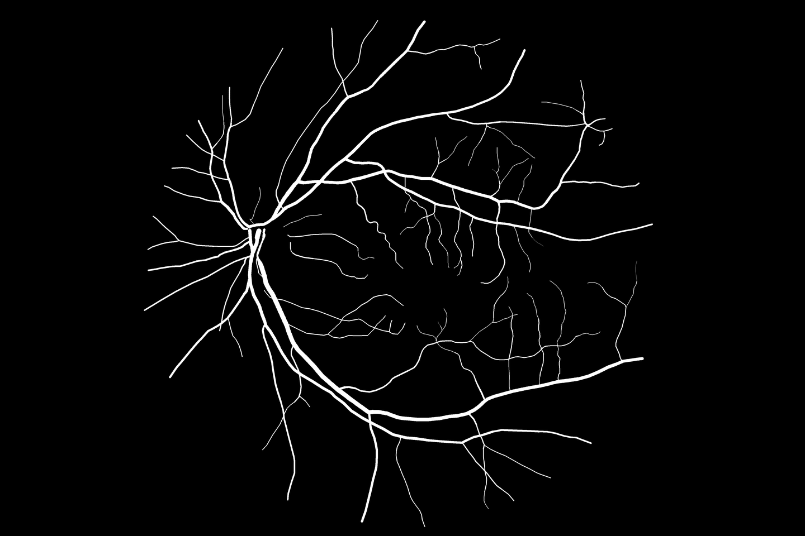

# DRHAGIS

<div align="center">
    <a href="https://github.com/openmedlab/"></a>
</div>
<p style="text-align:center;font-size:10px;"><em></em></p>

## Dataset Information

DRHAGIS (Diabetic Retinopathy, Hypertension, Age-related macular degeneration and Glaucoma ImageS) provides fundus images from a UK diabetic retinopathy screening program, together with expert vessel segmentations and field-of-view masks. It contains 39 unique images arranged in four comorbidity groups: glaucoma, hypertension, diabetic retinopathy and age-related macular degeneration. Images numbered 24 and 32 represent the same patient image in two groups.

The images were acquired using Topcon TRC-NW6s, Topcon TRC-NW8 or Canon CR DGi cameras with a 45° horizontal field of view. Fundus photographs are JPEG files, while manual segmentations and masks are binary PNG files. The varying resolutions and comorbidities support evaluation of retinal vessel extraction under screening conditions.

## Dataset Meta Information

| Dimensions | Modality | Task Type    | Anatomical Structures | Anatomical Area | Number of Categories | Data Volume | File Format |
|------------|----------|--------------|-----------------------|-----------------|----------------------|-------------|-------------|
| 2D         | Fundus   | Segmentation | Vessels               | Eye             | 1                    | 39          | .jpg, .png  |

### Resolution Details

| Dataset Statistics | size      |
|--------------------|-----------|
| min                | 1880x2816 |
| median             | 2136x3216 |
| max                | 3168x4752 |

## Label Information Statistics

| Metric     | Vessels |
|------------|---------|
| Case Count | 39      |
| Coverage   | 100%    |

## Visualization

<div align="center">
    <a href="https://github.com/openmedlab/"></a>
</div>
<p style="text-align:center;font-size:10px;"><em>Original fundus image.</em></p>

<div align="center">
    <a href="https://github.com/openmedlab/"></a>
</div>
<p style="text-align:center;font-size:10px;"><em>Manual retinal vessel annotation.</em></p>

## File Structure

``` 
DRHAGIS
├── Fundus_Images
│   ├── 1.jpg
│   ├── 2.jpg
│   ├── 3.jpg
│   └── ...
├── Manual_Segmentations
│   ├── 1_manual_orig.png
│   ├── 2_manual_orig.png
│   ├── 3_manual_orig.png
│   └── ...
└── Mask_images
    ├── 1_mask_orig.png
    ├── 2_mask_orig.png
    ├── 3_mask_orig.png
    └── ...
```

## Authors and Institutions

Sven Holm (University of Manchester, Faculty of Biology, Medicine and Health, Division of Pharmacy and Optometry)

Greg Russell (University of Manchester, Faculty of Biology, Medicine and Health, Division of Pharmacy and Optometry)

Vincent Nourrit (Telecom Bretagne, Département d'Optique Technopôle Brest-Iroise)

Niall McLoughlin (University of Manchester, Faculty of Biology, Medicine and Health, Division of Pharmacy and Optometry)

## Source Information

Official Website: https://personalpages.manchester.ac.uk/staff/niall.p.mcloughlin/

Download Link: https://personalpages.manchester.ac.uk/staff/niall.p.mcloughlin/

Article Address: https://pubmed.ncbi.nlm.nih.gov/28217714/

Publication Date: 2016

Original Paper: https://pmc.ncbi.nlm.nih.gov/articles/PMC5299858/

## Citation

``` 
@article{holm2017dr,
  title={DR HAGIS—a fundus image database for the automatic extraction of retinal surface vessels from diabetic patients},
  author={Holm, Sven and Russell, Greg and Nourrit, Vincent and McLoughlin, Niall},
  journal={Journal of Medical Imaging},
  volume={4},
  number={1},
  pages={014503--014503},
  year={2017},
  publisher={Society of Photo-Optical Instrumentation Engineers}
}
```

Original introduction article is [here](https://zhuanlan.zhihu.com/p/10267641878).
