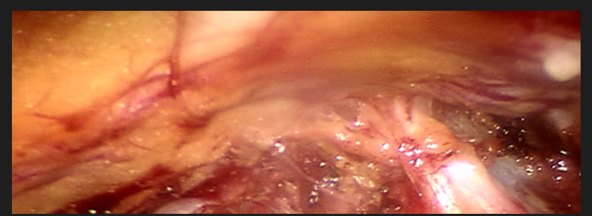
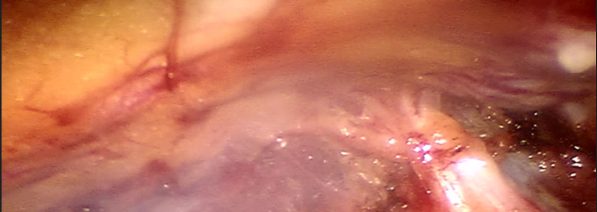

# DeSmokeData

## Dataset Information

DeSmokeData is a paired dataset for laparoscopic image desmoking. The conference dataset described in the source introduction contains 961 smoky and smoke-free image pairs selected from 63 robot-assisted radical prostatectomy videos recorded using the da Vinci Si system. The final pairs come from 21 video segments and cover varying smoke severity, including nonuniform smoke and suspended particles. Three reviewers selected aligned pairs through collaborative review.

This document describes the 961-pair conference version. The official repository also points to an expanded dataset containing more than 3,000 pairs on IEEE DataPort.

## Dataset Meta Information

| Dimensions | Modality | Task Type | Anatomical Structures | Anatomical Area | Number of Categories | Data Volume | File Format |
|------------|----------|-----------|-----------------------|-----------------|----------------------|-------------|-------------|
| 2D         | Surgical | Desmoking | Prostate              | Prostate Tumor  | 1                    | 961         | png         |

### Resolution Details

| Dataset Statistics | size       |
|--------------------|------------|
| min                | [700, 350] |
| median             | [700, 350] |
| max                | [700, 350] |

## Visualization

<div align="center">
    <a href="https://github.com/openmedlab/"></a>
</div>
<p style="text-align:center;font-size:10px;"><em>Smoke-free image.</em></p>

<div align="center">
    <a href="https://github.com/openmedlab/"></a>
</div>
<p style="text-align:center;font-size:10px;"><em>Smoky image.</em></p>

## File Structure

``` 
└── dataset
    ├──1.png
    |-----1_gt.png
     |----2.png
     |----2_gt.png
```

## Authors and Institutions

Wenyao Xia, Victoria Fan, Terry Peters and Elvis C. S. Chen (Western University, Canada).

## Source Information

Official Website: https://github.com/wxia43/DesmokeData

Download Link: https://github.com/wxia43/DesmokeData

Article Address: Not provided in the source introduction.

Publication Date: 2024

## Citation

``` 
Xia, Wenyao, Terry M. Peters, Victoria Fan, Hamsini Sthanunathan, Olivia Qi, and Elvis C. S. Chen. "In Vivo Laparoscopic Image De-smoking Dataset, Evaluation, and Beyond." IEEE Transactions on Medical Imaging (2025).

Xia, Wenyao, Victoria Fan, Terry Peters, and Elvis C. S. Chen. "A New Benchmark In Vivo Paired Dataset for Laparoscopic Image De-smoking." International Conference on Medical Image Computing and Computer-Assisted Intervention (2024): 3-13.
```

Original introduction article is [here](https://zhuanlan.zhihu.com/p/16294688032).
