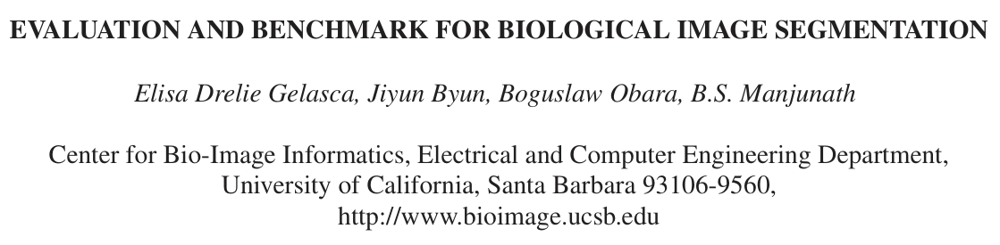
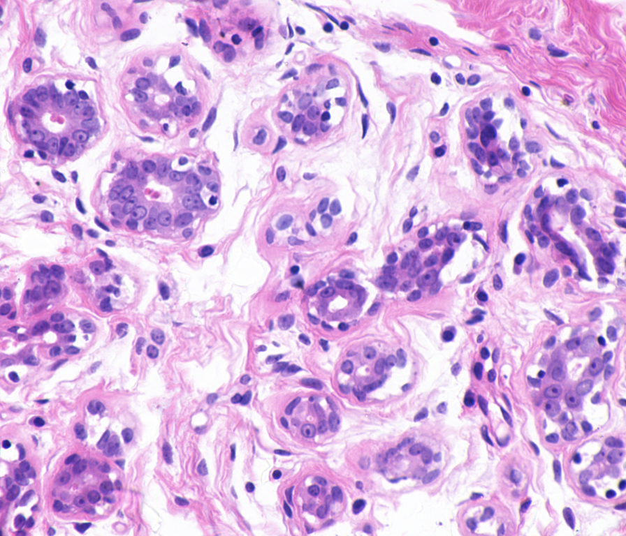

# EBBIS-BCC

<div align="center">
    <a href="https://github.com/openmedlab/"></a>
</div>
<p style="text-align:center;font-size:10px;"><em></em></p>

## Dataset Information

EBBIS-BCC is the breast cancer cell subset of the Evaluation and Benchmark for Biological Image Segmentation collection. The broader benchmark spans subcellular, cellular, and tissue scales. This subset contains 58 hematoxylin-and-eosin-stained breast histopathology images with cell segmentation annotations. The official benchmark includes both benign and malignant cells.

The paired image and mask files support evaluation of biological image segmentation methods. The source introduction reports image dimensions of 768 × 896 pixels for its analyzed 58-image mirror collection. The official benchmark page lists multiple image sizes.

## Dataset Meta Information

| Dimensions | Modality  | Task Type    | Anatomical Structures | Anatomical Area | Number of Categories | Data Volume | File Format |
|------------|-----------|--------------|-----------------------|-----------------|----------------------|-------------|-------------|
| 2D         | Pathology | Segmentation | Breast cell nuclei    | Breast          | 1                    | 58          | .tif        |

### Resolution Details

| Dataset Statistics | size      |
|--------------------|-----------|
| min                | 768 × 896 |
| median             | 768 × 896 |
| max                | 768 × 896 |

## Label Information Statistics

The following counts describe the mirror collection analyzed in the original introduction. The segmentation target is cell nuclei; the benchmark includes benign and malignant specimens.

| Metric     | Breast Cell Nuclei |
|------------|--------------------|
| Case Count | 58                 |
| Coverage   | 100%               |

## Visualization

<div align="center">
    <a href="https://github.com/openmedlab/"></a>
</div>
<p style="text-align:center;font-size:10px;"><em>Original breast pathology images.</em></p>

<div align="center">
    <a href="https://github.com/openmedlab/"></a>
</div>
<p style="text-align:center;font-size:10px;"><em>Cell-nuclei segmentation annotations.</em></p>

## File Structure

```
breast-cancer-cell-segmentation/
├── Images/
│   ├── ytma10_010704_benign1_ccd.tif
│   ├── ytma10_010704_benign1_ccd.tif.xml
│   ├── ytma10_010704_benign2_ccd.tif
│   ├── ytma10_010704_benign2_ccd.tif.xml
│   ├── ...
├── Masks/
│   ├── ytma10_010704_benign1.TIF
│   ├── ytma10_010704_benign1.TIF.xml
│   ├── ytma10_010704_benign2.TIF
│   ├── ytma10_010704_benign2.TIF.xml
│   ├── ...
```

## Authors and Institutions

Elisa Drelie Gelasca (Center for Bio-Image Informatics, Electrical and Computer Engineering Department, University of California, Santa Barbara)

Jiyun Byun (Center for Bio-Image Informatics, Electrical and Computer Engineering Department, University of California, Santa Barbara)

Boguslaw Obara (Center for Bio-Image Informatics, Electrical and Computer Engineering Department, University of California, Santa Barbara)

B.S. Manjunath (Center for Bio-Image Informatics, Electrical and Computer Engineering Department, University of California, Santa Barbara)

## Source Information

Official Website: https://bioimage.ucsb.edu/research/bio-segmentation

Download Link: https://www.heywhale.com/mw/dataset/5e9e9b35ebb37f002c625423

Article Address: https://ieeexplore.ieee.org/document/4712130

Publication Date: 2008-10

## Citation

```
@inproceedings{gelasca2008evaluation,
  title={Evaluation and benchmark for biological image segmentation},
  author={Gelasca, Elisa Drelie and Byun, Jiyun and Obara, Boguslaw and Manjunath, BS},
  booktitle={2008 15th IEEE international conference on image processing},
  pages={1816--1819},
  year={2008},
  organization={IEEE}
}
```

Original introduction article is [here](https://zhuanlan.zhihu.com/p/11761388861).
