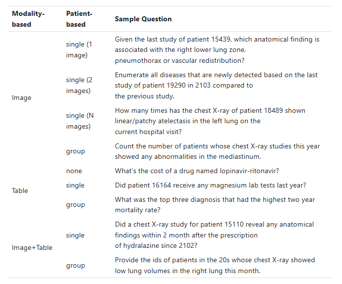
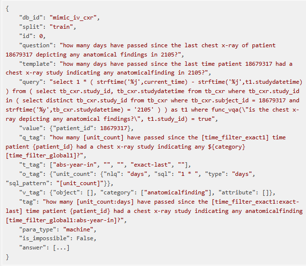

# EHRXQA

## Dataset Information

EHRXQA is a multimodal question answering dataset that combines structured electronic health records with chest X-ray images. It links MIMIC-IV tables, MIMIC-CXR images, and Chest ImaGenome annotations through 19,264 shared patient identifiers. An image reference table connects radiographs with patient and hospital admission identifiers, enabling queries that combine imaging findings with structured clinical information.

The dataset contains 46,152 questions generated from 417 templates. Templates are grouped by required modality: image, table, or image and table. They are also organized by patient scope: no specific patient, a single patient, or a group of patients. Each question is paired with a SQL or NeuralSQL query and its answer. Question paraphrases are manually reviewed after generation.

## Dataset Meta Information

| Task Type     | Language | Train  | Val   | Test  | File Format       |
|---------------|----------|--------|-------|-------|-------------------|
| Multimodal QA | English  | 36,174 | 5,170 | 4,808 | .json, .csv, .sql |

## Dataset Information Statistics

| Modality      | Train  | Val   | Test  | Total  |
|---------------|--------|-------|-------|--------|
| Image         | 12,860 | 1,838 | 1,668 | 16,366 |
| Table         | 12,961 | 1,852 | 1,716 | 16,529 |
| Image + Table | 10,353 | 1,480 | 1,424 | 13,257 |
| Total         | 36,174 | 5,170 | 4,808 | 46,152 |

<div align="center">
    <a href="https://github.com/openmedlab/"></a>
</div>
<p style="text-align:center;font-size:10px;"><em>Question template examples grouped by required modality and patient scope.</em></p>

## Dataset Example

The example contains a question, its template, an executable query, an answer, and associated metadata. The query links clinical records to findings in chest radiographs.

<div align="center">
    <a href="https://github.com/openmedlab/"></a>
</div>
<p style="text-align:center;font-size:10px;"><em>Example EHRXQA JSON sample with a question, query, answer, and template metadata.</em></p>

## File Structure

The database is distributed in silver and gold versions, corresponding to automatically generated image annotations and manually annotated evaluation data. The silver database contains 800 patients for training and validation, while the gold database contains 400 patients for testing. Both contain clinical CSV tables and the SQL schema. Question-answer samples are provided as JSON files.

``` 
ehrxqa
├── database
│   ├── silver
│   │   ├── admissions.csv
│   │   ├── chartevents.csv
│   │   ├── cost.csv
│   │   ├── d_icd_diagnoses.csv
│   │   ├── d_icd_procedures.csv
│   │   ├── d_items.csv
│   │   ├── d_labitems.csv
│   │   ├── diagnoses_icd.csv
│   │   ├── icustays.csv
│   │   ├── inputevents.csv
│   │   ├── labevents.csv
│   │   ├── microbiologyevents.csv
│   │   ├── mimic_iv_cxr.sql
│   │   ├── outputevents.csv
│   │   ├── patients.csv
│   │   ├── prescriptions.csv
│   │   ├── procedures_icd.csv
│   │   ├── tb_cxr.csv
│   │   └── transfers.csv
│   └── gold
│       ├── admissions.csv
│       ├── chartevents.csv
│       ├── cost.csv
│       ├── d_icd_diagnoses.csv
│       ├── d_icd_procedures.csv
│       ├── d_items.csv
│       ├── d_labitems.csv
│       ├── diagnoses_icd.csv
│       ├── icustays.csv
│       ├── inputevents.csv
│       ├── labevents.csv
│       ├── microbiologyevents.csv
│       ├── mimic_iv_cxr.sql
│       ├── outputevents.csv
│       ├── patients.csv
│       ├── prescriptions.csv
│       ├── procedures_icd.csv
│       ├── tb_cxr.csv
│       └── transfers.csv
└── dataset
    ├── train.json
    ├── valid.json
    └── test.json
```

## Authors and Institutions

Seongsu Bae, Daeun Kyung, Jaehee Ryu, Eunbyeol Cho, Gyubok Lee, Sunjun Kweon, Jungwoo Oh, and Edward Choi (KAIST, South Korea)

Lei Ji (Microsoft Research Asia, China)

Eric I-Chao Chang (Centre for Perceptual and Interactive Intelligence, Hong Kong)

Tackeun Kim (Seoul National University Bundang Hospital, South Korea)

<div align="center">
    <a href="https://github.com/openmedlab/"></a>
</div>
<p style="text-align:center;font-size:10px;"><em>Authors and institutional affiliations.</em></p>

## Source Information

Official Website: https://physionet.org/content/ehrxqa/1.0.0/

Download Link: https://physionet.org/content/ehrxqa/1.0.0/

Article Address: https://arxiv.org/abs/2310.18652

Publication Date: 2023-10

## Citation

``` 
@misc{bae2023ehrxqamultimodalquestionanswering,
      title={EHRXQA: A Multi-Modal Question Answering Dataset for Electronic Health Records with Chest X-ray Images}, 
      author={Seongsu Bae and Daeun Kyung and Jaehee Ryu and Eunbyeol Cho and Gyubok Lee and Sunjun Kweon and Jungwoo Oh and Lei Ji and Eric I-Chao Chang and Tackeun Kim and Edward Choi},
      year={2023},
      eprint={2310.18652},
      archivePrefix={arXiv},
      primaryClass={cs.CL},
      url={https://arxiv.org/abs/2310.18652}, 
}
```

Original introduction article is [here](https://zhuanlan.zhihu.com/p/8834865116).
