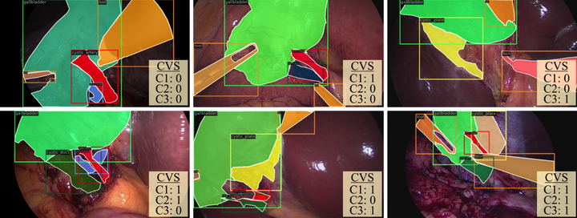
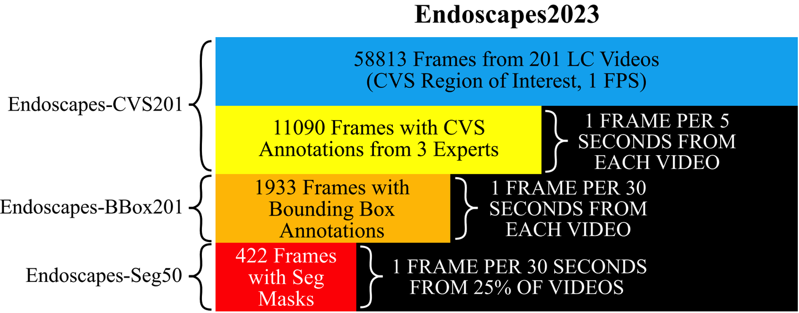
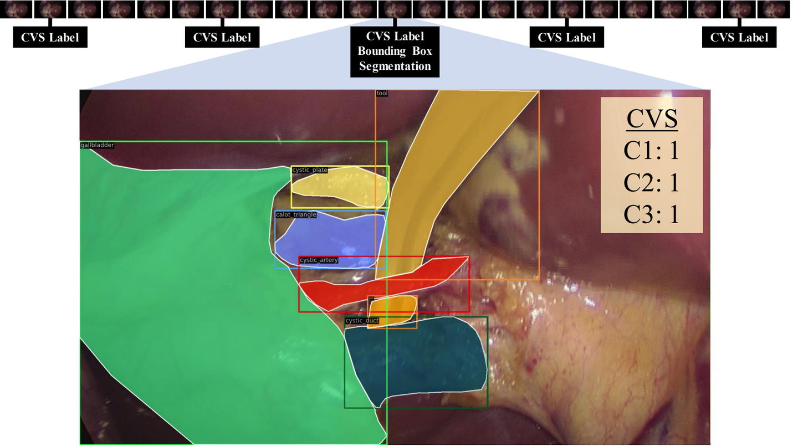

# Endoscapes

<div align="center">
    <a href="https://github.com/openmedlab/"></a>
</div>
<p style="text-align:center;font-size:10px;"><em></em></p>

## Dataset Information

Endoscapes is a laparoscopic cholecystectomy dataset for surgical scene segmentation, object detection and Critical View of Safety (CVS) assessment. It contains 201 videos and 58,813 frames in the relevant dissection phase. Three experts provide CVS annotations for 11,090 frames; 1,933 frames have bounding-box annotations, and the public Endoscapes-Seg50 subset has segmentation masks for 493 frames from 50 videos.

The main split comprises 120 training videos, 41 validation videos and 40 test videos. The segmentation subset contains 14,940 frames according to the introduction and uses 30 training, 10 validation and 10 test videos. Its six object classes cover five anatomical structures or regions and one tool class.

## Dataset Meta Information

| Dimensions | Modality  | Task Type                               | Anatomical Structures | Data Volume | File Format                   |
|------------|-----------|-----------------------------------------|-----------------------|-------------|-------------------------------|
| 2D         | Endoscopy | Segmentation, Detection, CVS Assessment | Abdominal Cavity      | 58813       | jpg, json, csv, npy, png, txt |

## Dataset Information Statistics

| Subset             | Videos | Annotated Frames | Annotation Type                             |
|--------------------|--------|------------------|---------------------------------------------|
| Endoscapes-CVS201  | 201    | 11,090           | Three CVS Criteria, Three Expert Annotators |
| Endoscapes-BBox201 | 201    | 1,933            | Bounding Boxes, Six Classes                 |
| Endoscapes-Seg50   | 50     | 493              | Instance and Semantic Masks, Six Classes    |

## Visualization

<div align="center">
    <a href="https://github.com/openmedlab/"></a>
</div>
<p style="text-align:center;font-size:10px;"><em>Original dataset diagram showing 422 segmentation frames; the public release reports 493.</em></p>

<div align="center">
    <a href="https://github.com/openmedlab/"></a>
</div>
<p style="text-align:center;font-size:10px;"><em>CVS labels, segmentation masks and bounding boxes.</em></p>

The annotation example shows the gallbladder, hepatocystic triangle dissection region, cystic artery, cystic duct, cystic plate and tools, together with the three CVS criteria.

## File Structure

``` 
$DATA_HOME
└── train
    ├── 1_29375.jpg # SYNTAX: ${VIDEO_ID}_{FRAME_NUM}.jpg
    ├── ...
    ├── 120_85800.jpg
    ├── annotation_coco.json # Annotation File for Endoscapes-BBox201 (Object Detection, COCO Format). Also contains instance segmentation where available.
    ├── annotation_coco_vid.json # Annotation File for Endoscapes-CVS201 Temporal Models. Contains Bounding Box/Segmentation where available.
    ├── annotation_ds_coco.json # Annotation File for Endoscapes-CVS201 Single-Frame Models. Contains Bounding Box/Segmentation where available.
└── val
    ├── 121_14850.jpg
    ├── ...
    ├── 161_34325.jpg
    ├── annotation_coco.json
    ├── annotation_coco_vid.json
    ├── annotation_ds_coco.json
└── test
    ├── 162_5850.jpg
    ├── ...
    ├── 201_46125.jpg
    ├── annotation_coco.json
    ├── annotation_coco_vid.json
    ├── annotation_ds_coco.json
└── train_seg
    ├── 4_21725.jpg
    ├── ...
    ├── 119_58000.jpg
    ├── annotation_coco.json # Annotation File for Endoscapes-Seg50 (bounding boxes + instance segmentation, COCO format)
└── val_seg
    ├── 126_10825.jpg
    ├── ...
    ├── 159_60875.jpg
    ├── annotation_coco.json
└── test_seg
    ├── 165_22925.jpg
    ├── ...
    ├── 189_34875.jpg
    ├── annotation_coco.json
└── 12_5 # Official 12.5% Splits of Endoscapes-CVS201 Train Set (3 folds)
    ├── train_0
        ├── 16_9500.jpg
        ├── ...
        ├── 118_121800.jpg
        ├── annotation_coco.json
        ├── annotation_coco_vid.json
        ├── annotation_ds_coco.json
    ├── train_1
        ├── 2_29075.jpg
        ├── ...
        ├── 107_57875.jpg
        ├── annotation_coco.json
        ├── annotation_coco_vid.json
        ├── annotation_ds_coco.json
    ├── train_2
        ├── 8_14050.jpg
        ├── ...
        ├── 119_90825.jpg
        ├── annotation_coco.json
        ├── annotation_coco_vid.json
        ├── annotation_ds_coco.json
└── 25 # Official 25% Splits of Endoscapes-CVS201 Train Set (3 folds)
    ├── train_0
        ├── 1_29375.jpg
        ├── ...
        ├── 116_36150.jpg
        ├── annotation_coco.json
        ├── annotation_coco_vid.json
        ├── annotation_ds_coco.json
    ├── train_1
        ├── 2_29075.jpg
        ├── ...
        ├── 120_85800.jpg
        ├── annotation_coco.json
        ├── annotation_coco_vid.json
        ├── annotation_ds_coco.json
    ├── train_2 # Same videos as train_seg above
        ├── 4_21725.jpg
        ├── ...
        ├── 119_58000.jpg
        ├── annotation_coco.json
        ├── annotation_coco_vid.json
        ├── annotation_ds_coco.json
└── all_metadata.csv # all metadata for the entire Endoscapes2023 (CVS annotations from all annotators, etc.)
└── insseg
    ├── 5_5900.npy # stack of instance masks, where each channel corresponds to an object instance
    ├── 5_5900.csv # label of each slice of numpy masks
    ├── ...
└── semseg
    ├── 5_5900.png # semantic segmentation mask, 480x854x3 image with each element representing the class_id of each pixel; the 3 channels are identical
    ├── ...
└── train_vids.txt # 120 training videos for Endoscapes-CVS201 and Endoscapes-BBox201
└── val_vids.txt # 41 validation videos for Endoscapes-CVS201 and Endoscapes-BBox201
└── test_vids.txt # 40 testing videos for Endoscapes-CVS201 and Endoscapes-BBox201
└── train_seg_vids.txt # 30 training videos for Endoscapes-Seg50
└── val_seg_vids.txt # 10 validation videos for Endoscapes-Seg50
└── test_seg_vids.txt # 10 testing videos for Endoscapes-Seg50
└── seg_label_map.txt # map from class name to id; note that background is ignored for object detection/instance segmentation; for these tasks, id 0 becomes cystic plate, ...
```

## Authors and Institutions

Aditya Murali (ICube Laboratory, University of Strasbourg, France)

Deepak Alapatt (ICube Laboratory, University of Strasbourg, France)

Pietro Mascagni (IHU Strasbourg, France; Fondazione Policlinico Universitario A. Gemelli IRCCS, Rome, Italy)

Armine Vardazaryan (IHU Strasbourg, France)

Alain Garcia (IHU Strasbourg, France)

Nariaki Okamoto (IRCAD, Strasbourg, France)

Guido Costamagna (Fondazione Policlinico Universitario A. Gemelli IRCCS, Rome, Italy)

Didier Mutter (IHU Strasbourg, France)

Jacques Marescaux (IRCAD, Strasbourg, France)

Bernard Dallemagne (IRCAD, Strasbourg, France)

Nicolas Padoy (ICube Laboratory, University of Strasbourg, France; IHU Strasbourg, France)

## Source Information

Official Website: https://github.com/CAMMA-public/Endoscapes?tab=readme-ov-file

Download Link: https://github.com/CAMMA-public/Endoscapes?tab=readme-ov-file

Article Address: https://arxiv.org/pdf/2312.12429

Publication Date: 2024-01-26

Annotation Statistics: https://github.com/CAMMA-public/Endoscapes

## Citation

``` 
@article{murali2023endoscapes,
      title={The Endoscapes Dataset for Surgical Scene Segmentation, Object Detection, and Critical View of Safety Assessment: Official Splits and Benchmark}, 
      author={Aditya Murali and Deepak Alapatt and Pietro Mascagni and Armine Vardazaryan and Alain Garcia and Nariaki Okamoto and Guido Costamagna and Didier Mutter and Jacques Marescaux and Bernard Dallemagne and Nicolas Padoy},
      journal={arXiv preprint arXiv:2312.12429},
      year={2023},
}
```

Original introduction article is [here](https://zhuanlan.zhihu.com/p/701109338).
