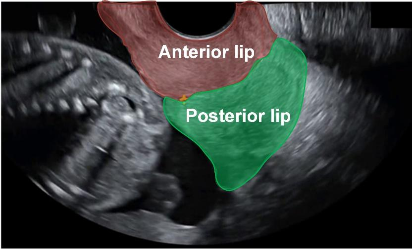
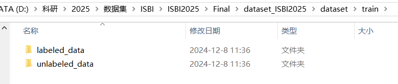

# ISBI 2025 FUGC

## Dataset Information

The ISBI 2025 Fetal Ultrasound Grand Challenge (FUGC) provides transvaginal cervical ultrasound images for semi-supervised segmentation of the anterior and posterior cervical lips. These structures support cervical biometry and research into pregnancy assessment. Manual annotation is time consuming, making the combination of labeled and unlabeled images useful for studying semi-supervised methods.

The source introduction reports 890 images in the challenge and 500 accessible training images. The training set includes 50 labeled images and 450 unlabeled images. Participants jointly segment the two cervical lip regions.

## Competition Content

Joint segmentation of the anterior and posterior cervical lips using semi-supervised methods.

## Dataset Meta Information

| Dimensions | Modality   | Task Type    | Anatomical Area | Number of Categories | Data Volume (Available) | File Format |
|------------|------------|--------------|-----------------|----------------------|-------------------------|-------------|
| 2D         | Ultrasound | Segmentation | Abdomen         | 2                    | 890 (500)               | .png        |

### Resolution Details

| Dataset Statistics | Size      |
|--------------------|-----------|
| min                | (544,336) |
| median             | (544,336) |
| max                | (544,336) |

## Visualization

<div align="center">
    <a href="https://github.com/openmedlab/"></a>
</div>
<p style="text-align:center;font-size:10px;"><em>Cervical ultrasound images and segmentation labels.</em></p>

## File Structure

The train directory contains 500 ultrasound images. The labeled_data directory contains 50 labeled images organized into images and labels folders. The unlabeled_data directory contains 450 images.

<div align="center">
    <a href="https://github.com/openmedlab/"></a>
</div>
<p style="text-align:center;font-size:10px;"><em>Training dataset directory structure.</em></p>

<div align="center">
    <a href="https://github.com/openmedlab/"></a>
</div>
<p style="text-align:center;font-size:10px;"><em>Images and labels directories within labeled_data.</em></p>

## Authors and Institutions

Jieyun Bai, the University of Auckland, Auckland, New Zealand and Jinan University, Guangzhou, China

Ziduo Yang, Jinan University, Guangzhou, China

Md. Kamrul Hasan, Imperial College London, London, UK

Jie Gan, University of Sydney, Sydney, Australia

Zhuonan Liang, University of Sydney, Sydney, Australia

Weidong Cai, University of Sydney, Sydney, Australia

Tao Tan, Netherlands Cancer Institute (NKI), Amsterdam, The Netherlands and Macao Polytechnic University, Macao SAR, China

Jing Ye, Monash University Monash, Australia and Shanghai AI Laboratory, Shanghai, China

Mohammad Yaqub, Mohamed bin Zayed University, Abu Dhabi, United Arab Emirates

Dong Ni, Shenzhen University, China

Saad Slimani, Ibn Rochd University Hospital, Hassan II University, Casablanca, Morocco

Benard Ohene-Botwe, Department of Radiography, School of Biomedical and Allied Health Sciences, College of Health Sciences, University of Ghana, Accra, Ghana

Campello Roman Victor Manuel, Artificial Intelligence in Medicine Lab (BCN-AIM), Barcelona, Spain

Karim Lekadir, Artificial Intelligence in Medicine Lab (BCN-AIM), Barcelona, Spain

## Source Information

Official Website: https://www.codabench.org/competitions/4781/

Download Link: https://zenodo.org/records/14305302

Article Address: Not provided in the source introduction.

Publication Date: 2024-12-09

Baseline Model: https://github.com/maskoffs/Fetal-Ultrasound-Grand-Challenge

## Citation

```
Bai J, Zhou Z, Ou Z, et al. PSFHS challenge report: Pubic symphysis and fetal head segmentation from intrapartum ultrasound images[J]. Medical Image Analysis, 2025, 99: 103353.
Chen Z, Ou Z, Lu Y, et al. Direction-guided and multi-scale feature screening for fetal head–pubic symphysis segmentation and angle of progression calculation[J]. Expert Systems with Applications, 2024, 245: 123096.
Lu Y, Zhi D, Zhou M, et al. Multitask deep neural network for the fully automatic measurement of the angle of progression[J]. Computational and Mathematical Methods in Medicine, 2022, 2022.
Lu Y, Zhou M, Zhi D, et al. The JNU-IFM dataset for segmenting pubic symphysis-fetal head[J]. Data in Brief, 2022, 41: 107904.
Bai J, Sun Z, Yu S, et al. A framework for computing angle of progression from transperineal ultrasound images for evaluating fetal head descent using a novel double branch network[J]. Frontiers in Physiology, 2022, 13: 2565.
Zhou Z, Lu Y, Bai J, et al. Segment Anything Model for fetal head-pubic symphysis segmentation in intrapartum ultrasound image analysis[J]. Expert Systems with Applications, 2024: 125699.
Jiang J, Wang H, Bai J, et al. Intrapartum Ultrasound Image Segmentation of Pubic Symphysis and Fetal Head Using Dual Student-Teacher Framework with CNN-ViT Collaborative Learning[C]//International Conference on Medical Image Computing and Computer-Assisted Intervention. Cham: Springer Nature Switzerland, 2024: 448-458.
Ou Z, Bai J, Chen Z, et al. RTSeg-Net: a lightweight network for real-time segmentation of fetal head and pubic symphysis from intrapartum ultrasound images[J]. Computers in biology and medicine, 2024, 175: 108501.
Qiu R, Zhou M, Bai J, et al. PSFHSP-Net: an efficient lightweight network for identifying pubic symphysis-fetal head standard plane from intrapartum ultrasound images[J]. Medical & Biological Engineering & Computing, 2024: 1-12.
Chen G, Bai J, Ou Z, et al. PSFHS: intrapartum ultrasound image dataset for AI-based segmentation of pubic symphysis and fetal head[J]. Scientific Data, 2024, 11(1): 436.
Chen Z, Lu Y, Long S, et al. Fetal head and pubic symphysis segmentation in intrapartum ultrasound image using a dual-path boundary-guided residual network[J]. IEEE Journal of Biomedical and Health Informatics, 2024.
Bai, J., Lekadir, K., Ni, D., Slimani, S., Campello, V. M., Ohene-Botwe, B., Lu, Y., Chen, G., Hou, H., Qiu, D., & Zhou, Z. (2024). Intrapartum Ultrasound Grand Challenge 2024. 27th International Conference on Medical Image Computing and Computer Assisted Intervention (MICCAI 2024). Zenodo. https://doi.org/10.5281/zenodo.10979813
Jieyun Bai, Zhanhong Ou, Yaosheng Lu, Dong Ni, Gaowen Chen, Gaowen Chen, Zhanhong Ou, Zhanhong Ou, Gaowen Chen, & Yaosheng Lu. (2023). Pubic Symphysis-Fetal Head Segmentation from Transperineal Ultrasound Images. International Conference on Medical Image Computing and Computer Assisted Intervention (MICCAI) 2023 (MICCAI 2023). Zenodo. https://doi.org/10.5281/zenodo.7861699
```

Original introduction article is [here](https://zhuanlan.zhihu.com/p/11562451378).
