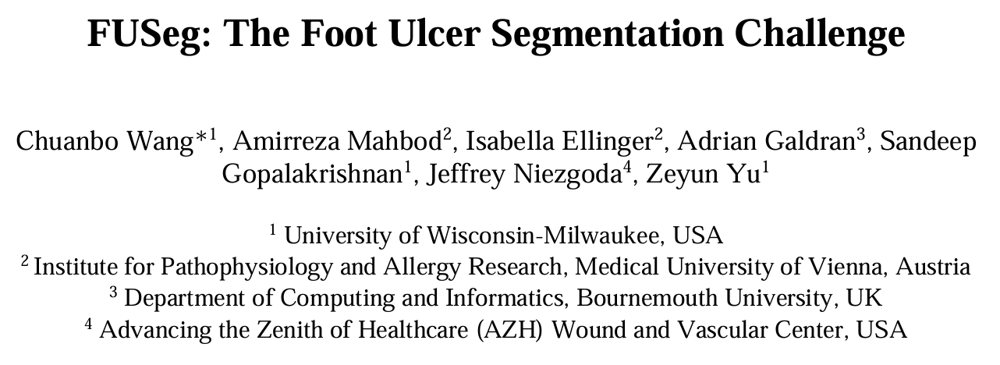
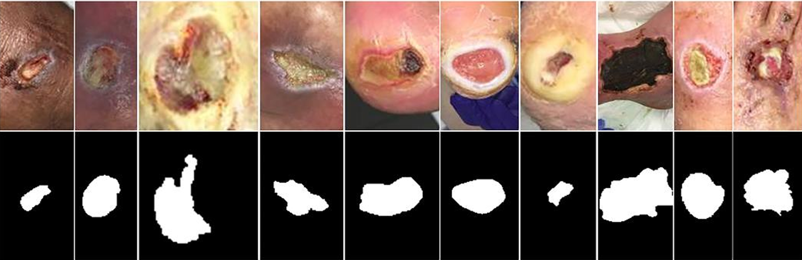

# FUSC2021 (FUSeg 2021)

<div align="center">
    <a href="https://github.com/openmedlab/"></a>
</div>
<p style="text-align:center;font-size:10px;"><em></em></p>

## Dataset Information

FUSC2021, also known as the FUSeg 2021 Foot Ulcer Segmentation Challenge, contains 1,210 clinical photographs from 889 patients, collected between October 2019 and April 2021. Images were acquired during repeated clinical visits with a Canon SX620 HS camera or iPad Pro, with varying lighting and backgrounds.

The challenge uses 810 training, 200 validation, and 200 test images. Training and validation masks are available; test annotations are withheld. Thus, the 1,010-image collection analyzed in the original introduction covers the training and validation images, while the full challenge contains 1,210 images. The released images are standardized to 512 × 512 pixels.

## Dataset Meta Information

| Dimensions | Modality             | Task Type    | Anatomical Structures | Anatomical Area | Number of Categories | Data Volume                             | File Format |
|------------|----------------------|--------------|-----------------------|-----------------|----------------------|-----------------------------------------|-------------|
| 2D         | Clinical Photography | Segmentation | Foot ulcers           | Foot            | 1                    | 1210 (1010 train/validation + 200 test) | .png        |

### Resolution Details

| Dataset Statistics | size      |
|--------------------|-----------|
| min                | 512 × 512 |
| median             | 512 × 512 |
| max                | 512 × 512 |

## Label Information Statistics

The introduction reports 986 images with ulcer annotations among the 1,010 analyzed training/validation images (97.62%). This statistic does not describe the withheld test masks.

| Metric     | Foot Ulcer                         |
|------------|------------------------------------|
| Case Count | 986                                |
| Coverage   | 97.62% of the 1010 analyzed images |

## Visualization

<div align="center">
    <a href="https://github.com/openmedlab/"></a>
</div>
<p style="text-align:center;font-size:10px;"><em>Foot-ulcer photographs and segmentation masks.</em></p>

## File Structure

```
wound-segmentation-master
└── data
    └── Foot Ulcer Segmentation Challenge
        ├── train
        │   ├── images
        │   │   ├── 0011.png
        │   │   ├── 0012.png
        │   │   ├── 0013.png
        │   │   └── ...
        │   ├── labels
        │   │   ├── 0011.png
        │   │   ├── 0012.png
        │   │   ├── 0013.png
        │   │   └── ...
        ├── validation
        │   ├── images
        │   │   ├── 0001.png
        │   │   ├── 0002.png
        │   │   └── ...
        │   ├── labels
        │   │   ├── 0001.png
        │   │   ├── 0002.png
        │   │   └── ...
        ├── test
        │   ├── images
        │   │   ├── 1011.png
        │   │   ├── 1014.png
        │   │   ├── 1016.png
        │   │   └── ...
        ├── FootUlcerSegmentationChallenge2021.pdf
        └── README.MD
```

## Authors and Institutions

Chuanbo Wang (University of Wisconsin-Milwaukee, USA)

Amirreza Mahbod (Institute for Pathophysiology and Allergy Research, Medical University of Vienna, Austria)

Isabella Ellinger (Institute for Pathophysiology and Allergy Research, Medical University of Vienna, Austria)

Adrian Galdran (Department of Computing and Informatics, Bournemouth University, UK)

Sandeep Gopalakrishnan (University of Wisconsin-Milwaukee, USA)

Jeffrey Niezgoda (Advancing the Zenith of Healthcare (AZH) Wound and Vascular Center, USA)

Zeyun Yu (University of Wisconsin-Milwaukee, USA)

## Source Information

Official Website: https://fusc.grand-challenge.org/FUSeg-2021/

Download Link: https://fusc.grand-challenge.org/FUSeg-2021/

Article Address: https://arxiv.org/pdf/2201.00414

Publication Date: 2021-07

## Citation

```
@article{wang2024fuseg,
  title={FUSeg: The foot ulcer segmentation challenge},
  author={Wang, Chuanbo and Mahbod, Amirreza and Ellinger, Isabella and Galdran, Adrian and Gopalakrishnan, Sandeep and Niezgoda, Jeffrey and Yu, Zeyun},
  journal={Information},
  volume={15},
  number={3},
  pages={140},
  year={2024},
  publisher={MDPI}
}
```

Original introduction article is [here](https://zhuanlan.zhihu.com/p/10278245980).
