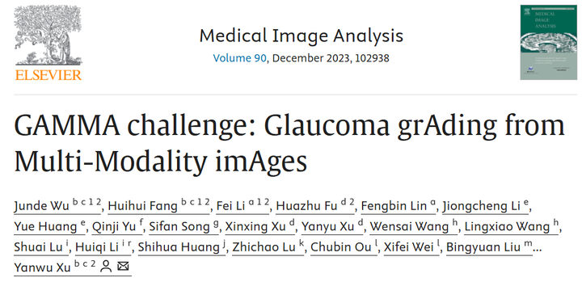
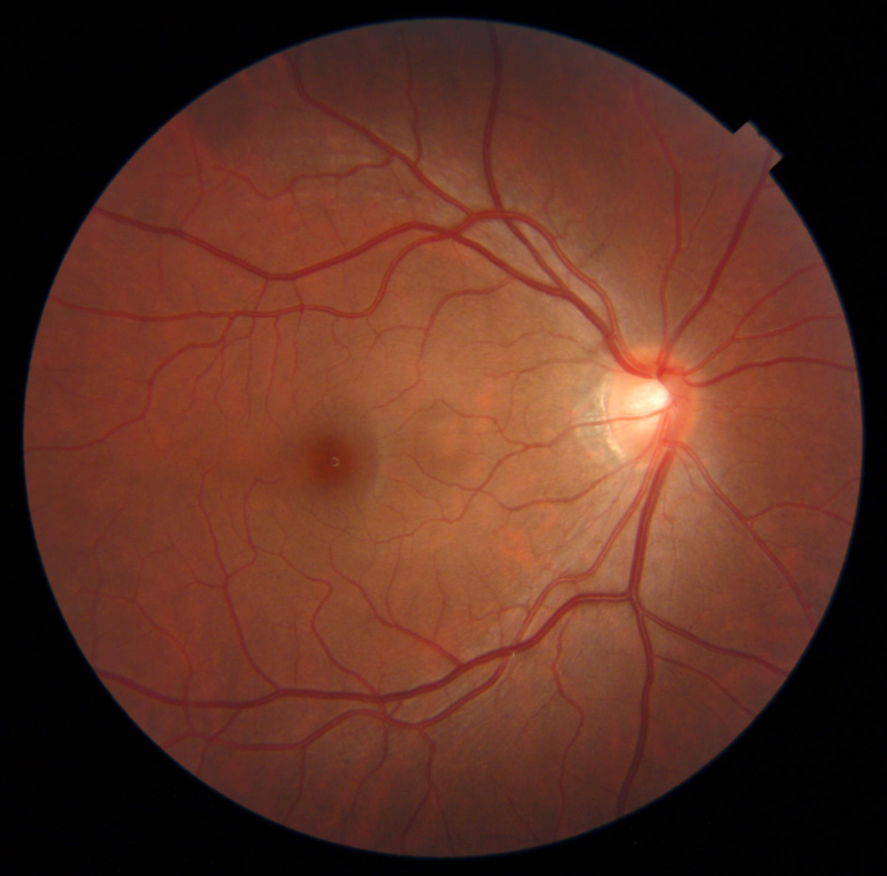

# GAMMA

<div align="center">
    <a href="https://github.com/openmedlab/"></a>
</div>
<p style="text-align:center;font-size:10px;"><em></em></p>

## Dataset Information

GAMMA (Glaucoma grAding from Multi-Modality imAges), provided by the Zhongshan Ophthalmic Center of Sun Yat-sen University, contains 300 pairs of 2D fundus photographs and 3D optical coherence tomography (OCT) volumes from 276 patients. The challenge supports glaucoma grading, fovea localization and optic disc/cup segmentation.

This document follows the source introduction's focus on Task 3, optic disc and cup segmentation. It describes the 100 training fundus images with publicly supplied disc and cup masks.

## Dataset Meta Information

| Dimensions | Modality | Task Type    | Anatomical Structures | Anatomical Area | Number of Categories | Data Volume | File Format |
|------------|----------|--------------|-----------------------|-----------------|----------------------|-------------|-------------|
| 2D         | Fundus   | Segmentation | Optic Cup, Optic Disc | Fundus          | 2                    | 100         | .jpg, .png  |

### Resolution Details

| Dataset Statistics | size      |
|--------------------|-----------|
| min                | 1934*1956 |
| median             | 2000*2992 |
| max                | 2000*2992 |

## Label Information Statistics

| Metric     | Optic Cup | Optic Disc |
|------------|-----------|------------|
| Case Count | 100       | 100        |
| Coverage   | 100%      | 100%       |

## Visualization

<div align="center">
    <a href="https://github.com/openmedlab/"></a>
</div>
<p style="text-align:center;font-size:10px;"><em>Original fundus image.</em></p>

<div align="center">
    <a href="https://github.com/openmedlab/"></a>
</div>
<p style="text-align:center;font-size:10px;"><em>Disc and cup mask: gray denotes the disc and black denotes the cup.</em></p>

## File Structure

``` 
GAMMA/
├── task1_gamma_grading/
├── task2_Fovea_localization/
└── task3_disc_cup_segmentation/
    ├── testing/
    │   └── fundus color images/
    │       ├── 0101.jpg
    │       ├── 0102.jpg
    │       ├── 0103.jpg
    │       ├── 0104.jpg
    │       └── ... 
    ├── training/
    │   ├── Disc_Cup_Mask/
    │   │   ├── 0001.png
    │   │   ├── 0002.png
    │   │   ├── 0003.png
    │   │   ├── 0004.png
    │   │   └── ... 
    │   └── fundus color images/
    │       ├── 0001.jpg
    │       ├── 0002.jpg
    │       ├── 0003.jpg
    │       ├── 0004.jpg
    │       └── ... 
    └── License-GAMMA_1019.pdf
```

## Authors and Institutions

Junde Wu (South China University of Technology, Zhongshan Ophthalmic Center, Sun Yat-sen University)

Huihui Fang (South China University of Technology, Zhongshan Ophthalmic Center, Sun Yat-sen University)

Fei Li (Zhongshan Ophthalmic Center, Sun Yat-sen University)

Huazhu Fu (Institute of High Performance Computing, A*STAR, Singapore)

Fengbin Lin (Zhongshan Ophthalmic Center, Sun Yat-sen University)

Jiongcheng Li (School of Informatics, Xiamen University)

Yue Huang (School of Informatics, Xiamen University)

Qinji Yu (Shanghai Jiao Tong University)

Sifan Song (Xi’an Jiaotong-Liverpool University)

Xinxing Xu (Institute of High Performance Computing, A*STAR, Singapore)

Yanyu Xu (Institute of High Performance Computing, A*STAR, Singapore)

Wensai Wang (Institute of Biomedical Engineering, Chinese Academy of Medical Sciences and Peking Union Medical College)

Lingxiao Wang (Institute of Biomedical Engineering, Chinese Academy of Medical Sciences and Peking Union Medical College)

Shuai Lu (School of Medical Technology, Beijing Institute of Technology)

Huiqi Li (School of Information and Electronics, Beijing Institute of Technology)

Shihua Huang (Department of Computing, Hong Kong Polytechnic University)

Zhichao Lu (Department of Computer Science and Engineering, Southern University of Science and Technology)

Chubin Ou (Weizhi Medical Technology Company, Suzhou)

Xifei Wei (Weizhi Medical Technology Company, Suzhou)

Bingyuan Liu (École de Technologie Supérieure, Montreal)

Riadh Kobbi (DIAGNOS Inc., Quebec, Canada)

Xiaoying Tang (Department of Electrical and Electronic Engineering, Southern University of Science and Technology)

Li Lin (Department of Electrical and Electronic Engineering, Southern University of Science and Technology; Department of Electrical and Electronic Engineering, University of Hong Kong)

Qiang Zhou (Suixin (Shanghai) Technology Co., Ltd.)

Qiang Hu (Suixin (Shanghai) Technology Co., Ltd.)

Hrvoje Bogunović (Christian Doppler Laboratory for Artificial Intelligence in Retina, Department of Ophthalmology, Medical University of Vienna)

José Ignacio Orlando (Pladema Institute, UNICEN, Tandil, Argentina)

Xiulan Zhang (Zhongshan Ophthalmic Center, Sun Yat-sen University)

Yanwu Xu (South China University of Technology, Zhongshan Ophthalmic Center, Sun Yat-sen University)

## Source Information

Official Website: https://gamma.grand-challenge.org/Home/

Download Link: https://gamma.grand-challenge.org/Home/

Article Address: https://www.sciencedirect.com/science/article/pii/S1361841523001986

Publication Date: 2022-02

Author Manuscript: https://ignaciorlando.github.io/publication/2023-media/2023-media.pdf

## Citation

``` 
@article{wu2023gamma,
  title={Gamma challenge: glaucoma grading from multi-modality images},
  author={Wu, Junde and Fang, Huihui and Li, Fei and Fu, Huazhu and Lin, Fengbin and Li, Jiongcheng and Huang, Yue and Yu, Qinji and Song, Sifan and Xu, Xinxing and others},
  journal={Medical Image Analysis},
  volume={90},
  pages={102938},
  year={2023},
  publisher={Elsevier}
}
```

Original introduction article is [here](https://zhuanlan.zhihu.com/p/15628581437).
