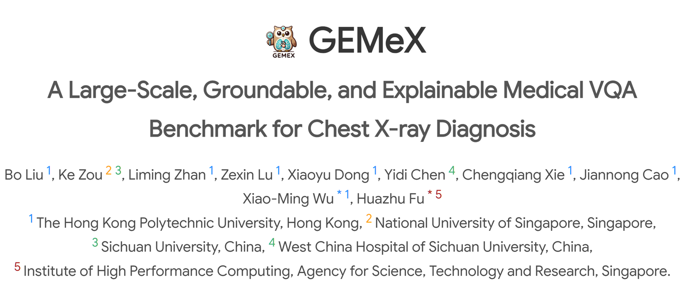
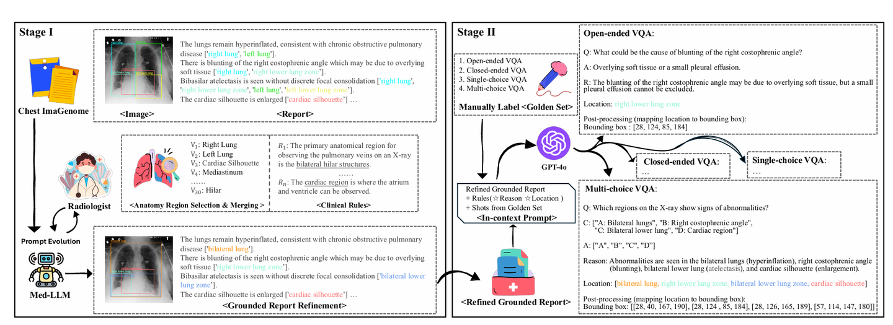
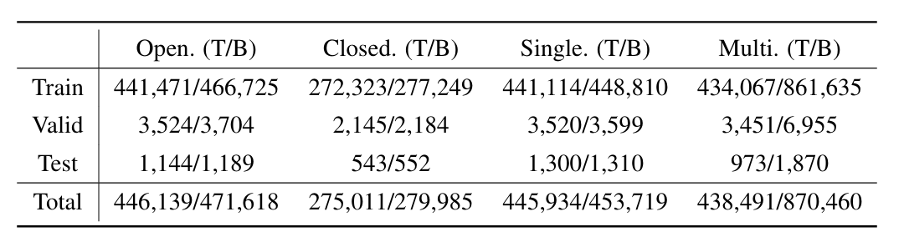
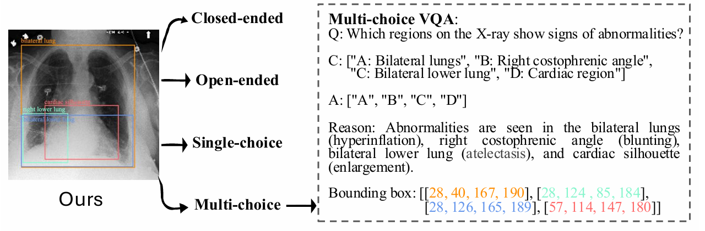
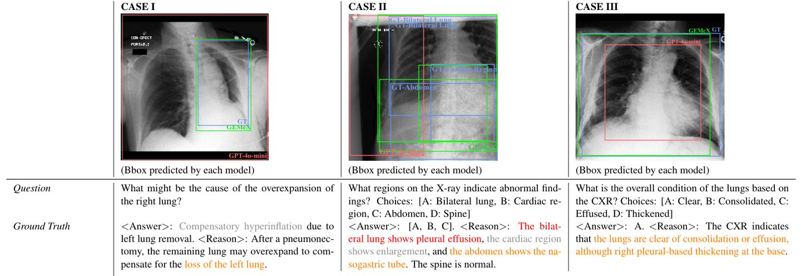

# GEMeX

<div align="center">
    <a href="https://github.com/openmedlab/"></a>
</div>
<p style="text-align:center;font-size:10px;"><em>GEMeX explains answers and grounds them in chest X-ray regions.</em></p>

## Dataset Information

GEMeX is a groundable and explainable medical VQA benchmark for chest X-ray diagnosis. The full benchmark described in the paper contains 151,025 images and 1,605,575 question-answer pairs. Each answer is accompanied by a textual explanation and, where available, bounding boxes that connect the explanation to relevant image regions.

The construction pipeline cleans and aligns Chest ImaGenome annotations, maps anatomical regions, and generates questions and explanations using GPT-4o with radiologist review. Questions take four forms: open-ended, closed-ended, single-choice, and multiple-choice. The full benchmark totals below are distinct from the partial data release linked by the project.

## Dataset Meta Information

| Task Type                  | Language | Train              | Val             | Test           | File Format                       |
|----------------------------|----------|--------------------|-----------------|----------------|-----------------------------------|
| Explainable / Grounded VQA | English  | 1,588,975 QA pairs | 12,640 QA pairs | 3,960 QA pairs | .json, .jsonl; source images .jpg |

## Dataset Information Statistics

<div align="center">
    <a href="https://github.com/openmedlab/"></a>
</div>
<p style="text-align:center;font-size:10px;"><em>GEMeX construction from chest radiographs, anatomical annotations, and generated question-answer explanations.</em></p>

The statistics give question counts (T) and bounding-box counts (B). A question may have more than one bounding box. The test set contains 3,960 question-answer pairs rather than the entire benchmark.

<div align="center">
    <a href="https://github.com/openmedlab/"></a>
</div>
<p style="text-align:center;font-size:10px;"><em>GEMeX question statistics and text/bounding-box annotation coverage.</em></p>

## Dataset Example

Samples include the question, its type, answer, reason, visual regions, visual locations, image path, original report, and identifiers. Choice-based questions also include answer options. The examples below show how textual explanations are associated with image regions.

<div align="center">
    <a href="https://github.com/openmedlab/"></a>
</div>
<p style="text-align:center;font-size:10px;"><em>Example chest X-ray, answer, explanation, and visual annotations.</em></p>

<div align="center">
    <a href="https://github.com/openmedlab/"></a>
</div>
<p style="text-align:center;font-size:10px;"><em>Challenging grounded VQA examples with detailed answer explanations.</em></p>

## File Structure

The introduction shows the following version 1 subset layout. The official Hugging Face repository inspected for this introduction exposes the four test JSONL files. Source chest radiographs are obtained from MIMIC-CXR under its access requirements.

``` 
data-v1-subset
├── sub_training_data.json
└── test
    ├── closed_ended_question.jsonl
    ├── multi_choice_question.jsonl
    ├── open_ended_question.jsonl
    └── single_choice_question.jsonl
```

## Authors and Institutions

Bo Liu, Liming Zhan, Zexin Lu, Xiaoyu Dong, Chengqiang Xie, Jiannong Cao, and Xiao-Ming Wu (The Hong Kong Polytechnic University, Hong Kong)

Ke Zou (National University of Singapore, Singapore; Sichuan University, China)

Yidi Chen (West China Hospital, Sichuan University, China)

Huazhu Fu (Institute of High Performance Computing, Agency for Science, Technology and Research, Singapore)

## Source Information

Official Website: https://www.med-vqa.com/GEMeX/

Download Link: https://huggingface.co/datasets/BoKelvin/GEMeX

Article Address: https://arxiv.org/abs/2411.16778

Publication Date: 2024-11

## Citation

``` 
@article{liu2024gemex,
  title={GEMeX: A Large-Scale, Groundable, and Explainable Medical VQA Benchmark for Chest X-ray Diagnosis},
  author={Liu, Bo and Zou, Ke and Zhan, Liming and Lu, Zexin and Dong, Xiaoyu and Chen, Yidi and Xie, Chengqiang and Cao, Jiannong and Wu, Xiao-Ming and Fu, Huazhu},
  journal={arXiv preprint arXiv:2411.16778},
  year={2024}
}
```

Original introduction article is [here](https://zhuanlan.zhihu.com/p/12495402227).
