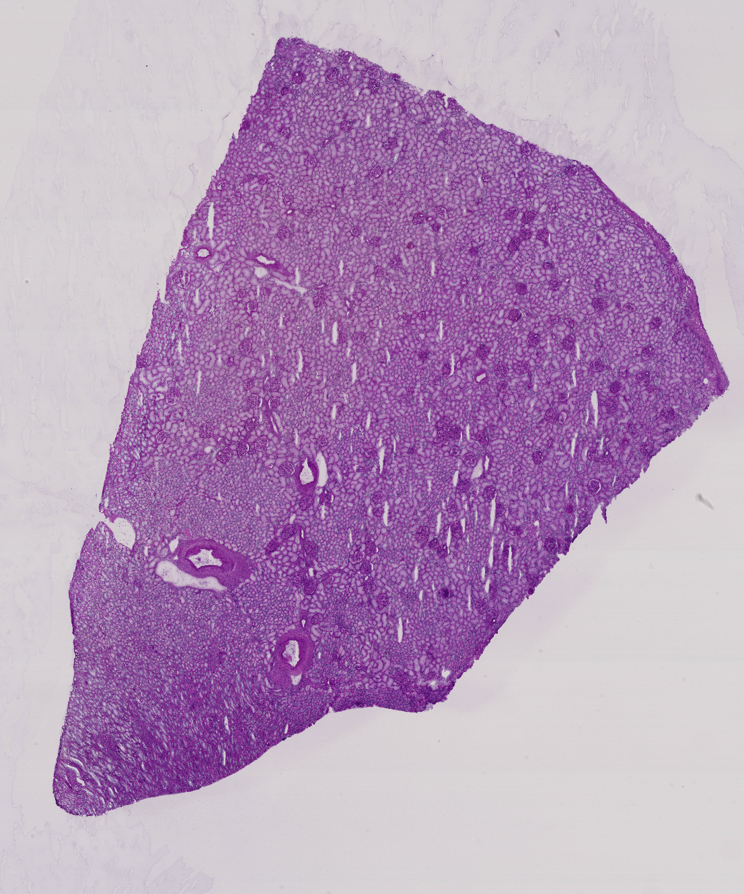
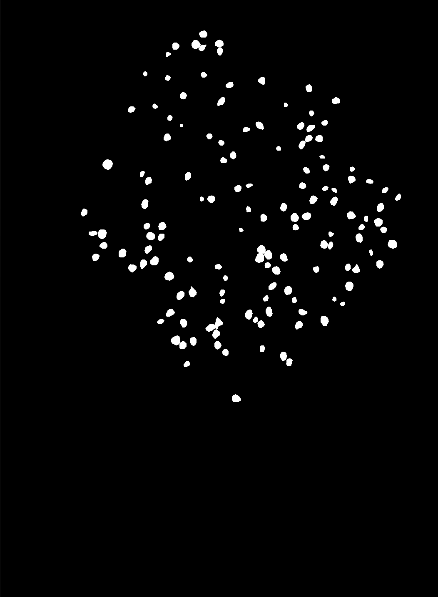

# HuBMAP

<div align="center">
    <a href="https://github.com/openmedlab/"></a>
</div>
<p style="text-align:center;font-size:10px;"><em></em></p>

## Dataset Information

HuBMAP (Human BioMolecular Atlas Program) – Hacking the Kidney is a glomerulus segmentation dataset containing 20 PAS-stained kidney tissue images: 11 fresh-frozen samples and nine formalin-fixed paraffin-embedded (FFPE) samples. The public competition data are divided into 15 training images and five test images. Training annotations encode glomerulus masks using run-length encoding (RLE).

The high-resolution tissue images and functional tissue unit annotations support research into the structure of kidney tissue and automated identification of glomeruli.

## Dataset Meta Information

| Dimensions | Modality             | Task Type    | Anatomical Structures | Anatomical Area | Number of Categories | Data Volume | File Format  |
|------------|----------------------|--------------|-----------------------|-----------------|----------------------|-------------|--------------|
| 2D         | Pathological Imaging | Segmentation | Glomeruli             | Kidney          | 1                    | 20          | .tiff, .json |

### Resolution Details

| Dataset Statistics | size        |
|--------------------|-------------|
| min                | 14844*13013 |
| median             | 31278*39000 |
| max                | 39960*50680 |

## Label Information Statistics

| Metric     | Glomeruli |
|------------|-----------|
| Case Count | 15        |
| Coverage   | 100%      |

## Visualization

<div align="center">
    <a href="https://github.com/openmedlab/"></a>
</div>
<p style="text-align:center;font-size:10px;"><em>Original kidney tissue image.</em></p>

<div align="center">
    <a href="https://github.com/openmedlab/"></a>
</div>
<p style="text-align:center;font-size:10px;"><em>Glomerulus annotations.</em></p>

## File Structure

``` 
HuBMAP/
├── HuBMAP-20-dataset_information.csv
├── hubmap-kidney-segmentation.zip
├── sample_submission.csv
├── train.csv
├── test/
│   ├── 2ec3f1bb9-anatomical-structure.json
│   ├── 2ec3f1bb9.tiff
│   ├── 3589adb90-anatomical-structure.json
│   ├── 3589adb90.tiff
│   ├── 57512b7f1-anatomical-structure.json
│   ├── 57512b7f1.tiff
│   ├── aa05346ff-anatomical-structure.json
│   ├── aa05346ff.tiff
│   ├── d488c759a-anatomical-structure.json
│   ├── d488c759a.tiff
│   ├── sample_submission.csv
│   └── ... 
└── train/
    ├── 1e2425f28-anatomical-structure.json
    ├── 1e2425f28.tiff
    ├── 2f6ecfcdf-anatomical-structure.json
    ├── 2f6ecfcdf.json
    ├── 2f6ecfcdf.tiff
    ├── 4ef6695ce-anatomical-structure.json
    ├── 4ef6695ce.json
    ├── 4ef6695ce.tiff
    └── ...
```

## Authors and Institutions

Katy Börner (Indiana University, USA)

Andrea deSouza (Eli Lilly and Company)

Deepika Vuppalanchi (Precision Value Health)

Richard Holland (Google)

Sandeep Allam (STLogics)

Christine Drury (Conference Ventures)

## Source Information

Official Website: https://www.kaggle.com/competitions/hubmap-kidney-segmentation/overview

Download Link: https://www.kaggle.com/competitions/hubmap-kidney-segmentation/overview

Article Address: https://www.kaggle.com/competitions/hubmap-kidney-segmentation/overview

Publication Date: 2020-11-16

Competition Timeline: https://www.kaggle.com/c/hubmap-kidney-segmentation

## Citation

``` 
@misc{hubmap-kidney-segmentation,
    author = {Addison Howard and Andy Lawrence and Bud Sims and Eddie Tinsley and Jarek Kazmierczak and Katy Borner and Leah Godwin and Marcos Novaes and Phil Culliton and Richard Holland and Rick Watson and Yingnan Ju},
    title = {HuBMAP - Hacking the Kidney},
    year = {2020},
    howpublished = {\url{https://kaggle.com/competitions/hubmap-kidney-segmentation}},
    note = {Kaggle}
}
```

Original introduction article is [here](https://zhuanlan.zhihu.com/p/14751465857).
