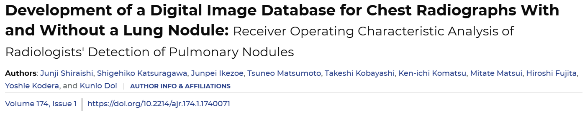
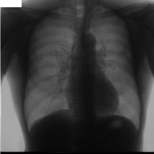
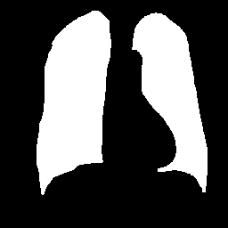

# JSRT

<div align="center">
    <a href="https://github.com/openmedlab/"></a>
</div>
<p style="text-align:center;font-size:10px;"><em></em></p>

## Dataset Information

The Japanese Society of Radiological Technology (JSRT) chest radiograph database was developed in 1998 to study images with and without pulmonary nodules. It contains 247 radiographs: 154 with nodules, including 100 malignant and 54 benign nodules, and 93 without nodules. The original images were digitized at 2048 × 2048 pixels with 0.175 mm pixel spacing and 12-bit grayscale, and stored as headerless big-endian raw data.

Associated information includes patient age and sex, benign or malignant diagnosis, nodule coordinates, a diagram of nodule location, and five nodule subtlety groups. JSRT has supported image processing, compression, display evaluation, PACS development, and computer-aided diagnosis. The introduction presented here focuses on a processed 256 × 256-pixel PNG version with lung segmentation masks, rather than the original raw-image format. Mini-JSRT resources also support introductory deep learning work.

## Dataset Meta Information

| Dimensions | Modality | Task Type    | Anatomical Structures | Anatomical Area | Number of Categories | Data Volume | File Format |
|------------|----------|--------------|-----------------------|-----------------|----------------------|-------------|-------------|
| 2D         | X-ray    | Segmentation | Lung                  | Lung            | 1                    | 247         | .png        |

### Resolution Details

|        | size    |
|--------|---------|
| min    | 256x256 |
| median | 256x256 |
| max    | 256x256 |

## Label Information Statistics

| Anatomical Structures | Lung |
|-----------------------|------|
| Cases                 | 247  |
| Coverage              | 100% |

## Visualization

<div align="center">
    <a href="https://github.com/openmedlab/"></a>
</div>
<p style="text-align:center;font-size:10px;"><em>Original chest radiograph.</em></p>

<div align="center">
    <a href="https://github.com/openmedlab/"></a>
</div>
<p style="text-align:center;font-size:10px;"><em>Corresponding lung region segmentation mask.</em></p>

## File Structure

The source introduction shows the following processed PNG layout:

``` 
JSRT/
└── segmentation01/
    └── Segmentation01/
        ├── test/
        │   ├── label/
        │   │   ├── 0.png
        │   │   ├── 1.png
        │   │   ├── 2.png
        │   │   └── ... 
        │   ├── org/
        │   │   ├── 0.png
        │   │   ├── 1.png
        │   │   ├── 2.png
        │   │   └── ...
        ├── train/
        │   ├── label/
        │   │   ├── 1.png
        │   │   ├── 2.png
        │   │   ├── 3.png
        │   │   └── ...
        │   ├── org/
        │   │   ├── 1.png
        │   │   ├── 2.png
        │   │   ├── 3.png
        │   │   ├── 4.png
        │   │   └── ...
```

## Authors and Institutions

Junji Shiraishi (Department of Radiology, Osaka City University Hospital)

Shigehiko Katsuragawa (Department of Radiology, Iwate Medical University)

Junpei Ikezoe (Department of Radiology, Ehime University)

Tsuneo Matsumoto (Department of Radiology, Yamaguchi University)

Takeshi Kobayashi (Department of Radiology, Kanazawa University)

Ken-ichi Komatsu (Medical Engineering Division, Toshiba)

Mitate Matsui (Medical Imaging Division, Konica)

Hiroshi Fujita (Department of Information Science, Faculty of Engineering, Gifu University)

Yoshie Kodera (Radiological Technology, School of Health Sciences, Nagoya University)

Kunio Doi (Kurt Rossmann Laboratories for Radiologic Image Research)

## Source Information

Official Website: http://db.jsrt.or.jp/eng.php

Download Link: http://db.jsrt.or.jp/eng.php

Article Address: https://ajronline.org/doi/full/10.2214/ajr.174.1.1740071

Publication Date: 2000-01

## Citation

``` 
@article{shiraishi2000development,
  title={Development of a digital image database for chest radiographs with and without a lung nodule: receiver operating characteristic analysis of radiologists' detection of pulmonary nodules},
  author={Shiraishi, Junji and Katsuragawa, Shigehiko and Ikezoe, Junpei and Matsumoto, Tsuneo and Kobayashi, Takeshi and Komatsu, Ken-ichi and Matsui, Mitate and Fujita, Hiroshi and Kodera, Yoshie and Doi, Kunio},
  journal={American journal of roentgenology},
  volume={174},
  number={1},
  pages={71--74},
  year={2000},
  publisher={Am Roentgen Ray Soc}
}
```

Original introduction article is [here](https://zhuanlan.zhihu.com/p/17329827668).
