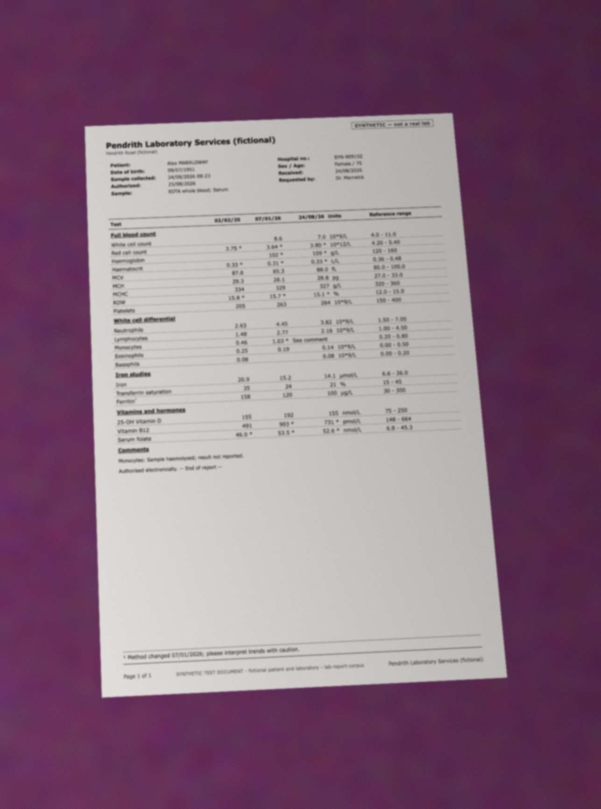

# Lab Report Corpus

    

<em>An invented lab report photographed with a phone</em>

## Dataset Information

Lab Report Corpus is a synthetic dataset for reading laboratory reports from documents and images. It contains 4,000 invented lab reports in the conventions of six countries (US, UK, Germany, France, Spain, Romania), rendered in 14 layouts. Each report is available as a PDF, and its pages as a clean scan, a noisy scan and a phone photo with perspective, blur, shadow and compression.

Every report comes with a computed answer key: marker, value, unit, printed reference range, flag, page and position. Results are labelled with hard cases such as censored values, dual units, tables split across pages, decimal commas, calculated values and results the reader should abstain from. Values come from invented people whose results agree with each other; there is no patient data.

It is intended for evaluating and training OCR, document AI and multimodal LLM systems that extract lab values.

## Dataset Meta Information

| Task Type | Language | Train | Val | Test | File Format | Licence |
|-----------|----------|-------|-----|------|-------------|---------|
| Document image to structured text (value extraction) | English, German, French, Spanish, Romanian | 3,249 | 366 | 385 | PDF, PNG/JPG, JSON/CSV | CC BY 4.0 |

## Dataset Statistics

| Reports | Pages | Pictures | Results with answers | Markers |
|---------|-------|----------|----------------------|---------|
| 4,000 | 5,331 | 6,371 | 165,538 | 60 |

## Links

- Hugging Face: https://huggingface.co/datasets/lifefrom/lab-report-corpus
- Generator and benchmark code: https://github.com/caraulani/lab-reading-bench
- Zenodo: https://doi.org/10.5281/zenodo.24341108
- Corpus page: https://lifefrom.ai/research/open-data/report-corpus
