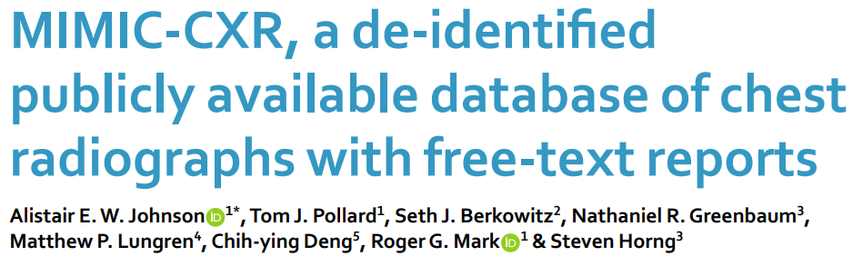
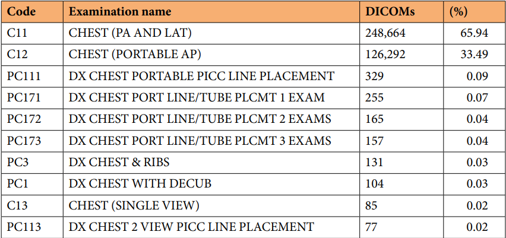
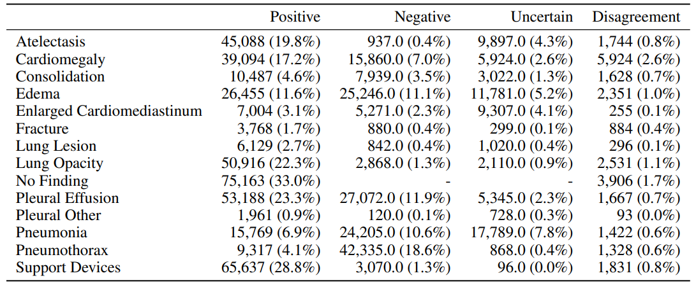
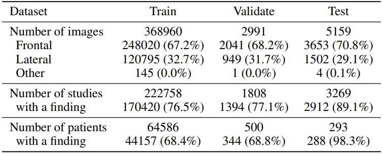
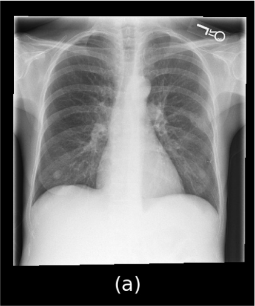
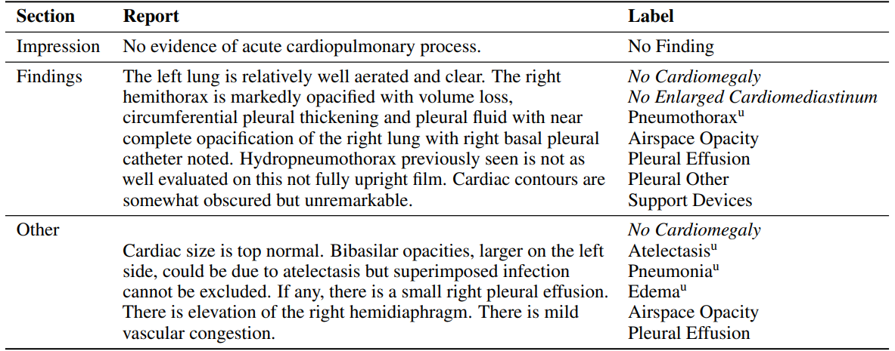

# MIMIC-CXR

<div align="center">
    <a href="https://github.com/openmedlab/"></a>
</div>
<p style="text-align:center;font-size:10px;"><em>MIMIC-CXR chest radiographs and radiology reports.</em></p>

## Dataset Information

MIMIC-CXR (MIMIC Chest X-ray) pairs de-identified chest radiographs with free-text radiology reports from Beth Israel Deaconess Medical Center in Boston, USA. Version 2.0.0 contains 377,110 images from 227,835 imaging studies. Images are supplied in DICOM format and reports as text files. A study may contain several images, all linked to the same report.

The image-report pairs support radiology report generation, image understanding, natural language processing, and disease classification. The training, validation, and test image counts below follow the split described in the original introduction. Access to the underlying patient data requires PhysioNet credentialing, the required training, and a data use agreement.

## Dataset Meta Information

| Task Type         | Language | Train          | Val          | Test         | File Format | Size  |
|-------------------|----------|----------------|--------------|--------------|-------------|-------|
| Report Generation | English  | 368,960 images | 2,991 images | 5,159 images | .txt, .dcm  | 621GB |

## Dataset Information Statistics

The following figures summarize examination types, disease categories, and the numbers of images, studies, and patients in each split.

<div align="center">
    <a href="https://github.com/openmedlab/"></a>
</div>
<p style="text-align:center;font-size:10px;"><em>Distribution of radiographic examination types.</em></p>

<div align="center">
    <a href="https://github.com/openmedlab/"></a>
</div>
<p style="text-align:center;font-size:10px;"><em>Distribution of report-derived disease labels illustrated in the original introduction.</em></p>

<div align="center">
    <a href="https://github.com/openmedlab/"></a>
</div>
<p style="text-align:center;font-size:10px;"><em>Image, study, and patient counts in the training, validation, and test sets.</em></p>

## Dataset Example

The introduction illustrates a chest radiograph and examples of report sections with derived disease labels. The report table shows several separate report excerpts.

<div align="center">
    <a href="https://github.com/openmedlab/"></a>
</div>
<p style="text-align:center;font-size:10px;"><em>Example chest radiograph.</em></p>

<div align="center">
    <a href="https://github.com/openmedlab/"></a>
</div>
<p style="text-align:center;font-size:10px;"><em>Example report sections and report-derived disease labels.</em></p>

## File Structure

Files are grouped by patient and study. The study directory contains its DICOM images; the report is stored beside that directory under the study identifier. The following patient directory is an example from the introduction.

``` 
files
└── p10
    └── p10000032
        ├── s50414267
        │   ├── 02aa804e-bde0afdd-112c0b34-7bc16630-4e384014.dcm
        │   └── 174413ec-4ec4c1f7-34ea26b7-c5f994f8-79ef1962.dcm
        ├── s50414267.txt
        ├── s53189527
        │   ├── 2a2277a9-b0ded155-c0de8eb9-c124d10e-82c5caab.dcm
        │   └── e084de3b-be89b11e-20fe3f9f-9c8d8dfe-4cfd202c.dcm
        ├── s53189527.txt
        ├── s53911762
        │   ├── 68b5c4b1-227d0485-9cc38c3f-7b84ab51-4b472714.dcm
        │   └── fffabebf-74fd3a1f-673b6b41-96ec0ac9-2ab69818.dcm
        ├── s53911762.txt
        ├── s56699142
        │   └── ea030e7a-2e3b1346-bc518786-7a8fd698-f673b44c.dcm
        └── s56699142.txt
```

## Authors and Institutions

Alistair E. W. Johnson (Institute for Medical Engineering and Science, Massachusetts Institute of Technology, USA)

Tom J. Pollard (Institute for Medical Engineering and Science, Massachusetts Institute of Technology, USA)

Nathaniel R. Greenbaum (Department of Emergency Medicine, Beth Israel Deaconess Medical Center, USA)

Matthew P. Lungren (Department of Radiology, Stanford University, USA)

Chih-ying Deng (Department of Biomedical Informatics, Harvard Medical School, USA)

Yifan Peng and Zhiyong Lu (National Center for Biotechnology Information, National Library of Medicine, USA; collaborators acknowledged in the MIMIC-CXR paper and authors of the MIMIC-CXR-JPG paper)

Roger G. Mark (Institute for Medical Engineering and Science, Massachusetts Institute of Technology, USA)

Seth J. Berkowitz (Department of Radiology, Beth Israel Deaconess Medical Center, USA)

Steven Horng (Department of Emergency Medicine, Beth Israel Deaconess Medical Center, USA)

## Source Information

Official Website: https://physionet.org/content/mimic-cxr/2.0.0/

Download Link: https://physionet.org/content/mimic-cxr/2.0.0/

Article Address: https://www.nature.com/articles/s41597-019-0322-0

Publication Date: 2019-09

## Citation

``` 
@article{johnson2019mimiccxr,
  title={MIMIC-CXR, a de-identified publicly available database of chest radiographs with free-text reports},
  author={Johnson, Alistair EW and Pollard, Tom J and Berkowitz, Seth J and Greenbaum, Nathaniel R and Lungren, Matthew P and Deng, Chih-ying and Mark, Roger G and Horng, Steven},
  journal={Scientific data},
  volume={6},
  number={1},
  pages={317},
  year={2019},
  publisher={Nature Publishing Group UK London}
}
```

Original introduction article is [here](https://zhuanlan.zhihu.com/p/693857577).
