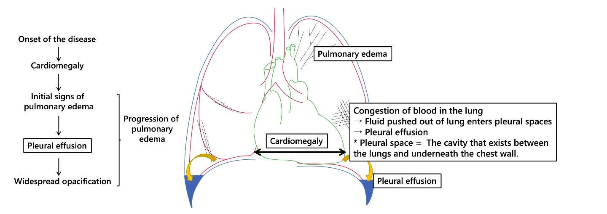
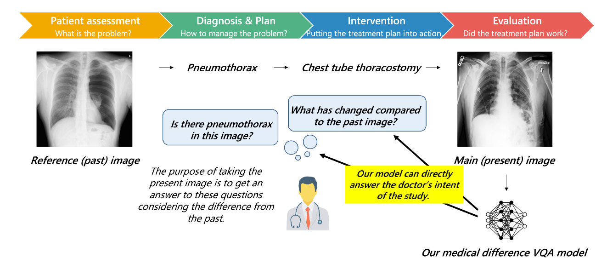
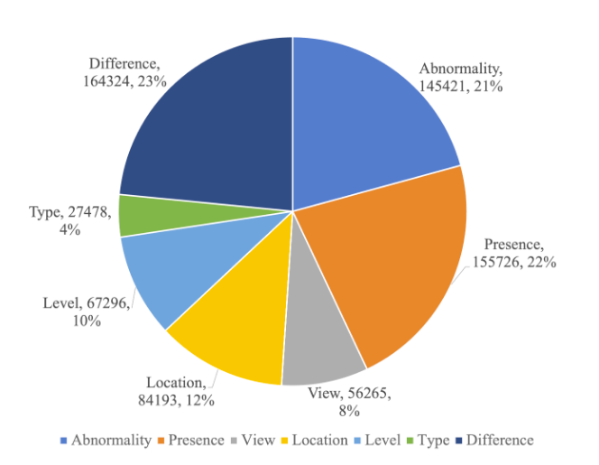
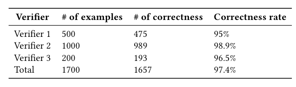
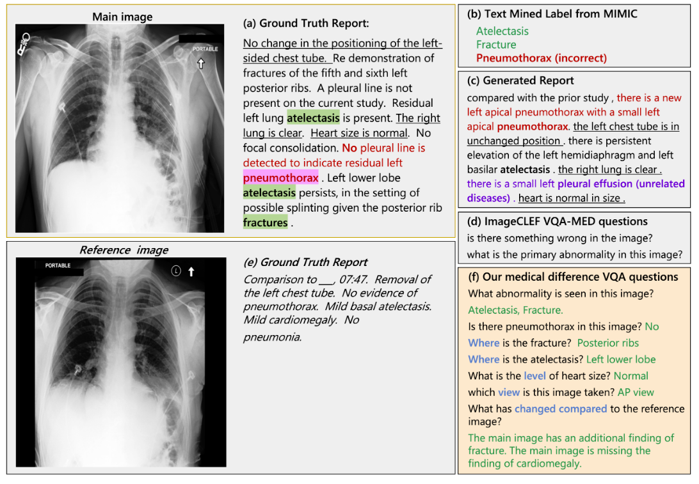
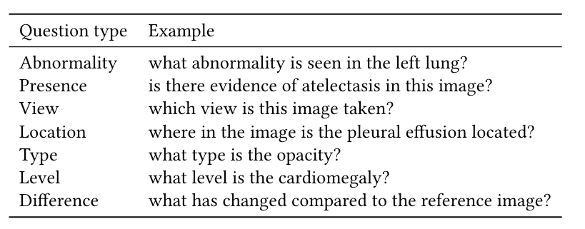

# MIMIC-Diff-VQA

<div align="center">
    <a href="https://github.com/openmedlab/"></a>
</div>
<p style="text-align:center;font-size:10px;"><em>MIMIC-Diff-VQA for comparing chest radiographs across visits.</em></p>

## Dataset Information

MIMIC-Diff-VQA, released on PhysioNet as Medical-Diff-VQA, evaluates questions about changes between chest X-rays acquired at different times for the same patient. It contains 164,324 pairs of current and previous studies and 700,703 question-answer pairs derived from MIMIC-CXR reports. The earlier study provides the reference image, while the later study provides the main image.

Construction follows an iterative extraction, checking, and correction process. Abnormality and attribute keywords are collected from reports, regular-expression rules extract structured information, and manual checks guide corrections. Seven question categories cover abnormality, presence, view, location, type, level, and difference. The first six concern the main image; difference questions require both images. The introduction describes an 8:1:1 training, validation, and test split.

<div align="center">
    <a href="https://github.com/openmedlab/"></a>
</div>
<p style="text-align:center;font-size:10px;"><em>Clinical motivation for comparing a current chest radiograph with a previous examination.</em></p>

## Dataset Meta Information

| Task Type      | Language | Train              | Val                | Test               | File Format |
|----------------|----------|--------------------|--------------------|--------------------|-------------|
| Difference VQA | English  | 80% of image pairs | 10% of image pairs | 10% of image pairs | .csv, .json |

## Dataset Information Statistics

| Question Type | Question-answer Pairs |
|---------------|-----------------------|
| Abnormality   | 145,421               |
| Presence      | 155,726               |
| View          | 56,265                |
| Location      | 84,193                |
| Type          | 27,478                |
| Level         | 67,296                |
| Difference    | 164,324               |
| Total         | 700,703               |

<div align="center">
    <a href="https://github.com/openmedlab/"></a>
</div>
<p style="text-align:center;font-size:10px;"><em>Counts of the seven clinically relevant question categories.</em></p>

Three human verifiers reviewed 1,700 sampled question-answer pairs against their associated reports. They marked 1,657 pairs correct. The introduction reports 97.33% correctness; the verifier table reports an overall rate rounded to 97.4%.

<div align="center">
    <a href="https://github.com/openmedlab/"></a>
</div>
<p style="text-align:center;font-size:10px;"><em>Human validation results for sampled question-answer pairs.</em></p>

## Dataset Example

The example contrasts the current image and report with the earlier image and report. It illustrates errors in classification or generated reports and shows how focused difference questions can direct attention to clinically relevant regions.

<div align="center">
    <a href="https://github.com/openmedlab/"></a>
</div>
<p style="text-align:center;font-size:10px;"><em>Current and reference examinations, report-based findings, and difference questions.</em></p>

<div align="center">
    <a href="https://github.com/openmedlab/"></a>
</div>
<p style="text-align:center;font-size:10px;"><em>Example questions from different categories.</em></p>

## File Structure

Keyword libraries support report extraction. `mimic_vqa_pairs.csv` stores the final question-answer pairs, `mimic_all.csv` contains study and image metadata, and `all_diseases.json` stores intermediate extracted findings. Images must be obtained from MIMIC-CXR and linked using patient and study identifiers.

``` 
.
├── libs
│   ├── parts_of_speech.csv
│   ├── disease_lib.csv
│   ├── level_lib.csv
│   ├── location_lib.csv
│   ├── position_change.csv
│   ├── postlocation_lib.csv
│   └── type_lib.csv
├── mimic_vqa_pairs.csv
├── mimic_all.csv
└── all_diseases.json
```

## Authors and Institutions

Xinyue Hu, Qiyuan An, Mengliang Zhang, and Yingying Zhu (University of Texas at Arlington, USA)

Lin Gu and Tatsuya Harada (The University of Tokyo, Japan)

Liangchen Liu and Ronald M. Summers (Clinical Center, National Institutes of Health, USA)

Kazuma Kobayashi (National Cancer Center, Japan)

## Source Information

Official Website: https://holipori.github.io/KDD2023-MIMIC-Diff-VQA/

Download Link: https://physionet.org/content/medical-diff-vqa/1.0.0/

Article Address: https://dl.acm.org/doi/10.1145/3580305.3599819

Publication Date: 2023-08

## Citation

``` 
@inproceedings{10.1145/3580305.3599819,
author = {Hu, Xinyue and Gu, Lin and An, Qiyuan and Zhang, Mengliang and Liu, Liangchen and Kobayashi, Kazuma and Harada, Tatsuya and Summers, Ronald M. and Zhu, Yingying},
title = {Expert Knowledge-Aware Image Difference Graph Representation Learning for Difference-Aware Medical Visual Question Answering},
year = {2023},
isbn = {9798400701030},
publisher = {Association for Computing Machinery},
address = {New York, NY, USA},
url = {https://doi.org/10.1145/3580305.3599819},
doi = {10.1145/3580305.3599819},
booktitle = {Proceedings of the 29th ACM SIGKDD Conference on Knowledge Discovery and Data Mining},
pages = {4156–4165},
numpages = {10},
keywords = {datasets, medical imaging, visual question answering},
series = {KDD '23}
}
```

Original introduction article is [here](https://zhuanlan.zhihu.com/p/692522668).
