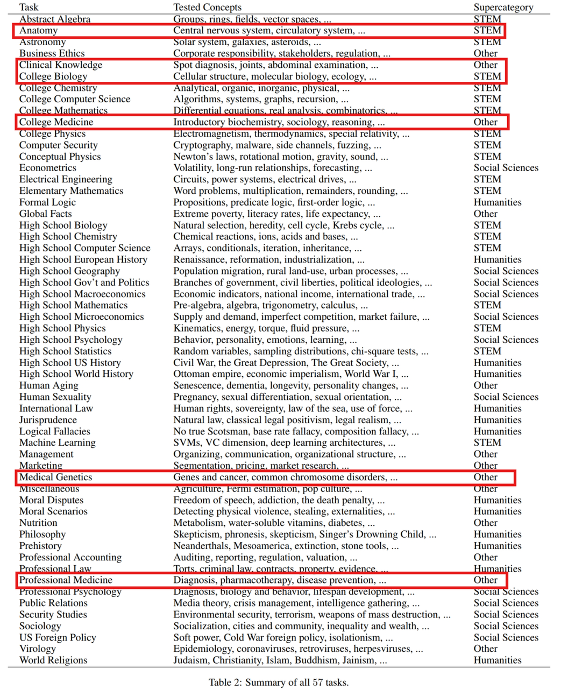
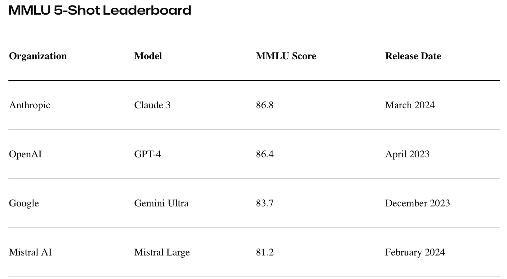
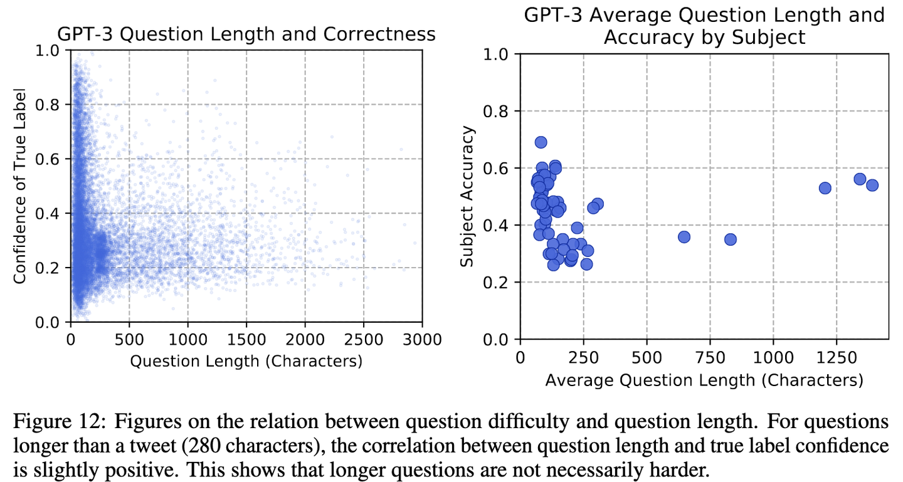
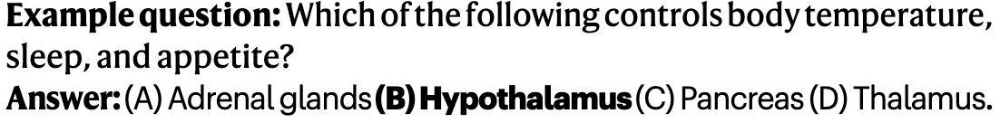
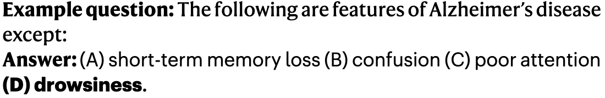
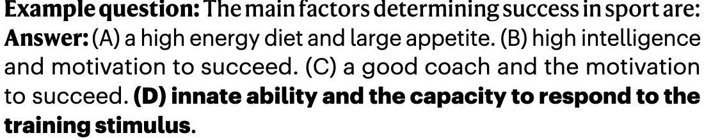
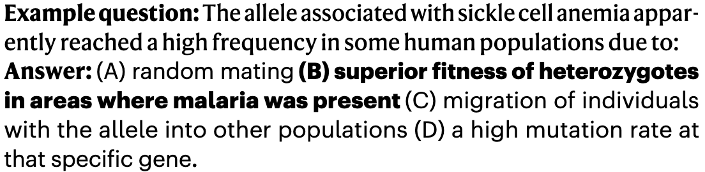
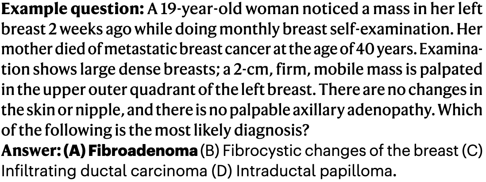
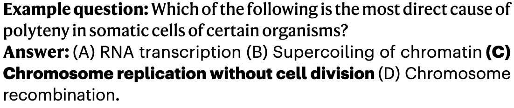

# MMLU Clinical Topics

<div align="center">
    <a href="https://github.com/openmedlab/"></a>
</div>
<p style="text-align:center;font-size:10px;"><em></em></p>

## Dataset Information

MMLU Clinical Topics is the six-subject medical subset of the 57-subject Massive Multitask Language Understanding benchmark. It includes anatomy, clinical knowledge, professional medicine, medical genetics, college medicine, and college biology. The subset contains 30 few-shot development questions, 123 validation questions, and 1,089 test questions, all with four answer choices and a reference answer. These subjects are part of the MultiMedQA evaluation used in Med-PaLM.

The official MMLU distribution contains one CSV file per subject and split, together with auxiliary training material from other multiple-choice datasets. The development questions support few-shot prompting; the test questions assess subject knowledge and reasoning. The figures below reproduce the historical statistics and March 2024 results shown in the original introduction.

## Dataset Meta Information

| Task Type          | Language | Train             | Val | Test | File Format | Size                    |
|--------------------|----------|-------------------|-----|------|-------------|-------------------------|
| Multiple-choice QA | English  | 30 (few-shot dev) | 123 | 1089 | .csv        | 537KB (source-reported) |

## Dataset Information Statistics

Each of the six subjects has five development questions. The total is 30; the original introduction incorrectly reports 25 in its aggregate row.

| Subject               | Dev | Val | Test |
|-----------------------|-----|-----|------|
| Anatomy               | 5   | 14  | 135  |
| Clinical knowledge    | 5   | 29  | 265  |
| Professional medicine | 5   | 31  | 272  |
| Medical genetics      | 5   | 11  | 100  |
| College medicine      | 5   | 22  | 173  |
| College biology       | 5   | 16  | 144  |
| Total                 | 30  | 123 | 1089 |

<div align="center">
    <a href="https://github.com/openmedlab/"></a>
</div>
<p style="text-align:center;font-size:10px;"><em>The 57 MMLU subjects, with the six medical subjects highlighted.</em></p>

<div align="center">
    <a href="https://github.com/openmedlab/"></a>
</div>
<p style="text-align:center;font-size:10px;"><em>Historical leaderboard snapshot from March 2024.</em></p>

<div align="center">
    <a href="https://github.com/openmedlab/"></a>
</div>
<p style="text-align:center;font-size:10px;"><em>Question length and difficulty statistics from the MMLU paper.</em></p>

## Dataset Example

The original introduction illustrates one question from each of the six medical subjects.

<div align="center">
    <a href="https://github.com/openmedlab/"></a>
</div>
<p style="text-align:center;font-size:10px;"><em>Anatomy example.</em></p>

<div align="center">
    <a href="https://github.com/openmedlab/"></a>
</div>
<p style="text-align:center;font-size:10px;"><em>Clinical knowledge example.</em></p>

<div align="center">
    <a href="https://github.com/openmedlab/"></a>
</div>
<p style="text-align:center;font-size:10px;"><em>College medicine example.</em></p>

<div align="center">
    <a href="https://github.com/openmedlab/"></a>
</div>
<p style="text-align:center;font-size:10px;"><em>Medical genetics example.</em></p>

<div align="center">
    <a href="https://github.com/openmedlab/"></a>
</div>
<p style="text-align:center;font-size:10px;"><em>Professional medicine example.</em></p>

<div align="center">
    <a href="https://github.com/openmedlab/"></a>
</div>
<p style="text-align:center;font-size:10px;"><em>College biology example.</em></p>

## File Structure

```
data/
├── auxiliary_train/
├── dev/
│   ├── anatomy_dev.csv
│   ├── clinical_knowledge_dev.csv
│   ├── college_biology_dev.csv
│   ├── college_medicine_dev.csv
│   ├── medical_genetics_dev.csv
│   ├── professional_medicine_dev.csv
│   └── ...
├── possibly_contaminated_urls.txt
├── README.txt
├── test/
│   ├── anatomy_test.csv
│   ├── clinical_knowledge_test.csv
│   ├── college_biology_test.csv
│   ├── college_medicine_test.csv
│   ├── medical_genetics_test.csv
│   ├── professional_medicine_test.csv
│   └── ...
└── val/
    ├── anatomy_val.csv
    ├── clinical_knowledge_val.csv
    ├── college_biology_val.csv
    ├── college_medicine_val.csv
    ├── medical_genetics_val.csv
    ├── professional_medicine_val.csv
    └── ...
```

## Authors and Institutions

Dan Hendrycks (UC Berkeley, USA)

Collin Burns (Columbia University, USA)

Steven Basart (UChicago, USA)

Andy Zou (UC Berkeley, USA)

Mantas Mazeika (UIUC, USA)

Dawn Song (UC Berkeley, USA)

Jacob Steinhardt (UC Berkeley, USA)

## Source Information

Official Website: https://github.com/hendrycks/test

Download Link: https://people.eecs.berkeley.edu/~hendrycks/data.tar

Article Address: https://arxiv.org/pdf/2009.03300.pdf

Publication Date: 2020-09

## Citation

```
@article{hendryckstest2021,
  title={Measuring Massive Multitask Language Understanding},
  author={Dan Hendrycks and Collin Burns and Steven Basart and Andy Zou and Mantas Mazeika and Dawn Song and Jacob Steinhardt},
  journal={Proceedings of the International Conference on Learning Representations (ICLR)},
  year={2021}
}

@article{hendrycks2021ethics,
  title={Aligning AI With Shared Human Values},
  author={Dan Hendrycks and Collin Burns and Steven Basart and Andrew Critch and Jerry Li and Dawn Song and Jacob Steinhardt},
  journal={Proceedings of the International Conference on Learning Representations (ICLR)},
  year={2021}
}
```

Original introduction article is [here](https://zhuanlan.zhihu.com/p/688575916).
