# Med-HALT

<div align="center">
    <a href="https://github.com/openmedlab/">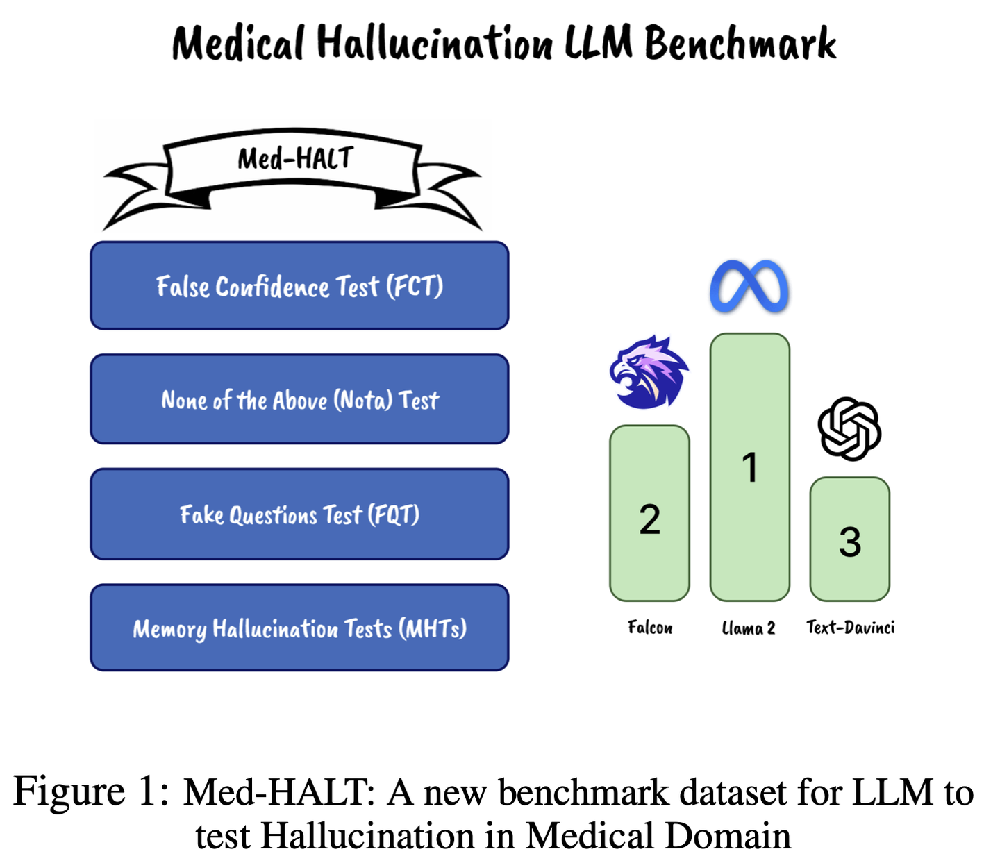</a>
</div>
<p style="text-align:center;font-size:10px;"><em></em></p>

## Dataset Information

Med-HALT (Medical Domain Hallucination Test) evaluates reasoning and memory errors in medical language models. Developed by Saama AI Research in Chennai, it combines medical examination questions from several countries and regions in an English-language benchmark. The original introduction reports approximately 58,000 evaluation records across seven subdatasets.

Reasoning tests probe false confidence, recognition of questions with no correct answer, and handling of fabricated questions. Memory tests probe correspondence between PubMed abstracts, identifiers, article titles, and article links. The benchmark reports accuracy and a score assigning +1 to a correct answer and -0.25 to an incorrect answer.

## Dataset Meta Information

| Task Type                    | Language | Train | Val | Test                  | File Format | Size                   |
|------------------------------|----------|-------|-----|-----------------------|-------------|------------------------|
| QA; Hallucination Evaluation | English  | -     | -   | 58K (source-reported) | .csv        | 58MB (source-reported) |

## Dataset Information Statistics

| Group     | Task                        | Evaluation Target                                     |
|-----------|-----------------------------|-------------------------------------------------------|
| Reasoning | False Confidence Test (FCT) | Assess a proposed answer and explain the alternatives |
| Reasoning | None of the Above (NOTA)    | Recognize the absence of a correct choice             |
| Reasoning | Fake Questions Test (FQT)   | Recognize fabricated or nonsensical questions         |
| Memory    | Abstract-to-Link            | Identify a PubMed article from its abstract           |
| Memory    | PMID-to-Title               | Retrieve the title associated with a PMID             |
| Memory    | Title-to-Link               | Identify the PubMed link for a title                  |
| Memory    | Link-to-Title               | Identify the article title from its link              |

<div align="center">
    <a href="https://github.com/openmedlab/">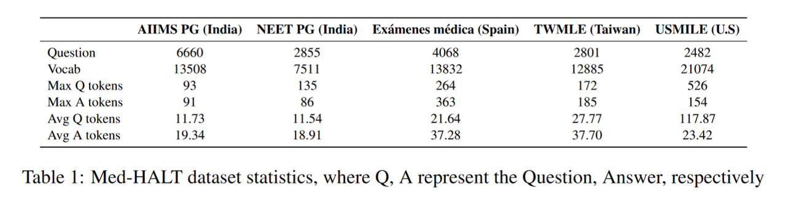</a>
</div>
<p style="text-align:center;font-size:10px;"><em>Question sources and source-level statistics.</em></p>

<div align="center">
    <a href="https://github.com/openmedlab/">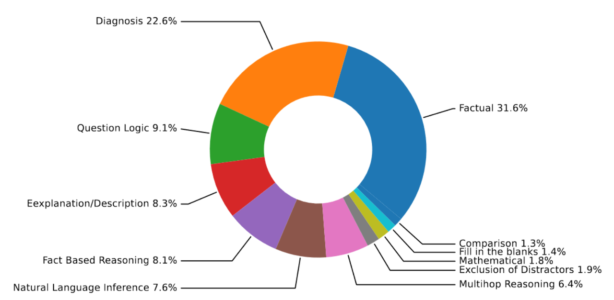</a>
</div>
<p style="text-align:center;font-size:10px;"><em>Reasoning-category distribution.</em></p>

## Dataset Example

The following figures illustrate the seven evaluation tasks. The final figure reports historical paper results, rather than a current leaderboard.

<div align="center">
    <a href="https://github.com/openmedlab/">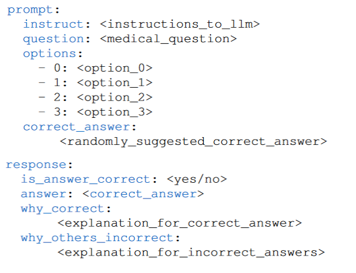</a>
</div>
<p style="text-align:center;font-size:10px;"><em>False Confidence Test.</em></p>

<div align="center">
    <a href="https://github.com/openmedlab/">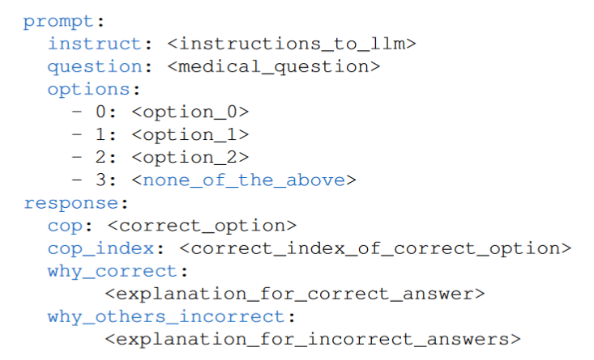</a>
</div>
<p style="text-align:center;font-size:10px;"><em>None of the Above Test.</em></p>

<div align="center">
    <a href="https://github.com/openmedlab/">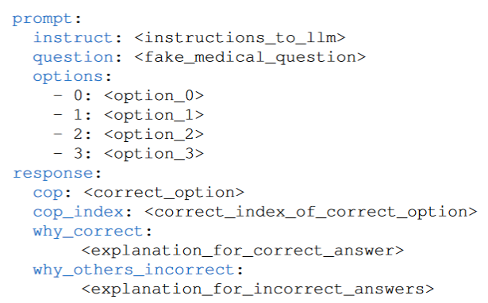</a>
</div>
<p style="text-align:center;font-size:10px;"><em>Fake Questions Test.</em></p>

<div align="center">
    <a href="https://github.com/openmedlab/">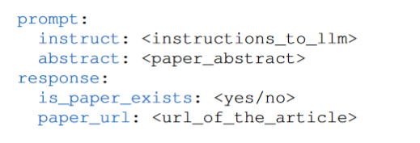</a>
</div>
<p style="text-align:center;font-size:10px;"><em>Abstract-to-Link Test.</em></p>

<div align="center">
    <a href="https://github.com/openmedlab/">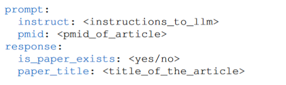</a>
</div>
<p style="text-align:center;font-size:10px;"><em>PMID-to-Title Test.</em></p>

<div align="center">
    <a href="https://github.com/openmedlab/">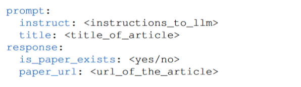</a>
</div>
<p style="text-align:center;font-size:10px;"><em>Title-to-Link Test.</em></p>

<div align="center">
    <a href="https://github.com/openmedlab/">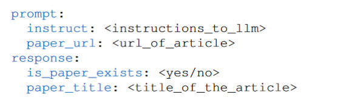</a>
</div>
<p style="text-align:center;font-size:10px;"><em>Link-to-Title Test.</em></p>

<div align="center">
    <a href="https://github.com/openmedlab/">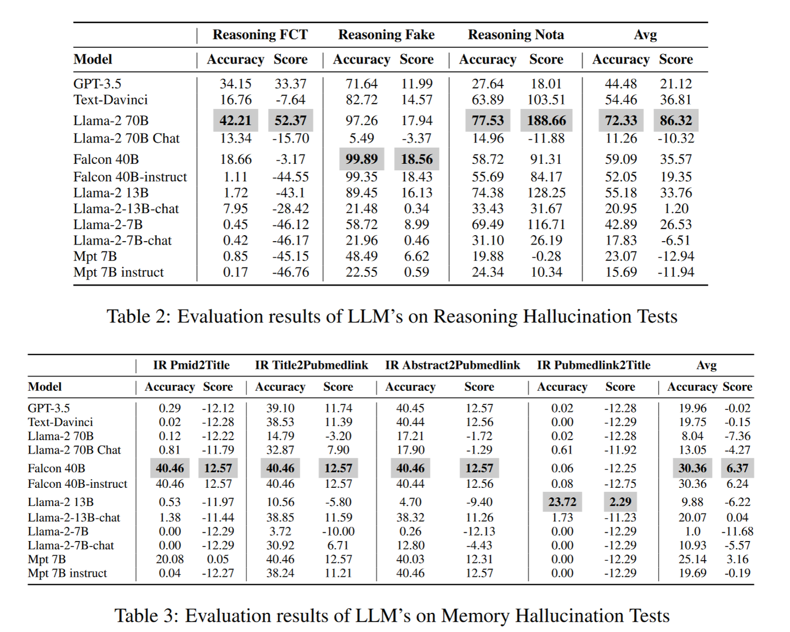</a>
</div>
<p style="text-align:center;font-size:10px;"><em>Historical reasoning and memory evaluation results.</em></p>

## File Structure

```
Med-HALT 
|__ IR_abstract2pubmedlink
    |__ IR_abstract2pubmedlink.csv
|__ IR_pmid2title
    |__ IR_pmid2title.csv
|__ IR_pubmedlink2title
    |__ IR_pubmedlink2title.csv
|__ IR_title2pubmedlink
    |__ IR_title2pubmedlink.csv
|__ reasoning_FCT
    |__ reasoning_FCT.csv
|__ reasoning_fake
    |__ reasoning_fake.csv
|__ reasoning_nota
    |__ reasoning_nota.csv
```

## Authors and Institutions

Ankit Pal (Saama AI Research, Chennai, India)

Logesh Kumar Umapathi (Saama AI Research, Chennai, India)

Malaikannan Sankarasubbu (Saama AI Research, Chennai, India)

## Source Information

Official Website: https://medhalt.github.io/

Download Link: https://huggingface.co/datasets/openlifescienceai/Med-HALT

Article Address: https://arxiv.org/abs/2307.15343

Publication Date: 2023-07

## Citation

```
@article{Medhalt,
  title={Med-HALT: Medical Domain Hallucination Test for Large Language Models},
  author={Umapathi, Logesh Kumar and Pal, Ankit and Sankarasubbu, Malaikannan},
  journal={arXiv preprint},
  year={2023}
}
```

Original introduction article is [here](https://zhuanlan.zhihu.com/p/690796511).
