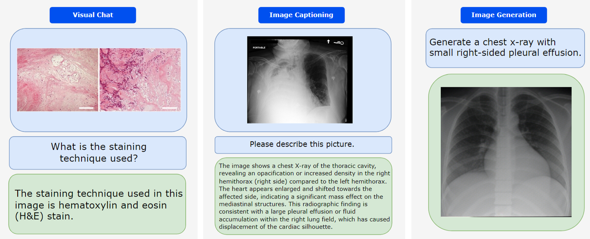

# MedMax

## Dataset Information

MedMax is a medical instruction dataset for models that process and generate interleaved images and text. It combines visual chat, visual question answering, image captioning, multimodal generation, image generation, and report understanding. The original dataset description reports 1.47 million task instances, 725K unique images, and one billion text tokens.

The thirteen sources are PubMedVision-IT, PMC-VQA, PMC_OA, QUILT_1M, QUILT_Instruct, PubMedVision-Alignment, MIMIC-CXR, OmniMedVQA, LLaVA-Med-IT, LLaVA-Med-PMC, PathVQA, SLAKE, and VQA-RAD. They cover biomedical domains including radiology and histopathology.

## Dataset Meta Information

| Dimension | Modalities                            | Task Type                                                          | Task Instances | Images | File Format        |
|-----------|---------------------------------------|--------------------------------------------------------------------|----------------|--------|--------------------|
| 2D        | Radiology, histopathology, and others | VQA / Report Understanding / Visual Chat / Generation / Captioning | 1.47M          | 725K   | .jsonl, .jpg, .png |

## Dataset Information Statistics

The source reports one billion text tokens. The official dataset card additionally reports 0.7 billion visual tokens, giving 1.7 billion tokens overall. The following image-size statistics refer to the processed images described in the introduction.

| Statistic | Image Size |
|-----------|------------|
| Minimum   | 512 × 512  |
| Median    | 512 × 512  |
| Maximum   | 512 × 512  |

## Dataset Example

<div align="center">
    <a href="https://github.com/openmedlab/"></a>
</div>
<p style="text-align:center;font-size:10px;"><em>Examples of medical image-text tasks in MedMax.</em></p>

## File Structure

Training and validation instructions are stored in JSONL files. Image archives are distributed separately as split files; after reconstruction they populate the `images` directory. The official release also provides `slake.tar.gz` to correct SLAKE image packaging. Credentialed examples refer to images obtained separately from sources such as MIMIC-CXR and QUILT.

``` 
root
├── images
│   ├── omnimedvqa
│   │   └── usn275171.png
│   └── pubmedvision-it
│       └── pmc_88771_0.jpg
├── train.jsonl
└── validation.jsonl
```

Each instance contains `text`, `tokens`, `image_path`, `task`, `source`, and `credential`. The `credential` field indicates whether access to the original images requires credentials. Such entries do not include precomputed tokens for those images.

## Authors and Institutions

Hritik Bansal, Daniel Israel, Siyan Zhao, Shufan Li, Tung Nguyen, and Aditya Grover (University of California, Los Angeles, USA)

## Source Information

Official Website: https://huggingface.co/datasets/mint-medmax/medmax_data

Download Link: https://huggingface.co/datasets/mint-medmax/medmax_data

Article Address: https://arxiv.org/abs/2412.12661

Publication Date: 2024-12

## Citation

``` 
@article{bansal2024medmax,
  title={MedMax: Mixed-Modal Instruction Tuning for Training Biomedical Assistants},
  author={Bansal, Hritik and Israel, Daniel and Zhao, Siyan and Li, Shufan and Nguyen, Tung and Grover, Aditya},
  journal={arXiv preprint arXiv:2412.12661},
  year={2024}
}
```

Original introduction article is [here](https://zhuanlan.zhihu.com/p/14076063368).
