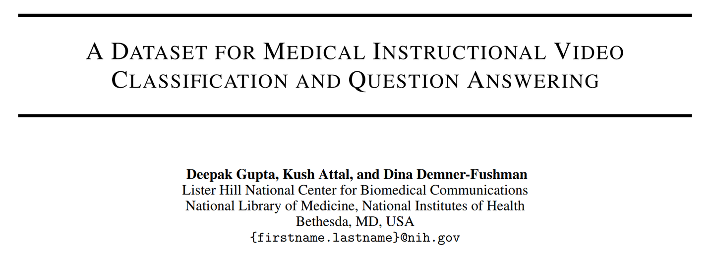
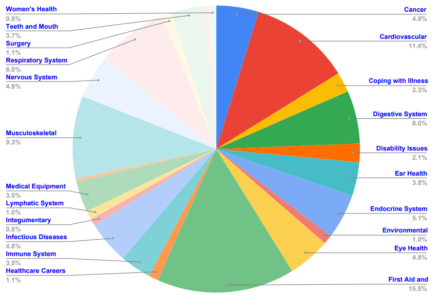
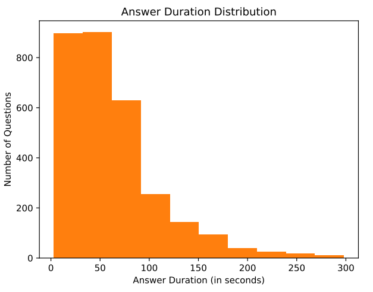
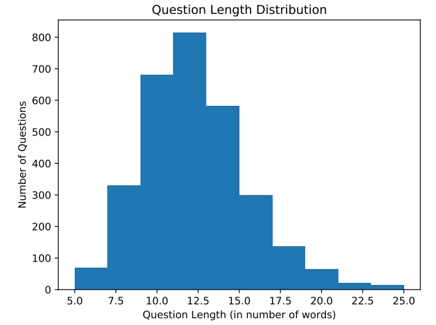
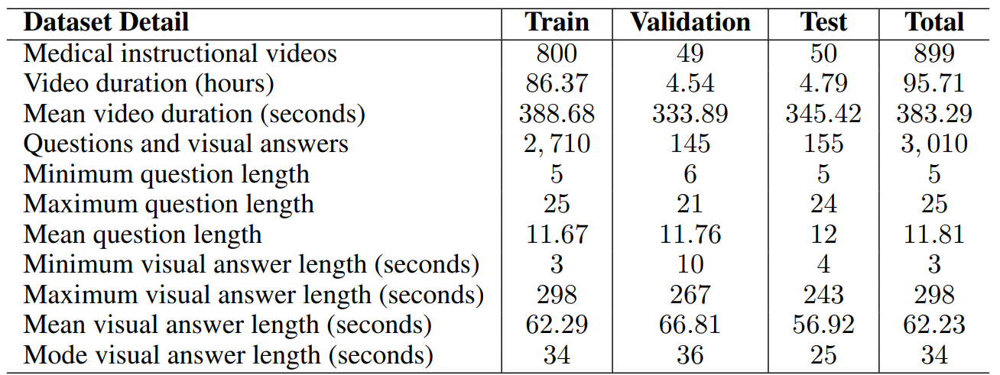
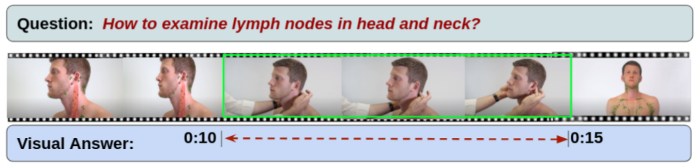

# MedVidQA

<div align="center">
    <a href="https://github.com/openmedlab/"></a>
</div>
<p style="text-align:center;font-size:10px;"><em>MedVidQA medical instructional videos and question answering.</em></p>

## Dataset Information

MedVidQA is a question answering dataset built from 899 medical instructional videos on YouTube, totaling 95.71 hours. It contains 3,010 questions annotated by medical informatics experts. An answer is a temporal segment in the associated video that visually demonstrates the requested procedure or information.

Videos are divided into 800 training videos, 49 validation videos, and 50 test videos. The dataset supports grounding textual medical questions in video content and developing systems that locate relevant visual answers in instructional videos.

## Dataset Meta Information

| Task Type                      | Language | Train      | Val       | Test      | File Format          | Size           |
|--------------------------------|----------|------------|-----------|-----------|----------------------|----------------|
| Video QA / Answer Localization | English  | 800 videos | 49 videos | 50 videos | .json, .npy features | 1.5GB features |

## Dataset Information Statistics

<div align="center">
    <a href="https://github.com/openmedlab/"></a>
</div>
<p style="text-align:center;font-size:10px;"><em>Distribution of instructional video topics.</em></p>

<div align="center">
    <a href="https://github.com/openmedlab/"></a>
</div>
<p style="text-align:center;font-size:10px;"><em>Distribution of video answer durations.</em></p>

<div align="center">
    <a href="https://github.com/openmedlab/"></a>
</div>
<p style="text-align:center;font-size:10px;"><em>Distribution of question lengths.</em></p>

| Metric                         | Train  | Val    | Test   | Total  |
|--------------------------------|--------|--------|--------|--------|
| Videos                         | 800    | 49     | 50     | 899    |
| Duration (hours)               | 86.37  | 4.54   | 4.79   | 95.71  |
| Questions                      | 2,710  | 145    | 155    | 3,010  |
| Mean video duration (seconds)  | 388.68 | 333.89 | 345.42 | 383.29 |
| Mean question length           | 11.67  | 11.76  | 12.00  | 11.81  |
| Mean answer duration (seconds) | 62.29  | 66.81  | 56.92  | 62.23  |

<div align="center">
    <a href="https://github.com/openmedlab/"></a>
</div>
<p style="text-align:center;font-size:10px;"><em>Detailed video, question, and answer statistics by split.</em></p>

## Dataset Example

Questions are supplied as text, while start and end timestamps identify the visual answer within a video.

<div align="center">
    <a href="https://github.com/openmedlab/"></a>
</div>
<p style="text-align:center;font-size:10px;"><em>Examples of medical questions and their corresponding video answer segments.</em></p>

## File Structure

Question-answer annotations and video features are downloaded separately. The `.npy` files contain extracted I3D features rather than raw video files.

``` 
MedVidQA
├── README.md
├── test.json
├── train.json
└── val.json
```

``` 
MedVidQA
└── I3D
    ├── 1NofulQIHs.npy
    ├── 6csJAWj_s.npy
    ├── 6VfQX5i4M8.npy
    └── ...
```

## Authors and Institutions

Deepak Gupta, Kush Attal, and Dina Demner-Fushman (Lister Hill National Center for Biomedical Communications, National Library of Medicine, National Institutes of Health, Bethesda, USA)

## Source Information

Official Website: https://github.com/deepaknlp/MedVidQACL

Download Link: https://github.com/deepaknlp/MedVidQACL/tree/master/MedVidQA

Article Address: https://arxiv.org/abs/2201.12888

Publication Date: 2022-01

## Citation

``` 
@article{gupta2023dataset,
  title={A dataset for medical instructional video classification and question answering},
  author={Gupta, Deepak and Attal, Kush and Demner-Fushman, Dina},
  journal={Scientific Data},
  volume={10},
  number={1},
  pages={158},
  year={2023},
  publisher={Nature Publishing Group UK London}
}
```

Original introduction article is [here](https://zhuanlan.zhihu.com/p/696749536).
