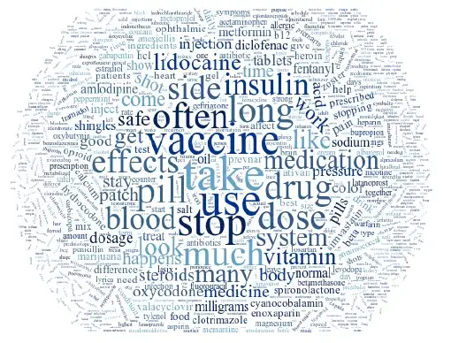
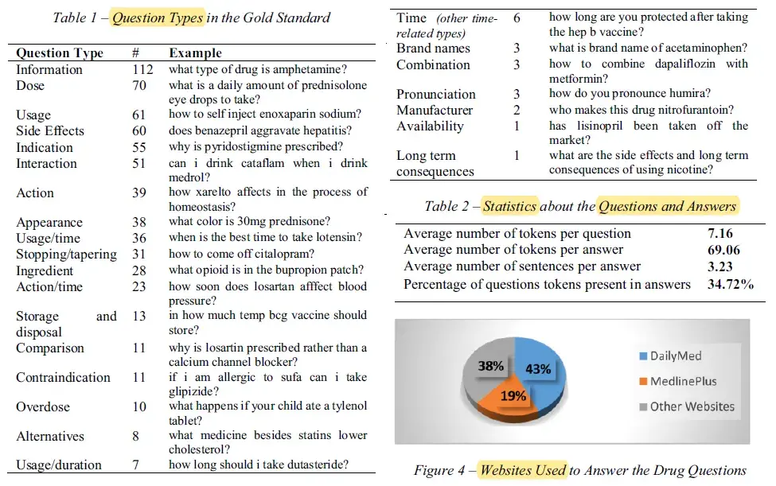
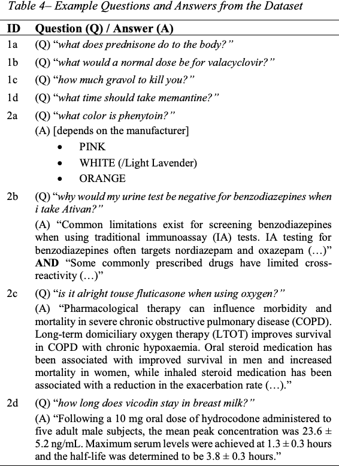

# MedicationQA

<div align="center">
    <a href="https://github.com/openmedlab/"></a>
</div>
<p style="text-align:center;font-size:10px;"><em></em></p>

## Dataset Information

MedicationQA is an English consumer medication question-answering corpus created at the Lister Hill National Center for Biomedical Communications, U.S. National Library of Medicine. Its original gold standard contains 674 question-answer pairs. Questions were drawn from consumer submissions to MedlinePlus, filtered for medication mentions with MetaMapLite, and selected by trained annotators.

Annotations identify the medication focus, question type, answer, source URL, and source section title. The corpus covers 25 question types, including dosage, use, interactions, and side effects. Four annotators prepared the records, followed by review from a physician and a question-answering expert. Answers were selected from sources such as MedlinePlus and DailyMed. The figures and counts describe the original gold-standard corpus; the linked Hugging Face packaging reports 690 rows and should be treated as a separate distribution.

## Dataset Meta Information

| Task Type | Language | Train                        | Val | Test | File Format | Size                    |
|-----------|----------|------------------------------|-----|------|-------------|-------------------------|
| QA        | English  | 674 (original gold standard) | -   | -    | .csv        | 215KB (source-reported) |

## Dataset Information Statistics

The original corpus has 25 question types. Questions average seven tokens; answers average 69 tokens and three sentences. The source figures summarize question types, answer sources, and text-length statistics.

<div align="center">
    <a href="https://github.com/openmedlab/"></a>
</div>
<p style="text-align:center;font-size:10px;"><em>Question types, answer sources, and question/answer statistics.</em></p>

## Dataset Example

Records contain Question, Focus (Drug), Question Type, Answer, Section Title, and URL. These fields retain the answer provenance alongside the consumer question.

<div align="center">
    <a href="https://github.com/openmedlab/"></a>
</div>
<p style="text-align:center;font-size:10px;"><em>Question-answer examples from the original paper.</em></p>

## File Structure

```
datasets--truehealth--medicationqa
|
|
+-- snapshots
| |
| +-- f8ae96155ac234a64aaf2b70
| |
| +-- data
| | |
| | +-- .gitattributes
| | +-- MedInfo2019-QA-Medications (1).csv
| | +-- README.md
|
+-- blobs
|
+-- refs
```

## Authors and Institutions

Asma Ben Abacha (Lister Hill National Center for Biomedical Communications, U.S. National Library of Medicine)

Yassine Mrabet (Lister Hill National Center for Biomedical Communications, U.S. National Library of Medicine)

Mark Sharp (Lister Hill National Center for Biomedical Communications, U.S. National Library of Medicine)

Travis R. Goodwin (Lister Hill National Center for Biomedical Communications, U.S. National Library of Medicine)

Sonya E. Shooshan (Lister Hill National Center for Biomedical Communications, U.S. National Library of Medicine)

Dina Demner-Fushman (Lister Hill National Center for Biomedical Communications, U.S. National Library of Medicine)

## Source Information

Official Website: https://huggingface.co/datasets/truehealth/medicationqa

Download Link: https://huggingface.co/datasets/truehealth/medicationqa

Article Address: https://lhncbc.nlm.nih.gov/LHC-publications/PDF/pub9965.pdf

Publication Date: 2019-08

## Citation

```
@inproceedings{BenAbacha:MEDINFO19,
	   author    = {Asma {Ben Abacha} and Yassine Mrabet and Mark Sharp and
   Travis Goodwin and Sonya E. Shooshan and Dina Demner{-}Fushman},    
	   title     = {Bridging the Gap between Consumers’ Medication Questions and Trusted Answers}, 
	   booktitle = {MEDINFO 2019},   
	   year      = {2019},}
```

Original introduction article is [here](https://zhuanlan.zhihu.com/p/699199585).
