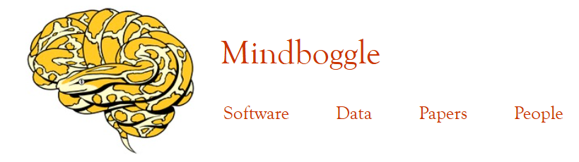
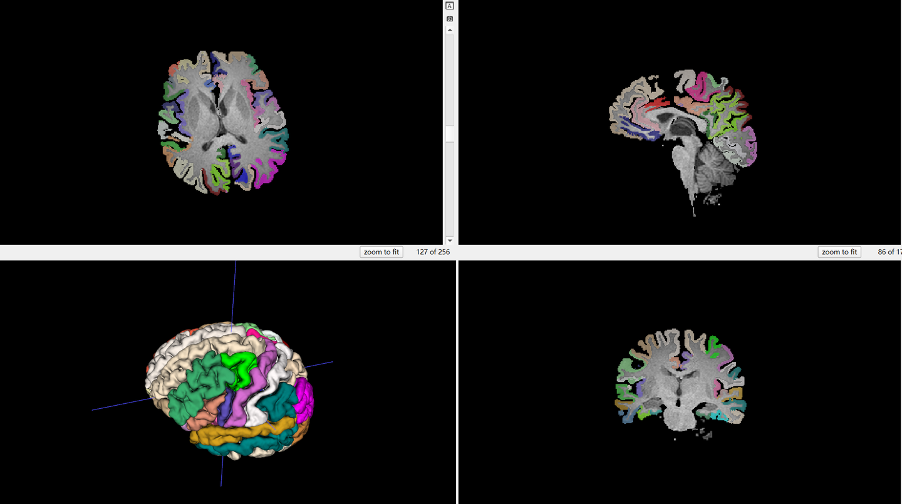

# Mindboggle

<div align="center">
    <a href="https://github.com/openmedlab/"></a>
</div>
<p style="text-align:center;font-size:10px;"><em></em></p>

## Dataset Information

Mindboggle-101 contains manually annotated brain surface and volume data derived from MRI scans of 101 healthy individuals. Cortical labels are manually edited according to the Desikan–Killiany–Tourville (DKT) protocol, which uses sulci and other anatomical landmarks to improve consistency. The collection also includes templates assembled from individual images and anatomical atlases for registration and labeling.

The dataset provides a benchmark for developing and validating brain image processing methods, including structural morphometry, cortical thickness measurement, and sulcal shape analysis. Volume and surface resources are available in formats including NIfTI and VTK.

## Dataset Meta Information

| Dimensions | Modality | Task Type    | Anatomical Structures | Anatomical Area | Number of Categories | Data Volume | File Format |
|------------|----------|--------------|-----------------------|-----------------|----------------------|-------------|-------------|
| 3D         | MR       | Segmentation | Brain structures      | Brain           | 62                   | 101         | .nii.gz     |

### Resolution Details

|        | spacing (mm)     | size        |
|--------|------------------|-------------|
| min    | (1.0, 1.0, 1.0)  | 170x217x160 |
| median | (1.0, 1.0, 1.0)  | 192x256x256 |
| max    | (1.20, 1.0, 1.0) | 256x256x256 |

Number of 2D slices: 22,829.

## Label Information Statistics

The following source-reported statistics cover the 31 left-hemisphere structures.

| Anatomical Structures           | Cases | Coverage | Min Volume (cm³) | Median Volume (cm³) | Max Volume (cm³) |
|---------------------------------|-------|----------|------------------|---------------------|------------------|
| left_caudal_anterior_cingulate  | 101   | 100.00%  | 1.13             | 3.36                | 5.77             |
| left_caudal_middle_frontal      | 101   | 100.00%  | 3.29             | 7.35                | 11.62            |
| left_cuneus                     | 101   | 100.00%  | 2.1              | 4.08                | 6.95             |
| left_entorhinal                 | 101   | 100.00%  | 0.87             | 1.63                | 2.98             |
| left_fusiform                   | 101   | 100.00%  | 5.72             | 8.53                | 14.3             |
| left_inferior_parietal          | 101   | 100.00%  | 6.69             | 12.08               | 17.91            |
| left_inferior_temporal          | 101   | 100.00%  | 7.17             | 11.56               | 18.72            |
| left_isthmus_cingulate          | 101   | 100.00%  | 1.41             | 2.36                | 3.55             |
| left_lateral_occipital          | 101   | 100.00%  | 7.48             | 11.45               | 17.28            |
| left_lateral_orbitofrontal      | 101   | 100.00%  | 5.81             | 8.5                 | 11.43            |
| left_lingual                    | 101   | 100.00%  | 3.69             | 6.34                | 9.47             |
| left_medial_orbitofrontal       | 101   | 100.00%  | 2.52             | 4.09                | 6.47             |
| left_middle_temporal            | 101   | 100.00%  | 8.35             | 14.23               | 23.3             |
| left_parahippocampal            | 101   | 100.00%  | 1.57             | 2.1                 | 2.99             |
| left_paracentral                | 101   | 100.00%  | 2.55             | 4.14                | 6.51             |
| left_pars_opercularis           | 101   | 100.00%  | 2.23             | 4.44                | 7.95             |
| left_pars_orbitalis             | 101   | 100.00%  | 0.99             | 2.24                | 4.51             |
| left_pars_triangularis          | 101   | 100.00%  | 1.75             | 4.34                | 7.97             |
| left_pericalcarine              | 101   | 100.00%  | 1.3              | 2.05                | 3.13             |
| left_postcentral                | 101   | 100.00%  | 6.4              | 10.71               | 15.82            |
| left_posterior_cingulate        | 101   | 100.00%  | 2.54             | 3.62                | 5.92             |
| left_precentral                 | 101   | 100.00%  | 7.74             | 13.2                | 18.93            |
| left_precuneus                  | 101   | 100.00%  | 6.58             | 9.61                | 12.6             |
| left_rostral_anterior_cingulate | 101   | 100.00%  | 1.41             | 3.59                | 6                |
| left_rostral_middle_frontal     | 101   | 100.00%  | 7.3              | 11.96               | 19.53            |
| left_superior_frontal           | 101   | 100.00%  | 18.1             | 24.11               | 34.48            |
| left_superior_parietal          | 101   | 100.00%  | 6.41             | 10.84               | 16.36            |
| left_superior_temporal          | 101   | 100.00%  | 10.77            | 16.56               | 23.79            |
| left_supramarginal              | 101   | 100.00%  | 6.44             | 11.05               | 17.36            |
| left_transverse_temporal        | 101   | 100.00%  | 0.61             | 1.23                | 2.26             |
| left_insula                     | 101   | 100.00%  | 4.22             | 5.93                | 7.76             |

## Visualization

<div align="center">
    <a href="https://github.com/openmedlab/"></a>
</div>
<p style="text-align:center;font-size:10px;"><em>Original brain image and cortical annotations.</em></p>

## File Structure

The source introduction shows the following file structure:

``` 
Mindboggle101_individuals/
├── OSF Storage (United States)
│   ├── FreeSurfer_output/
│   │   └── OSF Storage (United States)
│   │       ├── ...
│   │       ├── Afterthought-1.tar.gz
│   │       ├── Colin27-1.tar.gz
│   │       └── ...
Mindboggle101_release3/
├── OSF Storage (United States)
│   ├── Mindboggle101_surfaces/
│   │   ├── Extra-18_surfaces.zip
│   │   ├── MMRR-21_surfaces.zip
│   │   └── ...
│   ├── Mindboggle101_volumes/
│   │   ├── Extra-18_volumes.tar.gz
│   │   ├── ...
source_data/
├── OSF Storage (United States)
│   ├── HLN-12/
│   │   ├── OSF Storage (United States)
│   │       ├── HLN-12_T1s/
│   │       │   ├── ...
│   │       │   ├── Ding_1009_3_1.nii.gz
│   │       │   └── ...
```

## Authors and Institutions

Arno Klein (Child Mind Institute, New York, USA)

Satrajit S. Ghosh (McGovern Institute for Brain Research, Massachusetts Institute of Technology, Cambridge, USA)

Forrest S. Bao (Department of Electrical and Computer Engineering, University of Akron, USA)

Joachim Giard (University of Louvain, Belgium)

Yrjö Häme, Eliezer Stavsky, and Noah Lee (Columbia University, New York, USA)

Brian Rossa (TankThink Labs, Boston, USA)

Martin Reuter (Harvard Medical School, Cambridge, USA)

Elias Chaibub Neto (Sage Bionetworks, Seattle, USA)

Anisha Keshavan (University of California, San Francisco, USA)

## Source Information

Official Website: https://mindboggle.info/data.html

Download Link: https://mindboggle.info/data.html

Article Address: https://journals.plos.org/ploscompbiol/article?id=10.1371/journal.pcbi.1005350

Publication Date: 2016-07

## Citation

``` 
@article{klein2017mindboggling,
  title={Mindboggling morphometry of human brains},
  author={Klein, Arno and Ghosh, Satrajit S and Bao, Forrest S and Giard, Joachim and H{\"a}me, Yrj{\"o} and Stavsky, Eliezer and Lee, Noah and Rossa, Brian and Reuter, Martin and Chaibub Neto, Elias and others},
  journal={PLoS computational biology},
  volume={13},
  number={2},
  pages={e1005350},
  year={2017},
  publisher={Public Library of Science San Francisco, CA USA}
}
```

Original introduction article is [here](https://zhuanlan.zhihu.com/p/19615554335).
