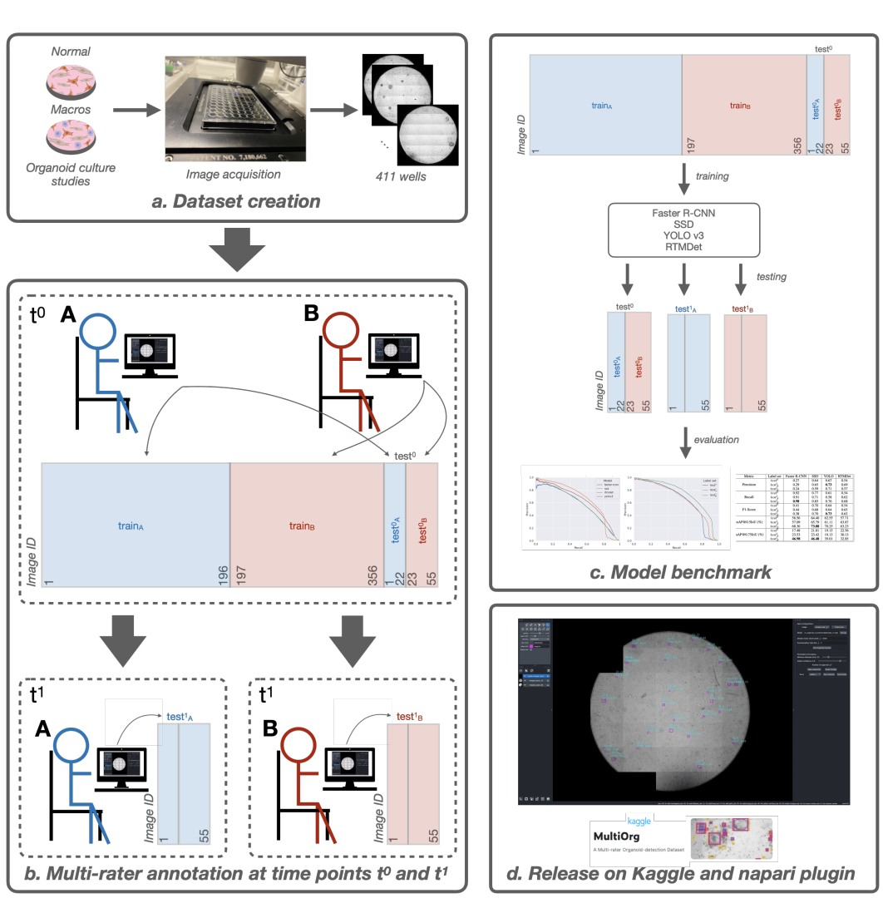
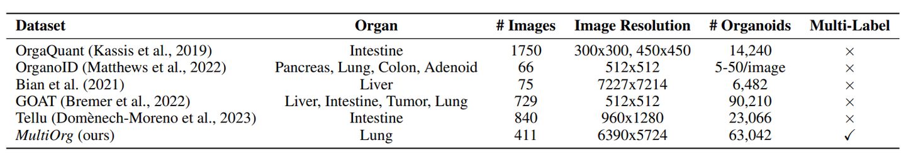
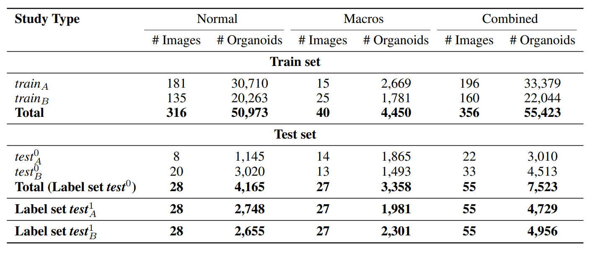
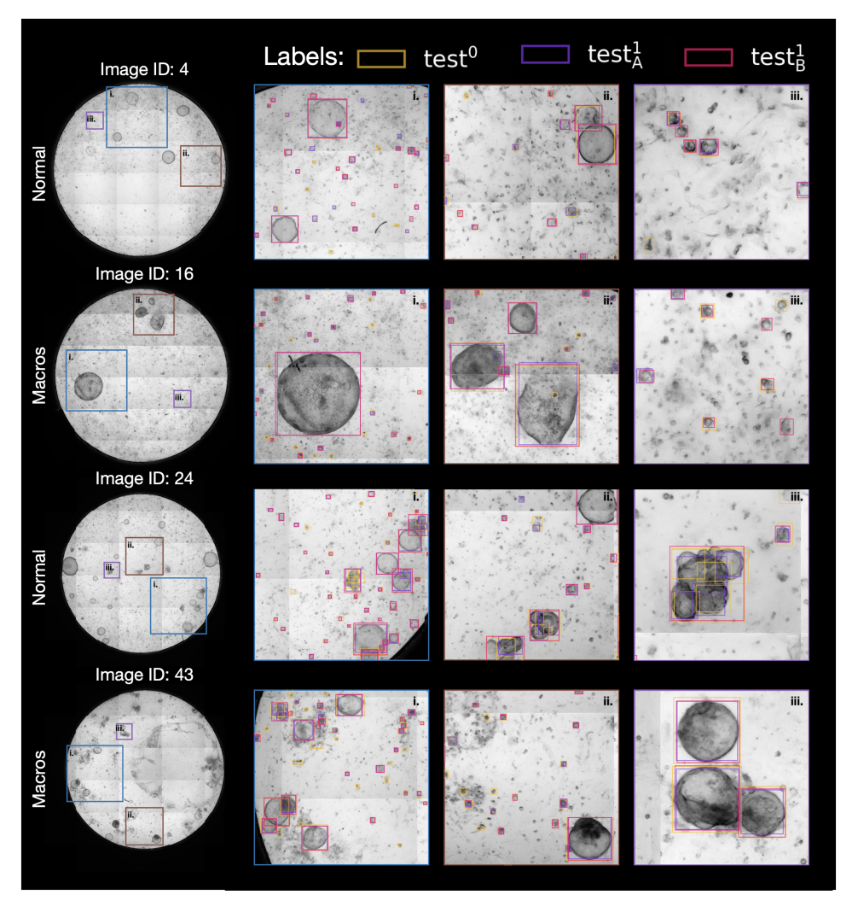

# MultiOrg

<div align="center">
    <a href="https://github.com/openmedlab/"></a>
</div>
<p style="text-align:center;font-size:10px;"><em></em></p>

## Dataset Information

MultiOrg is a lung organoid detection dataset developed at Helmholtz Munich. It contains 411 fully annotated high-resolution bright-field microscopy images, with more than 60,000 organoid annotations from 26 studies. The split comprises 356 training images and 55 test images across Normal and Macros experimental conditions.

The same test images have three independently produced annotation sets, obtained from two experts at two time points. These support evaluation of annotation variability as well as organoid detection. The accompanying work provides detection baselines and a napari plugin for interactive organoid counting and analysis.

## Dataset Meta Information

| Dimensions | Modality                | Task Type        | Anatomical Structures | Anatomical Area   | Number of Categories | Data Volume                              | File Format  |
|------------|-------------------------|------------------|-----------------------|-------------------|----------------------|------------------------------------------|--------------|
| 2D         | Bright-field Microscopy | Object Detection | Lung organoids        | Cell/tissue level | 1                    | 411 images; more than 60,000 annotations | .tiff; .json |

### Resolution Details

| Dataset Statistics | Pixel Size    | size        |
|--------------------|---------------|-------------|
| min                | 1.29 µm/pixel | 5719 × 5551 |
| max                | 1.29 µm/pixel | 6240 × 6940 |

## Label Information Statistics

<div align="center">
    <a href="https://github.com/openmedlab/"></a>
</div>
<p style="text-align:center;font-size:10px;"><em>Dataset creation, annotation, evaluation, and publication workflow.</em></p>

| Split    | Images | Annotation Sets                          |
|----------|--------|------------------------------------------|
| Training | 356    | Training annotations                     |
| Test     | 55     | test⁰, testᴬ¹, testᴮ¹ on the same images |

<div align="center">
    <a href="https://github.com/openmedlab/"></a>
</div>
<p style="text-align:center;font-size:10px;"><em>Comparison with other organoid datasets.</em></p>

<div align="center">
    <a href="https://github.com/openmedlab/"></a>
</div>
<p style="text-align:center;font-size:10px;"><em>Statistics for the training annotations and the three test annotation sets.</em></p>

## Visualization

<div align="center">
    <a href="https://github.com/openmedlab/"></a>
</div>
<p style="text-align:center;font-size:10px;"><em>Normal and Macros images with annotations from different raters and time points.</em></p>

## File Structure

```
MultiOrg/
├── test/
│   ├── Macros/
│   │   ├── Plate_15/
│   │   │   ├── image_0/
│   │   │   │   ├── image_0.tiff
│   │   │   │   └── image_0_t0_B.json
│   │   │   ├── image_1/
│   │   │   ├── image_2/
│   │   │   ├── image_3/
│   │   │   ├── image_4/
│   │   │   ├── image_5/
│   │   │   └── image_6/
│   │   └── Plate_23/
│   │   └── Plate_4/
│   │   │ .......
│   └── Normal/
│       ├── Plate_15/
│       ├── Plate_31/
│       ├── Plate_37/
│       └── Plate_4/
│       │ ......
├── train/
│   ├── Macros/
│   └── Normal/
├── croissant_mutliorg_metadata/
└── dataset-metadata.json
```

## Authors and Institutions

Christina Bukas (AI Department, Computational Health Center, Helmholtz Munich)

Harshavardhan Subramanian (AI Department, Computational Health Center, Helmholtz Munich)

Fenja See (Institute of Lung Health and Immunity, Comprehensive Pneumology Center, Helmholtz Munich; German Center for Lung Research)

Carina Steinchen (Institute of Lung Health and Immunity, Comprehensive Pneumology Center, Helmholtz Munich; German Center for Lung Research)

Ivan Ezhov (Department of Computer Science, School of Computation, Information and Technology, Technical University of Munich)

Gowtham Boosarpu (Institute of Lung Research, Philipps University Marburg; University Lung Center Giessen and Marburg; German Center for Lung Research)

Sara Asgharpour (Institute of Lung Health and Immunity, Comprehensive Pneumology Center, Helmholtz Munich; German Center for Lung Research)

Gerald Burgstaller (Institute of Lung Health and Immunity, Comprehensive Pneumology Center, Helmholtz Munich; German Center for Lung Research)

Mareike Lehmann (Institute of Lung Health and Immunity, Comprehensive Pneumology Center, Helmholtz Munich; German Center for Lung Research; Institute of Lung Research, Philipps University Marburg; University Lung Center Giessen and Marburg; German Center for Lung Research)

Florian Kofler (AI Department, Computational Health Center, Helmholtz Munich; Department of Neuroradiology, Technical University of Munich; Department of Quantitative Biomedicine, University of Zurich)

Marie Piraud (AI Department, Computational Health Center, Helmholtz Munich)

## Source Information

Official Website: https://www.kaggle.com/datasets/christinabukas/mutliorg

Download Link: https://www.kaggle.com/datasets/christinabukas/mutliorg

Article Address: https://arxiv.org/pdf/2410.14612

Publication Date: 2024-10

## Citation

```
@article{bukas2024multiorg,
  title={MultiOrg: A Multi-rater Organoid-detection Dataset},
  author={Bukas, Christina and Subramanian, Harshavardhan and See, Fenja and Steinchen, Carina and Ezhov, Ivan and Boosarpu, Gowtham and Asgharpour, Sara and Burgstaller, Gerald and Lehmann, Mareike and Kofler, Florian and others},
  journal={arXiv preprint arXiv:2410.14612},
  year={2024}
}
```

Original introduction article is [here](https://zhuanlan.zhihu.com/p/16154243373).
