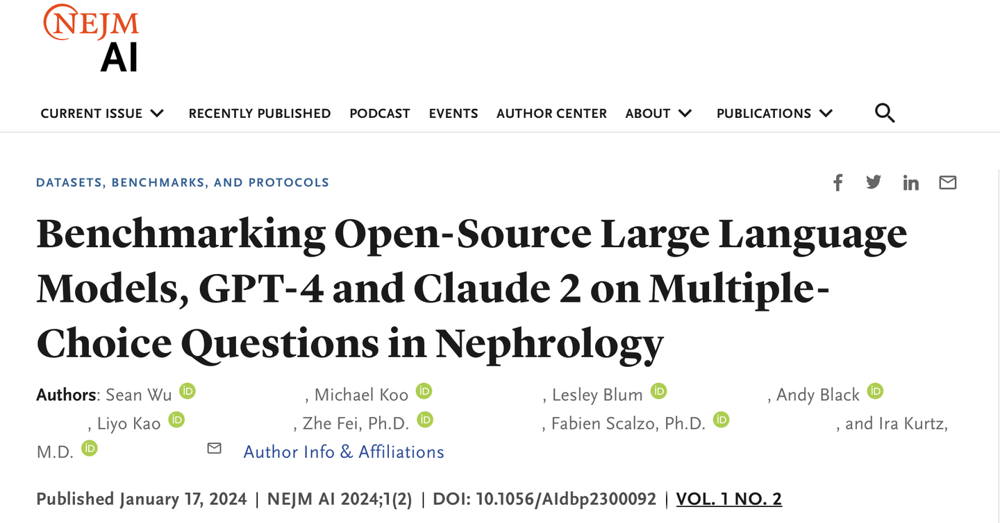
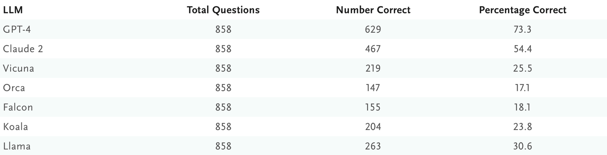

# NEJM-AI Benchmarking

<div align="center">
    <a href="https://github.com/openmedlab/"></a>
</div>
<p style="text-align:center;font-size:10px;"><em></em></p>

## Dataset Information

NEJM-AI Benchmarking is an English nephrology multiple-choice evaluation collection covering questions from January 2016 through April 2023. The paper reports 858 questions; the introduction reports 857 questions in the files it downloaded. The dataset assesses language models on a medical subspecialty, with both question/options and ground-truth answer files.

The distinction between the paper count and the downloaded-file count is retained below. Subject and option-count statistics refer to the 857-question snapshot analyzed in the original introduction. The source figure shows the paper-era model comparison.

## Dataset Meta Information

| Task Type          | Language | Train | Val | Test                                       | File Format | Size                    |
|--------------------|----------|-------|-----|--------------------------------------------|-------------|-------------------------|
| Multiple-choice QA | English  | -     | -   | 858 in paper; 857 in source-analyzed files | .csv        | 970KB (source-reported) |

## Dataset Information Statistics

Subject labels are preserved as they appear in the source distribution, including differently worded labels for related nephrology topics. These labels are not silently combined.

| Subject                                                              | Number of Questions | Percentage |
|----------------------------------------------------------------------|---------------------|------------|
| Hypertension                                                         | 89                  | 10.39%     |
| Acute Kidney Injury & Critical Care Nephrology                       | 88                  | 10.27%     |
| Primary and Secondary Glomerular Diseases                            | 60                  | 7.00%      |
| Transplantation                                                      | 60                  | 7.00%      |
| Disorders of Divalent Ions, Renal Bone Disease and Nephrolithiasis   | 57                  | 6.65%      |
| Pregnancy and Kidney Disease                                         | 30                  | 3.50%      |
| Chronic Kidney Disease                                               | 30                  | 3.50%      |
| End-Stage Kidney Disease                                             | 30                  | 3.50%      |
| ESRD & Dialysis                                                      | 30                  | 3.50%      |
| Electrolyte Acid-Base Disorders                                      | 30                  | 3.50%      |
| Chronic Kidney Disease and Progression                               | 30                  | 3.50%      |
| Infection Control & Prevention in Outpatient Hemodialysis Facilities | 30                  | 3.50%      |
| Primary Glomerular Disease                                           | 30                  | 3.50%      |
| End Stage Renal Disease & Dialysis                                   | 30                  | 3.50%      |
| Interventional Nephrology & Dialysis Therapy                         | 30                  | 3.50%      |
| Disorder of Divalent Ions Renal Bone Disease and Nephrolithiasis     | 29                  | 3.38%      |
| Primary & Secondary Glomerular Diseases                              | 29                  | 3.38%      |
| Secondary Glomerular Disease                                         | 29                  | 3.38%      |
| Electrolytes and Acid-Base Disorders                                 | 28                  | 3.27%      |
| Disorders of Divalent Ions Renal Bone Disease & Nephrolithiasis      | 27                  | 3.15%      |
| SUBJECT NOT FOUND                                                    | 61                  | 7.12%      |
| SUM                                                                  | 857                 | 100.00%    |

| Number of Options | Number of Questions | Percentage of Questions (%) |
|-------------------|---------------------|-----------------------------|
| 3                 | 4                   | 0.47%                       |
| 4                 | 675                 | 78.76%                      |
| 5                 | 177                 | 20.65%                      |
| 9                 | 1                   | 0.12%                       |

<div align="center">
    <a href="https://github.com/openmedlab/"></a>
</div>
<p style="text-align:center;font-size:10px;"><em>Historical model evaluation from the source paper.</em></p>

## Dataset Example

NEJM_All_Questions_And_Answers.csv contains question text and answer choices. Ground_Truth_Answers.csv contains the correct choices and explanations.

## File Structure

```
NEJM-AI_Benchmarking/
├── Ground_Truth_Answers.csv
└── NEJM_All_Questions_And_Answers.csv
```

## Authors and Institutions

Sean Wu (Keck Data Science Institute, Natural Science Division, Pepperdine University)

Michael Koo (Keck Data Science Institute, Natural Science Division, Pepperdine University)

Lesley Blum (Division of Nephrology, David Geffen School of Medicine, University of California, Los Angeles)

Andy Black (Division of Nephrology, David Geffen School of Medicine, University of California, Los Angeles)

Liyo Kao (Division of Nephrology, David Geffen School of Medicine, University of California, Los Angeles)

Zhe Fei (Department of Statistics, University of California, Riverside)

Fabien Scalzo (Keck Data Science Institute, Natural Science Division, Pepperdine University)

Ira Kurtz (Division of Nephrology, David Geffen School of Medicine, University of California, Los Angeles; Brain Research Institute, University of California, Los Angeles)

## Source Information

Official Website: https://huggingface.co/datasets/SeanWu25/NEJM-AI_Benchmarking_Medical_Language_Models

Download Link: https://huggingface.co/datasets/SeanWu25/NEJM-AI_Benchmarking_Medical_Language_Models

Article Address: https://ai.nejm.org/doi/full/10.1056/AIdbp2300092

Publication Date: 2024-01

## Citation

```
@article{wu2024benchmarking,
  title={Benchmarking Open-Source Large Language Models, GPT-4 and Claude 2 on Multiple-Choice Questions in Nephrology},
  author={Wu, Sean and Koo, Michael and Blum, Lesley and Black, Andy and Kao, Liyo and Fei, Zhe and Scalzo, Fabien and Kurtz, Ira},
  journal={NEJM AI},
  volume={1},
  number={2},
  pages={AIdbp2300092},
  year={2024},
  publisher={Massachusetts Medical Society}
}
```

Original introduction article is [here](https://zhuanlan.zhihu.com/p/691251135).
