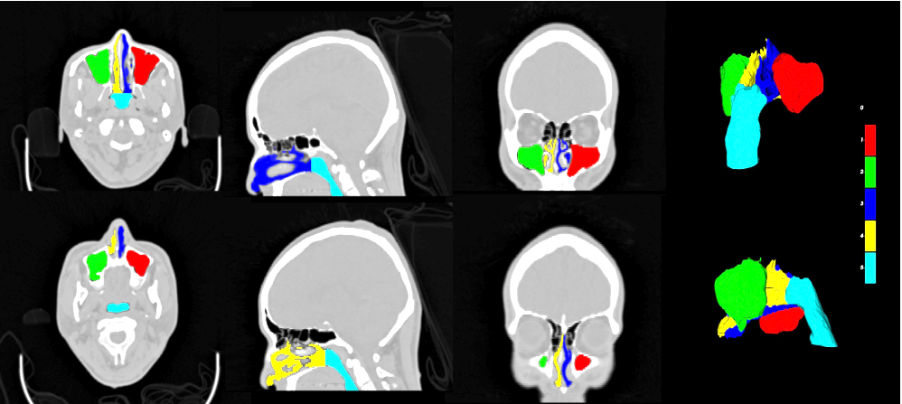
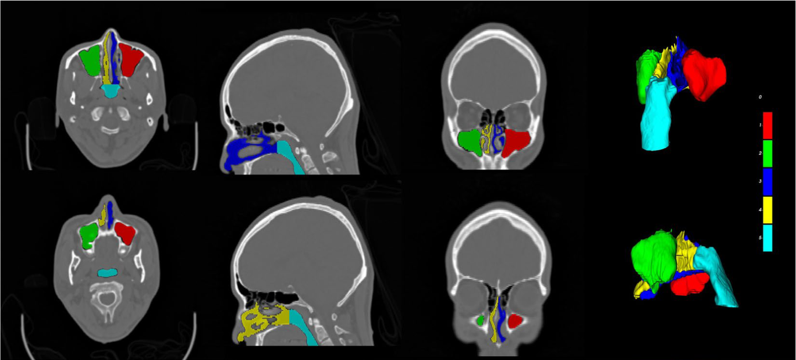

# NasalSeg

<div align="center">
    <a href="https://github.com/openmedlab/"></a>
</div>
<p style="text-align:center;font-size:10px;"><em></em></p>

## Dataset Information

NasalSeg provides 130 head CT scans from 130 patients for segmentation of the nasal cavities and paranasal sinuses. The cohort includes 74 men and 56 women aged 24–82 years, with a mean age of 54.6 ± 12.1 years. Images were acquired using a Siemens Biograph 64 scanner at the Department of Nuclear Medicine/PET Center of Huashan Hospital, Fudan University. Pixel-level annotations identify the left and right nasal cavities, nasopharynx, and left and right maxillary sinuses.

Three junior annotators with 1–5 years of experience produced the initial annotations; two senior annotators with 5–10 years of experience checked them; four radiology and otolaryngology experts with more than 20 years of experience performed the final validation. The dataset supports development and evaluation of automatic segmentation for quantitative analysis, facial surgery planning, and treatment assessment, where manual segmentation can be time-consuming and inconsistent.

## Dataset Meta Information

| Dimensions | Modality | Task Type    | Anatomical Structures | Anatomical Area | Number of Categories | Data Volume | File Format |
|------------|----------|--------------|-----------------------|-----------------|----------------------|-------------|-------------|
| 3D         | CT       | Segmentation | Nasal cavity          | Head            | 5+1                  | 130         | nrrd        |

### Resolution Details

The following dimensions reproduce the source introduction's statistics. The original paper separately reports a median acquisition shape of 148 × 512 × 512.

|        | spacing (mm)          | size           |
|--------|-----------------------|----------------|
| min    | (1.500, 0.586, 0.586) | (39, 109, 153) |
| median | (1.500, 0.586, 0.586) | (51, 152, 186) |
| max    | (1.500, 0.586, 0.586) | (59, 184, 229) |

Number of 2D slices: 6,590.

## Label Information Statistics

| Anatomical Structures | Background | Maxillary Sinus (R) | Maxillary Sinus (L) | Nasal Cavity (R) | Nasal Cavity (L) | Nasal Pharynx |
|-----------------------|------------|---------------------|---------------------|------------------|------------------|---------------|
| Cases                 | 130        | 130                 | 130                 | 130              | 130              | 130           |
| Coverage              | 100%       | 100%                | 100%                | 100%             | 100%             | 100%          |
| Min Volume (cm³)      | 450.5      | 0.6                 | 0                   | 7.3              | 6.2              | 5.7           |
| Median Volume (cm³)   | 665.7      | 12.9                | 13                  | 11               | 11               | 13.3          |
| Max Volume (cm³)      | 1023.5     | 31.4                | 39.5                | 18.3             | 23.4             | 31.8          |

## Visualization

<div align="center">
    <a href="https://github.com/openmedlab/"></a>
</div>
<p style="text-align:center;font-size:10px;"><em>Segmentation examples showing the background, right and left maxillary sinuses, right and left nasal cavities, and nasopharynx.</em></p>

## File Structure

The source introduction shows the following file structure:

``` 
NasalSeg/
├── images/
│   ├── P001_img.nrrd
│   ├── P002_img.nrrd
│   ├── P003_img.nrrd
│   └── ...  (130 .nrrd files)
│
└── labels/
    ├── P001_seg.nrrd
    ├── P002_seg.nrrd
    ├── P003_seg.nrrd
    └── ...  (130 .nrrd files)
```

## Authors and Institutions

Yichi Zhang, Tan Pan, Yuan Qi, and Yuan Cheng (Artificial Intelligence Innovation and Incubation Institute, Fudan University)

Yichi Zhang, Tan Pan, Xin Guo, Chen Jiang, Yuan Qi, and Yuan Cheng (Shanghai Academy of Artificial Intelligence for Science)

Jing Wang, Quanling Jiang, Jingjie Ge, Mei Tian, and Chuantao Zuo (Department of Nuclear Medicine/PET Center, Huashan Hospital, Fudan University)

Jing Wang, Mei Tian, and Chuantao Zuo (Human Phenome Institute, Fudan University)

Jie Lu (Department of Radiology and Nuclear Medicine, Xuanwu Hospital, Capital Medical University; Beijing Key Laboratory of Magnetic Resonance Imaging and Brain Informatics; Key Laboratory of Neurodegenerative Diseases, Ministry of Education)

Jianning Zhang (Department of Otolaryngology, Yueyang Hospital of Integrative Chinese & Western Medicine, Shanghai University of Traditional Chinese Medicine)

Xueling Liu (Department of Radiology, Huashan Hospital, Fudan University)

## Source Information

Official Website: https://github.com/YichiZhang98/NasalSeg

Download Link: https://zenodo.org/records/13893419

Article Address: https://www.nature.com/articles/s41597-024-04176-1

Publication Date: 2024-12

## Citation

``` 
@article{zhang2024nasalseg,
  title={NasalSeg: A Dataset for Automatic Segmentation of Nasal Cavity and Paranasal Sinuses from 3D CT Images},
  author={Zhang, Yichi and Wang, Jing and Pan, Tan and Jiang, Quanling and Ge, Jingjie and Guo, Xin and Jiang, Chen and Lu, Jie and Zhang, Jianning and Liu, Xueling and others},
  journal={Scientific Data},
  volume={11},
  number={1},
  pages={1329},
  year={2024},
  doi={10.1038/s41597-024-04176-1},
  publisher={Nature Publishing Group}
}
```

Original introduction article is [here](https://zhuanlan.zhihu.com/p/11553832332).
