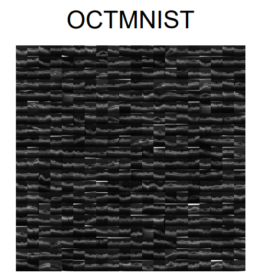
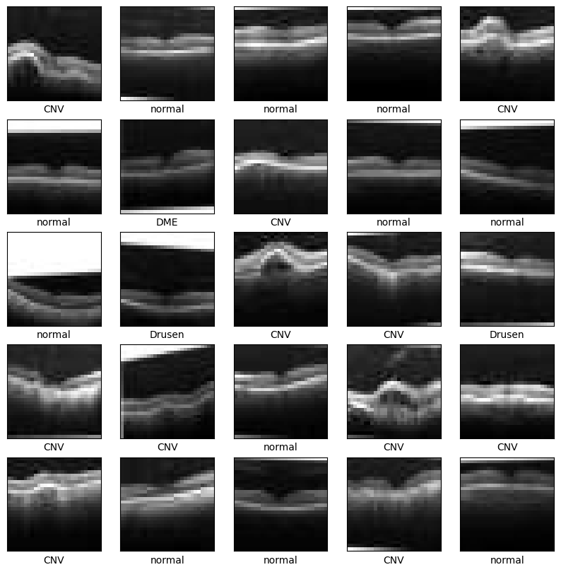

# OCTMNIST

<div align="center">
    <a href="https://github.com/openmedlab/"></a>
</div>
<p style="text-align:center;font-size:10px;"><em></em></p>

## Dataset Information

OCTMNIST is a four-class retinal image classification dataset derived from more than 100,000 optical coherence tomography (OCT) images. Its labels distinguish choroidal neovascularization (CNV, label 0), diabetic macular edema (DME, label 1), drusen (label 2), and normal retina (label 3). The version described here contains 109,309 images resized to 28 × 28 pixels.

CNV involves abnormal vessels growing from the choroid through breaks in Bruch's membrane into the subretinal pigment epithelium or subretinal space and is associated with vision loss. DME is a diabetes complication involving fluid accumulation in the macula, which can affect the fovea and central vision. Vision loss can develop over several months and make it difficult to focus clearly. Drusen are yellow deposits of lipids and proteins beneath the retina. Many people with drusen have no symptoms, and a few small drusen do not necessarily indicate eye disease; numerous large drusen can be an early sign of dry age-related macular degeneration.

## Dataset Meta Information

| Dimensions | Modality | Task Type      | Anatomical Structures | Anatomical Area | Number of Categories | Data Volume | File Format |
|------------|----------|----------------|-----------------------|-----------------|----------------------|-------------|-------------|
| 2D         | OCT      | Classification | Retina                | Eye             | 4                    | 109309      | png         |

### Resolution Details

|     | size     |
|-----|----------|
| max | (28, 28) |
| min | (28, 28) |

## Label Information Statistics

| Label    | Count |
|----------|-------|
| 0：CNV    | 35971 |
| 1：DME    | 11598 |
| 2：Drusen | 8866  |
| 3：normal | 52874 |

## Visualization

<div align="center">
    <a href="https://github.com/openmedlab/"></a>
</div>
<p style="text-align:center;font-size:10px;"><em>Examples from the OCTMNIST dataset.</em></p>

## File Structure

The official MedMNIST distribution provides NPZ arrays with training, validation, and test images and labels. The PNG layout below is the processed version shown in the source introduction.

The source introduction shows the following processed PNG layout:

``` 
OCTMNIST
├── images
│   │   ├── train
│   │   │  ├── XXX.png
│   │   │  ├── XXX.png
│   │   │  ├── ...
│   │   ├── val
│   │   │  ├── XXX.png
│   │   │  ├── XXX.png
│   │   │  ├── ...
│   │   ├── test
│   │   │   ├── XXX.png
│   │   │   ├── XXX.png
│   │   │   ├── ...
│   └── train.txt
│   └── val.txt
│   └── test.txt
```

## Authors and Institutions

Jiancheng Yang (Shanghai Jiao Tong University)

Rui Shi (Shanghai Jiao Tong University)

Bingbing Ni (Shanghai Jiao Tong University)

## Source Information

Official Website: https://github.com/MedMNIST/MedMNIST/tree/main

Download Link: https://doi.org/10.5281/zenodo.10519652

Article Address: https://arxiv.org/abs/2010.14925

Publication Date: 2021

## Citation

``` 
@inproceedings{medmnistv1,
    title={MedMNIST Classification Decathlon: A Lightweight AutoML Benchmark for Medical Image Analysis},
    author={Yang, Jiancheng and Shi, Rui and Ni, Bingbing},
    booktitle={IEEE 18th International Symposium on Biomedical Imaging (ISBI)},
    pages={191--195},
    year={2021}
}
```

Original introduction article is [here](https://zhuanlan.zhihu.com/p/14281434393).
