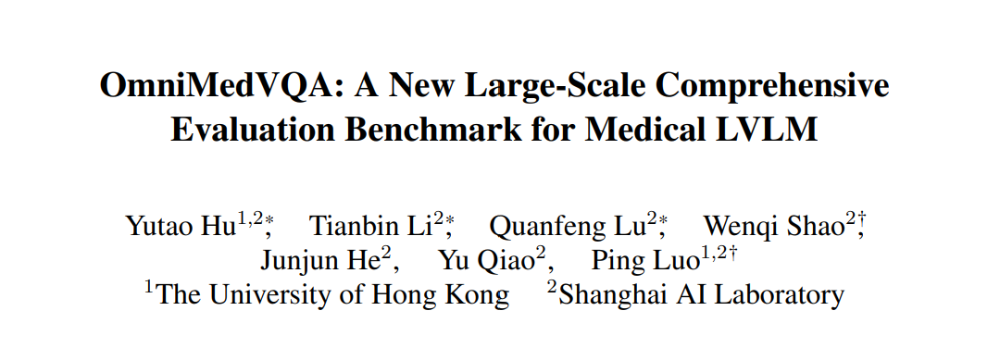
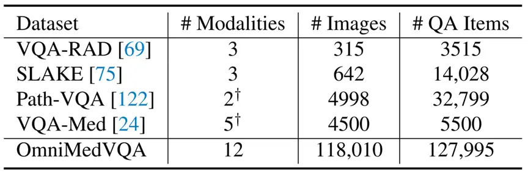
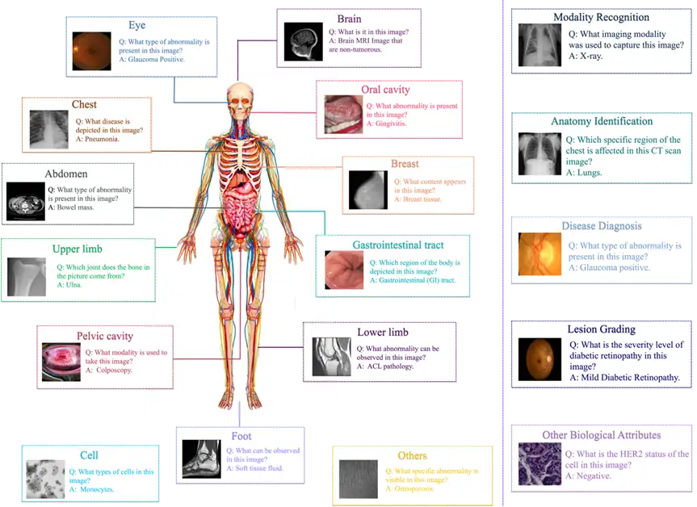
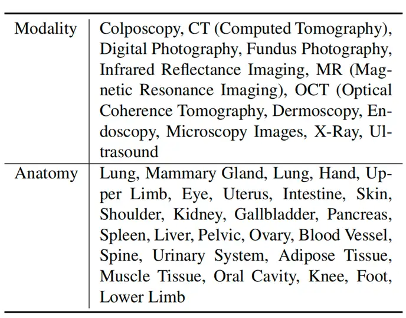
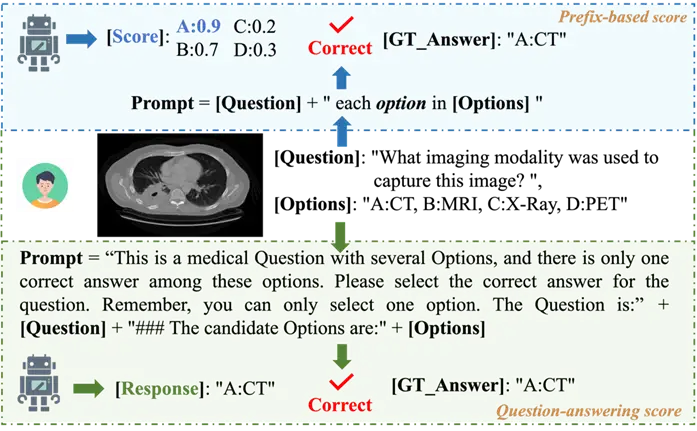
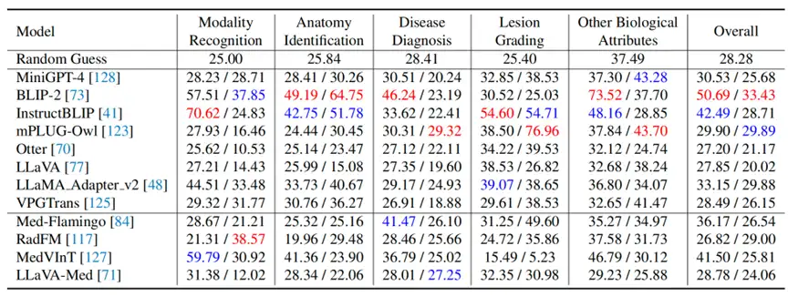
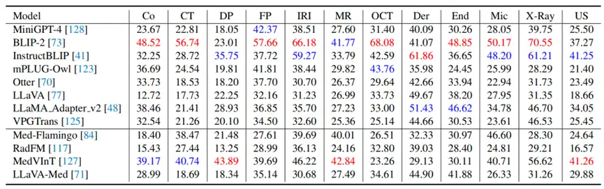

# OmniMedVQA

<div align="center">
    <a href="https://github.com/openmedlab/"></a>
</div>
<p style="text-align:center;font-size:10px;"><em>OmniMedVQA benchmark paper.</em></p>

## Dataset Information

OmniMedVQA is a medical visual question answering benchmark assembled from 73 classification datasets. It contains 118,010 images and 127,995 evaluation items spanning 12 imaging modalities and more than 20 anatomical regions. The benchmark tests the medical image understanding of large vision-language models.

Classification labels and additional dataset attributes are converted into question-answer templates. Sampling limits domination by large source datasets. A language model paraphrases questions and produces distractors to form multiple-choice items. Questions assess modality recognition, anatomy identification, disease diagnosis, lesion grading, and other biological attributes.

<div align="center">
    <a href="https://github.com/openmedlab/"></a>
</div>
<p style="text-align:center;font-size:10px;"><em>Comparison of OmniMedVQA with earlier medical VQA benchmarks.</em></p>

## Dataset Meta Information

| Task Type | Language | Images  | Evaluation Items | Modalities | Source Datasets |
|-----------|----------|---------|------------------|------------|-----------------|
| VQA       | English  | 118,010 | 127,995          | 12         | 73              |

## Dataset Information Statistics

| Question Type               | Images  | Question-answer Items |
|-----------------------------|---------|-----------------------|
| Modality Recognition        | 19,381  | 19,427                |
| Anatomy Identification      | 19,992  | 20,330                |
| Disease Diagnosis           | 73,099  | 73,455                |
| Lesion Grading              | 2,621   | 2,621                 |
| Other Biological Attributes | 12,156  | 12,162                |
| Total                       | 118,010 | 127,995               |

The per-type image counts and total are reproduced from the source table. The per-type counts sum to 127,249 rather than the reported total of 118,010, so they should not be treated as a partition of the overall image count.

<div align="center">
    <a href="https://github.com/openmedlab/"></a>
</div>
<p style="text-align:center;font-size:10px;"><em>Dataset overview and examples of the five question types.</em></p>

<div align="center">
    <a href="https://github.com/openmedlab/"></a>
</div>
<p style="text-align:center;font-size:10px;"><em>Imaging modalities and anatomical regions represented in OmniMedVQA.</em></p>

## Dataset Example

Evaluation uses two measures. The Question-answering Score checks the model's answer to an image and a multiple-choice question. The Prefix-based Score compares candidate answer continuations using the model's likelihoods.

<div align="center">
    <a href="https://github.com/openmedlab/"></a>
</div>
<p style="text-align:center;font-size:10px;"><em>Question-answering and prefix-based evaluation procedures.</em></p>

The original experiments evaluated eight general-purpose and four medical vision-language models. Their results are reported below by question type and modality. In the question-type table, the two values separated by a slash represent the Question-answering Score and Prefix-based Score. The modality table shows Question-answering Scores. These are the paper's original experiments.

<div align="center">
    <a href="https://github.com/openmedlab/"></a>
</div>
<p style="text-align:center;font-size:10px;"><em>Original evaluation results across five question types.</em></p>

<div align="center">
    <a href="https://github.com/openmedlab/"></a>
</div>
<p style="text-align:center;font-size:10px;"><em>Original Question-answering Scores across twelve imaging modalities.</em></p>

## File Structure

The release combines question-answer annotations with images from source datasets that permit redistribution. The paper identifies 42 openly accessible sources and 31 restricted sources. For restricted sources, users obtain the original images separately and associate them with the supplied evaluation items using the project instructions. The introduction does not provide a complete download directory tree.

## Authors and Institutions

Yutao Hu and Ping Luo (The University of Hong Kong and Shanghai AI Laboratory, China)

Tianbin Li, Quanfeng Lu, Wenqi Shao, Junjun He, and Yu Qiao (Shanghai AI Laboratory, China)

## Source Information

Official Website: https://github.com/OpenGVLab/Multi-Modality-Arena

Download Link: https://openxlab.org.cn/datasets/GMAI/OmniMedVQA

Article Address: https://arxiv.org/abs/2402.09181

Publication Date: 2024-02

## Citation

``` 
@article{hu2024omnimedvqa,
  title={OmniMedVQA: A New Large-Scale Comprehensive Evaluation Benchmark for Medical LVLM},
  author={Hu, Yutao and Li, Tianbin and Lu, Quanfeng and Shao, Wenqi and He, Junjun and Qiao, Yu and Luo, Ping},
  journal={arXiv preprint arXiv:2402.09181},
  year={2024}
}
```

Original introduction article is [here](https://zhuanlan.zhihu.com/p/696706317).
