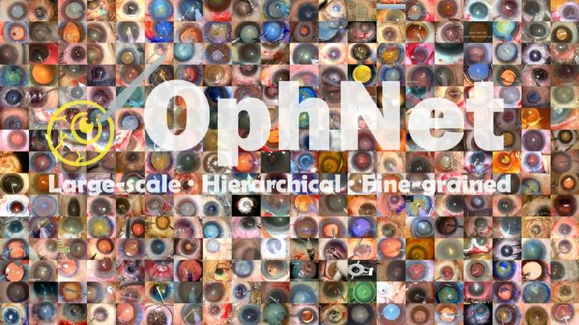
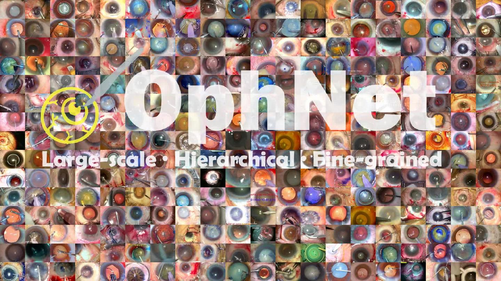
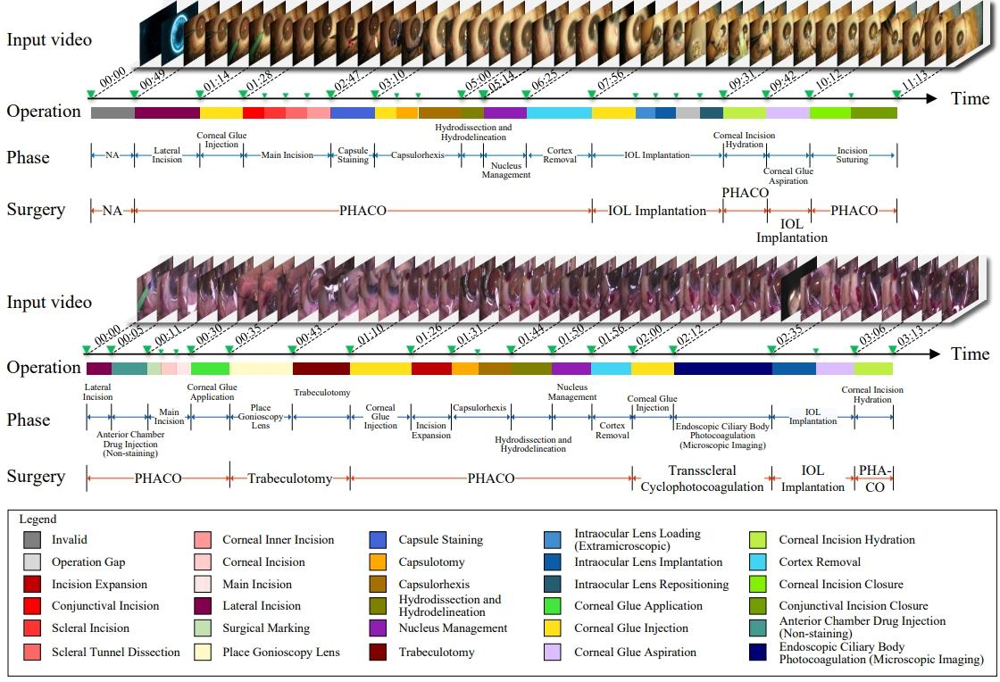
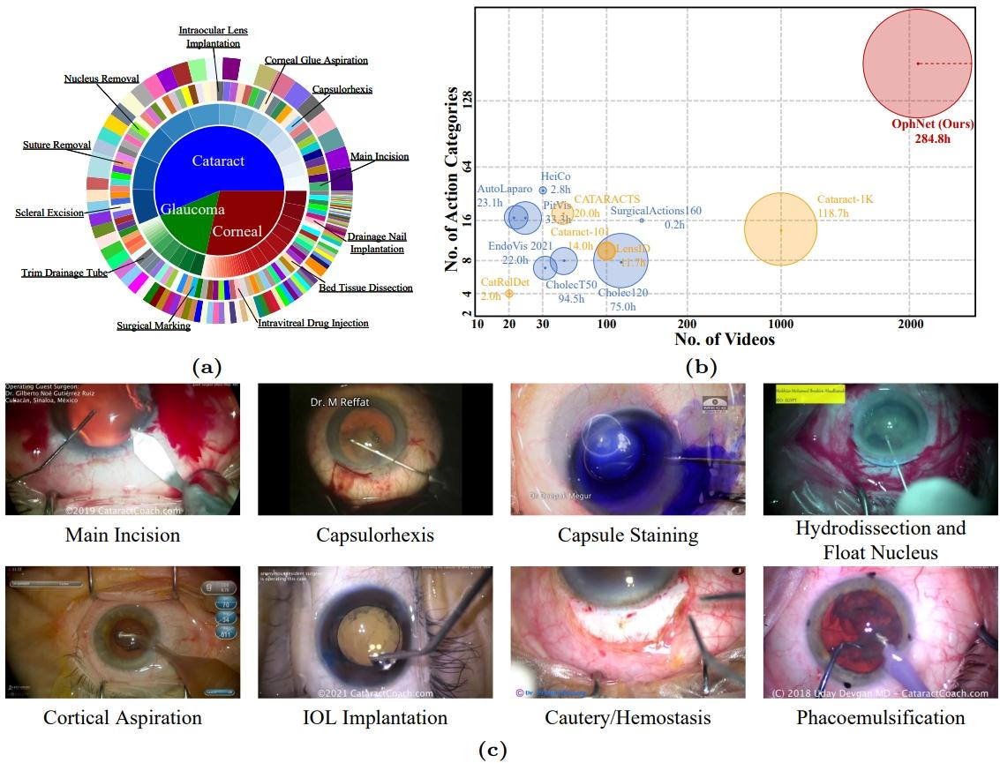
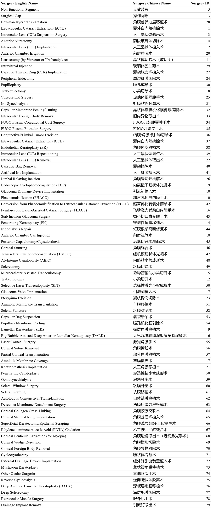
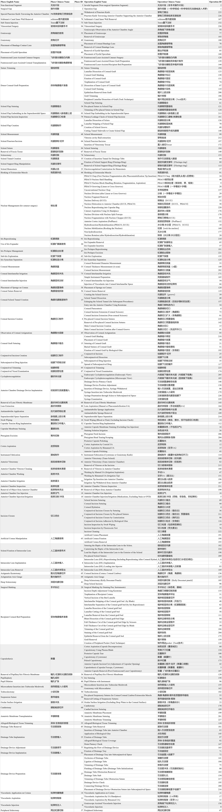

# OphNet2024

<div align="center">
    <a href="https://github.com/openmedlab/"></a>
</div>
<p style="text-align:center;font-size:10px;"><em></em></p>

## Dataset Information

OphNet2024 is the challenge release of the OphNet ophthalmic surgical workflow dataset. It contains 1,969 untrimmed surgical videos, with time-boundary annotations for 743 videos. The source introduction reports 80 surgery types, 96 phases and 232 fine-grained operations. Annotations describe surgery presence and temporal phase/operation boundaries.

This October 2024 release is distinct from the original [OphNet](OphNet.md) benchmark, which contains 2,278 videos and a different label vocabulary. OphNet2024 supplies 14,674 phase clips and 17,508 operation clips, while challenge annotations group infrequent phase and operation labels into an Others category. It supports recognition and temporal localization of ophthalmic surgical workflows.

## Dataset Meta Information

| Dimensions | Modality              | Task Type                    | Anatomical Structures | Anatomical Area | Number of Categories                        | Data Volume | File Format |
|------------|-----------------------|------------------------------|-----------------------|-----------------|---------------------------------------------|-------------|-------------|
| 2D         | Ophthalmic Microscope | Classification, Localization | Eye                   | Eye             | 80 Surgery Types; 96 Phases; 232 Operations | 1969        | .mp4        |

## Dataset Information Statistics

| Release Component                     | Quantity |
|---------------------------------------|----------|
| Untrimmed Surgical Videos             | 1,969    |
| Videos with Time-boundary Annotations | 743      |
| Trimmed Phase Clips                   | 14,674   |
| Trimmed Operation Clips               | 17,508   |

For the challenge, phase and operation categories with fewer than 15 clips are mapped to the Others category.

## Visualization

<div align="center">
    <a href="https://github.com/openmedlab/"></a>
</div>
<p style="text-align:center;font-size:10px;"><em>OphNet2024 overview.</em></p>

<div align="center">
    <a href="https://github.com/openmedlab/"></a>
</div>
<p style="text-align:center;font-size:10px;"><em>Temporal annotations for combined ophthalmic surgeries.</em></p>

<div align="center">
    <a href="https://github.com/openmedlab/"></a>
</div>
<p style="text-align:center;font-size:10px;"><em>Dataset composition, comparison and phase examples.</em></p>

<div align="center">
    <a href="https://github.com/openmedlab/"></a>
</div>
<p style="text-align:center;font-size:10px;"><em>Surgery labels.</em></p>

<div align="center">
    <a href="https://github.com/openmedlab/"></a>
</div>
<p style="text-align:center;font-size:10px;"><em>Phase and operation labels.</em></p>

## Task Setup

Task 1 covers surgery presence, phase and operation recognition. Task 2 covers temporal phase localization, identifying the start and end of surgical phases from untrimmed videos.

## File Structure

``` 
OphNet-benchmark/
├── annotation/
│   ├── OphNet2024_surgery.csv
│   ├── OphNet2024_loca_all.csv
│   ├── OphNet2024_loca_challenge.csv
│   ├── OphNet2024_loca_challenge_phase.csv
│   ├── OphNet2024_ori_operation_trimmed.csv
│   └── OphNet2024_ori_phase_trimmed.csv
└── data_processing/
    ├── download.sh
    └── clipper.py
```

``` 
OphNet2024/
├── OphNet2024_all/
├── OphNet2024_trimmed_phase/
├── OphNet2024_trimmed_operation/
└── Features/
```

## Authors and Institutions

Ming Hu (AIM Lab, Faculty of IT, Faculty of Engineering, Monash University, Airdoc-Monash Research, Airdoc)

Peng Xia (AIM Lab, Faculty of IT, Monash University, Airdoc-Monash Research, Airdoc)

Lin Wang (Bosch Corporate Research)

Siyuan Yan (AIM Lab, Faculty of IT, Faculty of Engineering, Monash University)

Feilong Tang (AIM Lab, Faculty of IT, Monash University, Airdoc-Monash Research, Airdoc)

Zhongxing Xu (Cornell University)

Yimin Luo (King’s College London)

Kaimin Song (Airdoc-Monash Research, Airdoc)

Jurgen Leitner (Faculty of Engineering, Monash University)

Xuelian Cheng (AIM Lab, Faculty of IT, Monash University)

Jun Cheng (Institute for Infocomm Research, A*STAR)

Chi Liu (Faculty of Data Science, City University of Macau)

Kaijing Zhou (Eye Hospital, Wenzhou Medical University)

Zongyuan Ge (AIM Lab, Faculty of IT, Faculty of Engineering, Monash University, Airdoc-Monash Research, Airdoc)

## Source Information

Official Website: https://github.com/minghu0830/OphNet-benchmark

Download Link: https://huggingface.co/datasets/xioamiyh/OphNet2024

Article Address: https://arxiv.org/pdf/2406.07471

Publication Date: 2024-10

## Citation

``` 
@article{hu2024ophnet,
  title={OphNet: A Large-Scale Video Benchmark for Ophthalmic Surgical Workflow Understanding},
  author={Hu, Ming and Xia, Peng and Wang, Lin and Yan, Siyuan and Tang, Feilong and Xu, Zhongxing and Luo, Yimin and Song, Kaimin and Leitner, Jurgen and Cheng, Xuelian and others},
  journal={arXiv preprint arXiv:2406.07471},
  year={2024}
}
```

Original introduction article is [here](https://zhuanlan.zhihu.com/p/3340939827).
