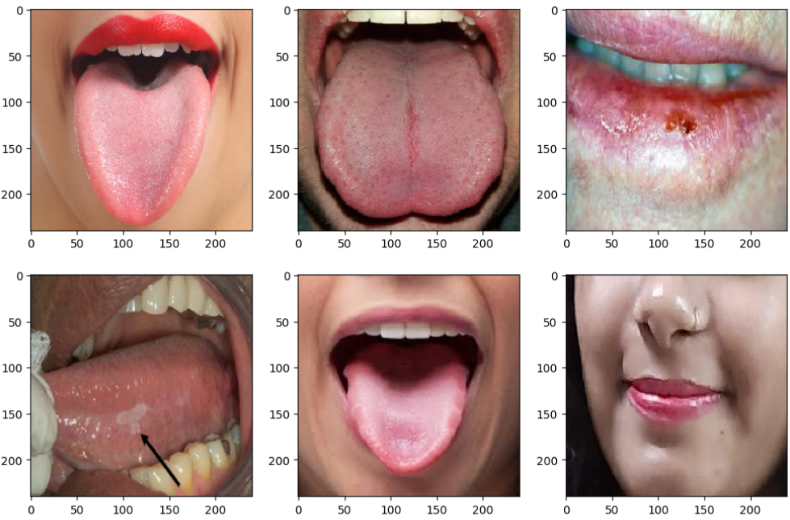
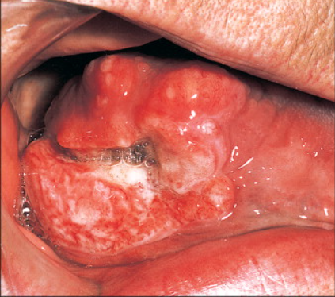
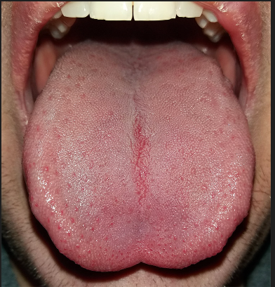

# Oral Cancer (Lips and Tongue) images

<div align="center">
    <a href="https://github.com/openmedlab/"></a>
</div>
<p style="text-align:center;font-size:10px;"><em></em></p>

## Dataset Information

This dataset contains photographs of cancerous and non-cancerous lips and tongues for oral cancer classification. Images were collected at several otolaryngology hospitals in Ahmedabad and classified with assistance from otolaryngologists. It includes 87 cancer images and 44 non-cancer images, all in PNG format. Some images are accompanied by brief patient histories that provide additional diagnostic context. The dataset creators caution that the reliability of the images and descriptions is not fully established.

## Dataset Meta Information

| Dimensions | Modality             | Task Type      | Anatomical Area | Number of Categories | Data Volume | File Format |
|------------|----------------------|----------------|-----------------|----------------------|-------------|-------------|
| 2D         | Clinical photographs | Classification | Oral cavity     | 2                    | 131         | png         |

### Resolution Details

|        | size         |
|--------|--------------|
| min    | (159, 318)   |
| median | (574, 748)   |
| max    | (3198, 1112) |

## Label Information Statistics

| Category    | Count |
|-------------|-------|
| Oral cancer | 87    |
| Non-cancer  | 44    |

## Visualization

<div align="center">
    <a href="https://github.com/openmedlab/"></a>
</div>
<p style="text-align:center;font-size:10px;"><em>Oral cancer examples.</em></p>

<div align="center">
    <a href="https://github.com/openmedlab/"></a>
</div>
<p style="text-align:center;font-size:10px;"><em>Non-cancer examples.</em></p>

## File Structure

The source introduction shows the following file structure:

``` 
dataset
├── images
│   ├── cancer
│   │   ├── XXX.png
│   │   ├── ...
│   │   ├── XXX.png
│   │   └── ...
│   └── non-cancer
│   │   ├── XXX.png
│   │   ├── ...
│   │   ├── XXX.png
│   │   └── ...
├── train.txt
├── val.txt
```

## Authors and Institutions

Shivam Barot

Prakrut Suthar

## Source Information

Official Website: https://www.kaggle.com/datasets/shivam17299/oral-cancer-lips-and-tongue-images

Download Link: https://www.kaggle.com/datasets/shivam17299/oral-cancer-lips-and-tongue-images

Article Address: None

Publication Date: 2021

## Citation

``` 
None
```

Original introduction article is [here](https://zhuanlan.zhihu.com/p/19353591592).
