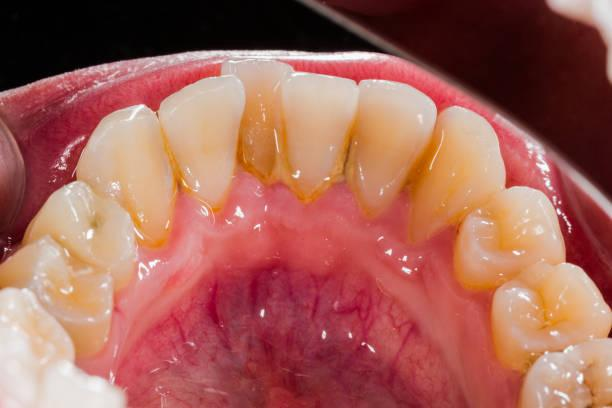
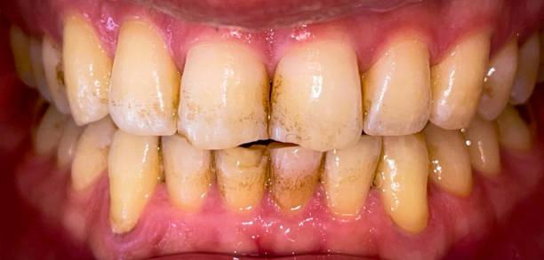

# Oral Dataset

## Dataset Information

Oral Dataset is a collection of oral photographs covering six conditions: caries, calculus, gingivitis, tooth discoloration, ulcers and hypodontia. The source introduction reports 8,188 images at 640 × 640 pixels. It describes images collected from hospitals and dental websites, with annotations and data augmentation including rotation, flipping, scaling and added noise.

The collection supports oral disease classification and analysis. The introduction mentions bounding-box annotations as well as class labels. Its reported class counts exceed the stated image total; the counts below are reproduced individually because the introduction does not explain this discrepancy.

## Dataset Meta Information

| Dimensions | Modality       | Task Type      | Number of Categories | Data Volume | File Format |
|------------|----------------|----------------|----------------------|-------------|-------------|
| 2D         | Natural Images | Classification | 6                    | 8188        | JPG         |

### Resolution Details

| Dataset Statistics | size    |
|--------------------|---------|
| min                | 640x640 |
| median             | 640x640 |
| max                | 640x640 |

## Label Information Statistics

| Category            | Count |
|---------------------|-------|
| Caries              | 2601  |
| Calculus            | 1296  |
| Gingivitis          | 2340  |
| Tooth Discoloration | 2017  |
| Ulcers              | 2806  |
| Hypodontia          | 342   |

These are the per-category counts reported by the source introduction. They total 11,402 and are not a partition of the reported 8,188 distinct images.

## Visualization

<div align="center">
    <a href="https://github.com/openmedlab/"></a>
</div>
<p style="text-align:center;font-size:10px;"><em>Calculus example.</em></p>

<div align="center">
    <a href="https://github.com/openmedlab/"></a>
</div>
<p style="text-align:center;font-size:10px;"><em>Gingivitis example.</em></p>

## File Structure

``` 
Oral_Dataset/
├── images/
│   │   ├─Calculus
│   │   │   └──XXX.JPG
│   │   │   └──....JPG
│   │   │   └──XXX.JPG
│   │   └─Gingivitis
│   │   └─.....
├── train.txt
├── val.txt
```

## Authors and Institutions

Salman Sajid  (Institution not specified in the source introduction)

## Source Information

Official Website: https://www.kaggle.com/datasets/salmansajid05/oral-diseases

Download Link: https://www.kaggle.com/datasets/salmansajid05/oral-diseases

Article Address: Not provided in the source introduction.

Publication Date: Not provided in the source introduction.

## Citation

``` 
The source introduction does not provide a citation.
```

Original introduction article is [here](https://zhuanlan.zhihu.com/p/12540781520).
