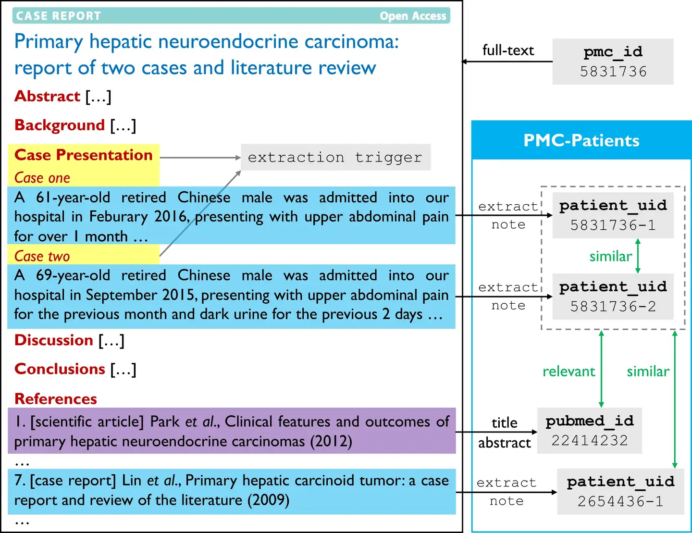
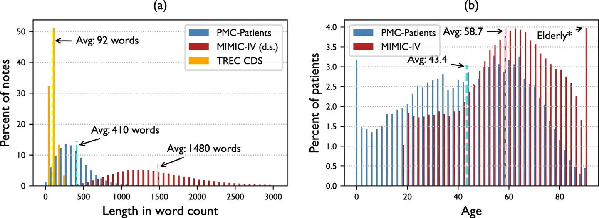
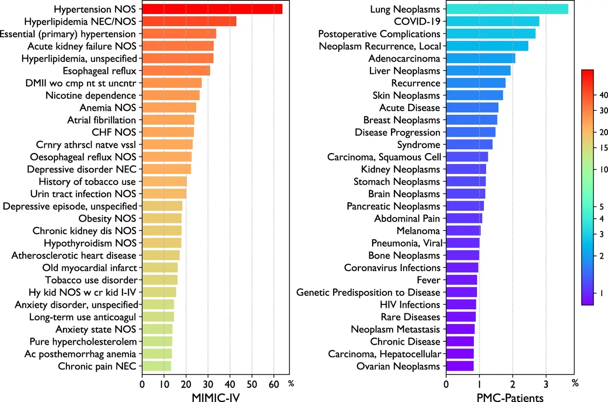
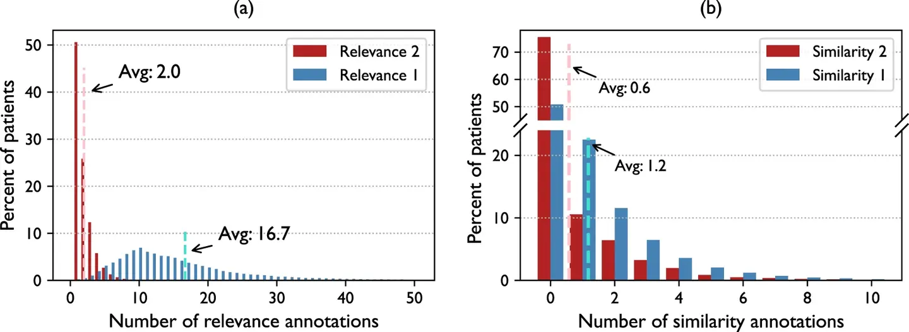
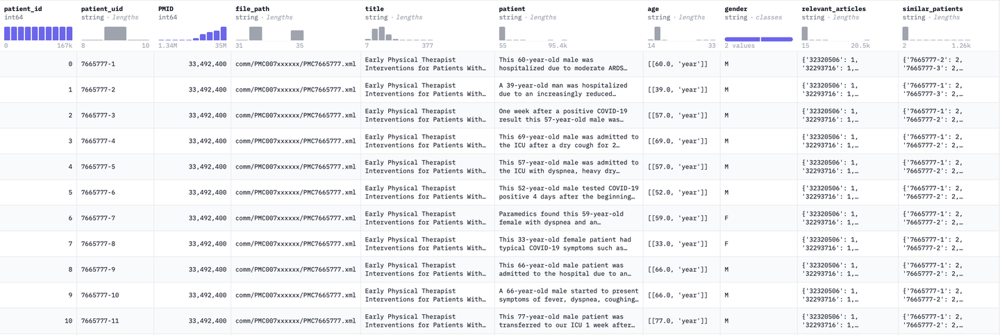

# PMC-Patients

<div align="center">
    <a href="https://github.com/openmedlab/"></a>
</div>
<p style="text-align:center;font-size:10px;"><em></em></p>

## Dataset Information

PMC-Patients is a retrieval-based clinical decision support dataset extracted from PubMed Central case reports. The release described in the introduction contains approximately 167,000 patient summaries, 3.1 million patient-article relevance annotations, and 293,000 patient-patient similarity annotations. The retrieval relationships are derived from the PubMed citation graph.

The dataset supports patient-to-article retrieval (ReCDS-PAR) and patient-to-patient retrieval (ReCDS-PPR). Each patient summary is associated with article provenance and demographic fields, enabling document retrieval and similar-case retrieval experiments.

## Dataset Meta Information

| Task Type                                   | Language | Train                               | Val | Test | File Format | Size                    |
|---------------------------------------------|----------|-------------------------------------|-----|------|-------------|-------------------------|
| Information Retrieval; Case-based Retrieval | English  | 167K patient summaries (collection) | -   | -    | .csv        | 545MB (source-reported) |

## Dataset Information Statistics

| Item                                   | Source-reported Count |
|----------------------------------------|-----------------------|
| Patient summaries                      | 167K                  |
| Patient-article relevance annotations  | 3.1M                  |
| Patient-patient similarity annotations | 293K                  |

<div align="center">
    <a href="https://github.com/openmedlab/"></a>
</div>
<p style="text-align:center;font-size:10px;"><em>Text-length and patient-age distributions compared with MIMIC-IV and TREC CDS.</em></p>

<div align="center">
    <a href="https://github.com/openmedlab/"></a>
</div>
<p style="text-align:center;font-size:10px;"><em>Disease-term frequencies in MIMIC-IV and PMC-Patients.</em></p>

<div align="center">
    <a href="https://github.com/openmedlab/"></a>
</div>
<p style="text-align:center;font-size:10px;"><em>Relevance and patient-similarity annotation distributions.</em></p>

## Dataset Example

The CSV contains patient_id, a PMID-based patient UID, source PMID/title, XML path, patient text, age tuples, and sex. Retrieval annotations connect patient summaries with relevant articles and similar patients.

<div align="center">
    <a href="https://github.com/openmedlab/"></a>
</div>
<p style="text-align:center;font-size:10px;"><em>Patient-summary example from the official paper.</em></p>

<div align="center">
    <a href="https://github.com/openmedlab/"></a>
</div>
<p style="text-align:center;font-size:10px;"><em>Dataset-record example shown in the original introduction.</em></p>

## File Structure

```
PMC-Patients
├── .gitattributes
├── PMC-Patients.csv
└── README.md
```

## Authors and Institutions

Zhengyun Zhao (Center for Statistical Science, Tsinghua University)

Sheng Yu (Center for Statistical Science, Tsinghua University)

Qiao Jin (School of Medicine, Tsinghua University)

Fangyuan Chen (School of Medicine, Tsinghua University)

Tuorui Peng (Department of Physics, Tsinghua University)

## Source Information

Official Website: https://github.com/zhao-zy15/PMC-Patients

Download Link: https://huggingface.co/zhengyun21

Article Address: https://www.nature.com/articles/s41597-023-02814-8

Publication Date: 2023-11

## Citation

```
@article{Zhao2023ALD,
  title={A large-scale dataset of patient summaries for retrieval-based clinical decision support systems.},
  author={Zhengyun Zhao and Qiao Jin and Fangyuan Chen and Tuorui Peng and Sheng Yu},
  journal={Scientific data},
  year={2023},
  volume={10},
  number={1},
  pages={909},
  url={https://api.semanticscholar.org/CorpusID:266360591}
}
```

Original introduction article is [here](https://zhuanlan.zhihu.com/p/690422289).
