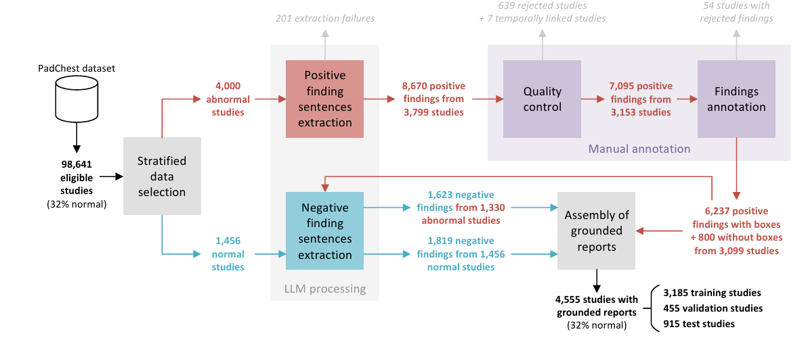
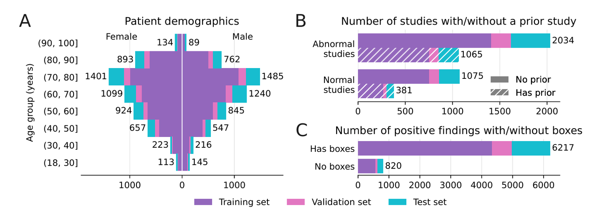
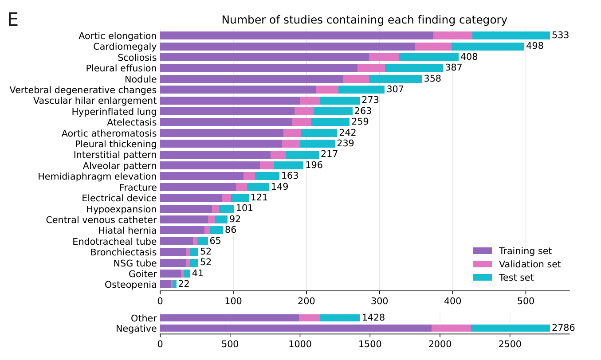
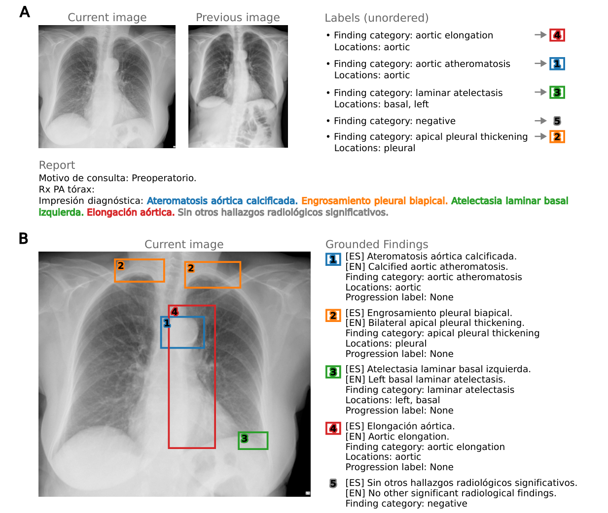

# PadChest-GR

<div align="center">
    <a href="https://github.com/openmedlab/"></a>
</div>
<p style="text-align:center;font-size:10px;"><em></em></p>

## Dataset Information

PadChest-GR is a bilingual chest radiograph dataset for grounded radiology report generation. It is derived from PadChest and includes 4,555 studies: 3,099 abnormal and 1,456 normal. Reports in Spanish and English contain 7,037 positive findings and 3,422 negative findings. Positive findings include spatial annotations, with up to two bounding boxes identifying their anatomical location.

Radiologists manually annotated the findings and locations. The annotations also describe finding type and, where available, progression relative to previous examinations, using statuses such as stable, worsening, and new. GPT-4 was used to extract single-finding sentences from Spanish reports and translate them into English. These linked images, bilingual descriptions, and spatial annotations support clinically interpretable image analysis and report generation.

## Dataset Meta Information

| Task Type                                                                            | Language            | train | val | test | File Format                    | Size |
|--------------------------------------------------------------------------------------|---------------------|-------|-----|------|--------------------------------|------|
| Image annotation, finding localization, report generation, and bilingual translation | Spanish and English | 3,185 | 455 | 915  | Images: PNG; annotations: JSON | 46GB |

<div align="center">
    <a href="https://github.com/openmedlab/"></a>
</div>
<p style="text-align:center;font-size:10px;"><em>Dataset curation workflow: study selection, processing, and annotation produce grounded bilingual reports containing positive and negative findings and bounding boxes.</em></p>

## Dataset Information Statistics

<div align="center">
    <a href="https://github.com/openmedlab/"></a>
</div>
<p style="text-align:center;font-size:10px;"><em>Dataset statistics: (A) sex and age-group distributions across splits; (B) availability of prior imaging in normal and abnormal studies; (C) bounding-box annotation availability for positive findings.</em></p>

<div align="center">
    <a href="https://github.com/openmedlab/"></a>
</div>
<p style="text-align:center;font-size:10px;"><em>Numbers of studies by finding category and split, including positive, negative, and other findings.</em></p>

## Visualization

<div align="center">
    <a href="https://github.com/openmedlab/"></a>
</div>
<p style="text-align:center;font-size:10px;"><em>Example grounded report with a chest radiograph, bilingual finding descriptions, and bounding boxes.</em></p>

## File Structure

Images are supplied in PNG format and annotations in JSON format. The source introduction does not provide a directory layout.

## Authors and Institutions

Daniel C. Castro, Shruthi Bannur, Stephanie L. Hyland, Kenza Bouzid, Kenji Takeda, and Javier Alvarez-Valle (Microsoft Research, Cambridge, UK)

Aurelia Bustos (Medbravo, Alicante, Spain)

Maria Teodora Wetscherek (Department of Radiology, University of Cambridge; Cambridge University Hospitals NHS Foundation Trust, UK)

Maria Dolores Sánchez Valverde, Lara Jaques Pérez, Lourdes Pérez Rodríguez, and Joaquín Galant Herrero (Department of Radiology, Hospital Universitario San Juan de Alicante, Spain)

José María Salinas (Department of Health Informatics, Hospital Universitario San Juan de Alicante, Spain)

Antonio Pertusa (University Institute for Computing Research, University of Alicante, Spain)

## Source Information

Official Website: https://bimcv.cipf.es/bimcv-projects/padchest-gr/

Download Link: https://bimcv.cipf.es/bimcv-projects/padchest-gr/#:~:text=Descargar%20Dataset,46%20GB

Article Address: https://arxiv.org/pdf/2411.05085

Publication Date: 2024-11-07

## Citation

``` 
@article{castro2024padchest,
  title={PadChest-GR: A Bilingual Chest X-ray Dataset for Grounded Radiology Report Generation},
  author={Castro, Daniel C and Bustos, Aurelia and Bannur, Shruthi and Hyland, Stephanie L and Bouzid, Kenza and Wetscherek, Maria Teodora and S{\'a}nchez-Valverde, Maria Dolores and Jaques-P{\'e}rez, Lara and P{\'e}rez-Rodr{\'\i}guez, Lourdes and Takeda, Kenji and others},
  journal={arXiv preprint arXiv:2411.05085},
  year={2024}
}
```

Original introduction article is [here](https://zhuanlan.zhihu.com/p/14632833436).
