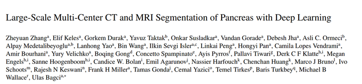
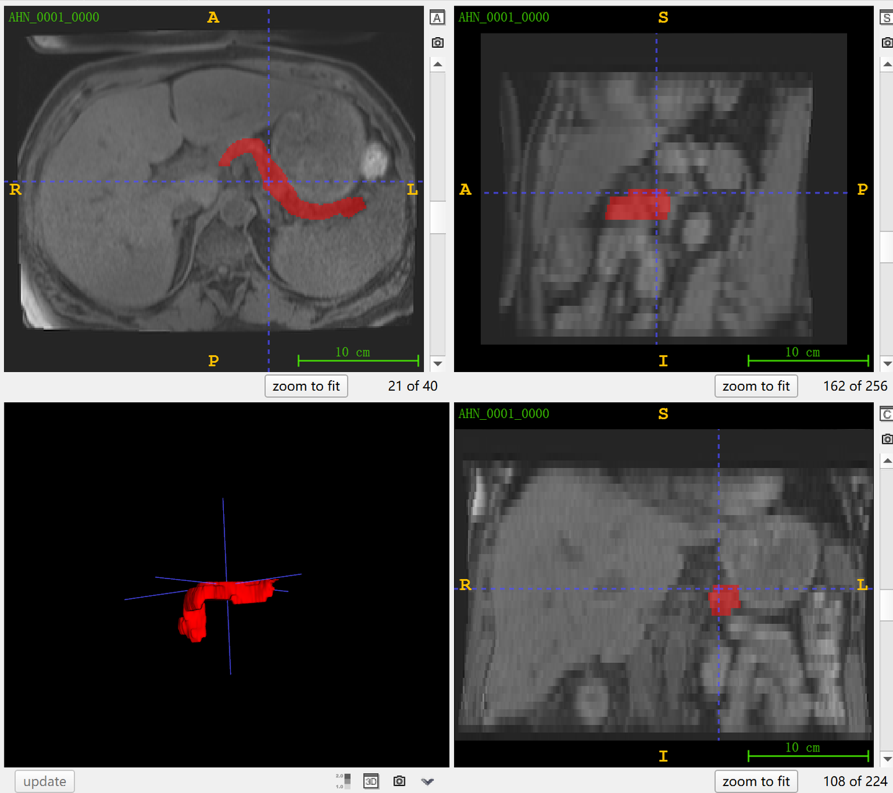
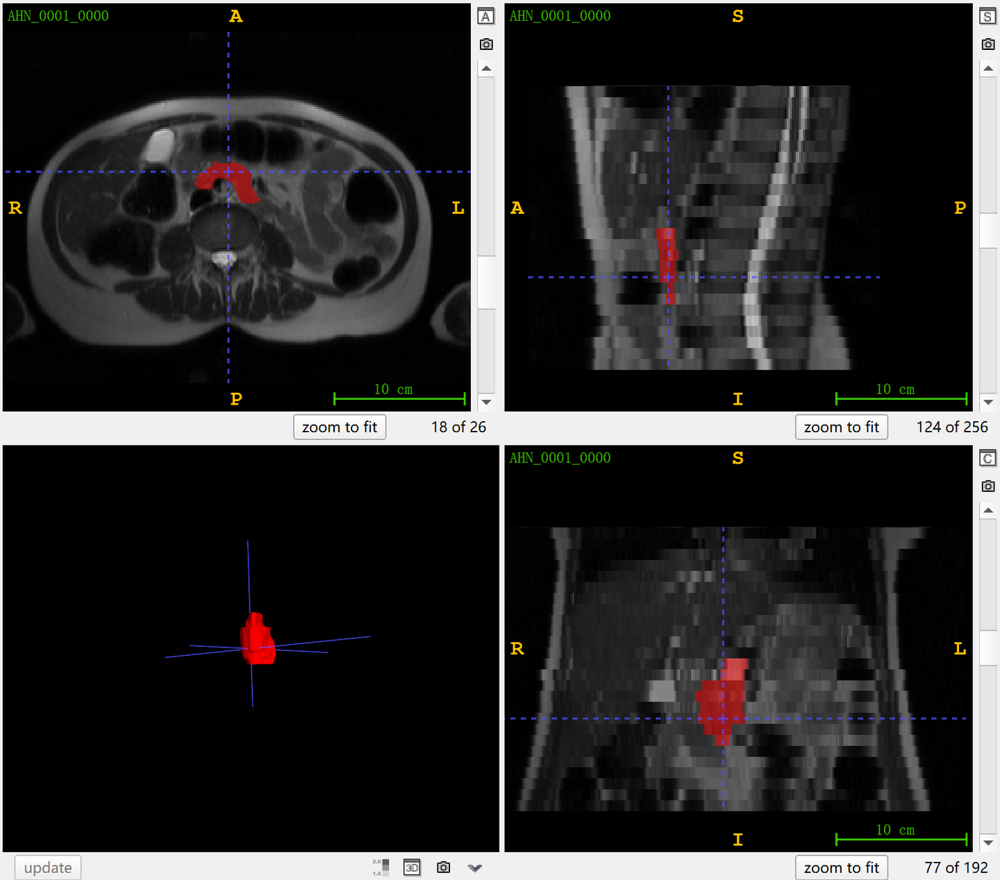

# PanSegData

<div align="center">
    <a href="https://github.com/openmedlab/"></a>
</div>
<p style="text-align:center;font-size:10px;"><em></em></p>

## Dataset Information

PanSegData is a multi-center MRI dataset for pancreas segmentation. It contains 767 abdominal scans from 499 participants, acquired at five centers between March 2004 and November 2022. The collection includes 385 T1-weighted scans and 382 T2-weighted scans, with pancreas segmentation annotations. Differences in scanners, acquisition protocols and patient populations provide a diverse benchmark for developing and evaluating segmentation methods.

MRI provides soft-tissue contrast without ionizing radiation. PanSegData supports research into MRI-based pancreas segmentation, an important component of pancreatic disease assessment.

## Dataset Meta Information

| Dimensions | Modality   | Task Type    | Anatomical Structures | Anatomical Area | Number of Categories | Data Volume | File Format |
|------------|------------|--------------|-----------------------|-----------------|----------------------|-------------|-------------|
| 3D         | MRI(T1,T2) | Segmentation | Pancreas              | Abdomen         | 1                    | 767         | .nii.gz     |

### Resolution Details

| Dataset Statistics | spacing (mm)       | size            |
|--------------------|--------------------|-----------------|
| min                | (0.53, 0.53, 1.8)  | (256, 192, 20)  |
| median             | (1.09, 1.09, 4.4)  | (256, 256, 39)  |
| max                | (1.80, 1.80, 10.4) | (604, 604, 148) |

Number of 2D slices in the dataset: 33,400.

## Label Information Statistics

| Metric              | Pancreas |
|---------------------|----------|
| Case Count          | 767      |
| Coverage            | 100%     |
| Min Volume (cm³)    | 18       |
| Median Volume (cm³) | 79       |
| Max Volume (cm³)    | 394      |

## Visualization

<div align="center">
    <a href="https://github.com/openmedlab/"></a>
</div>
<p style="text-align:center;font-size:10px;"><em>T1-weighted image visualization.</em></p>

<div align="center">
    <a href="https://github.com/openmedlab/"></a>
</div>
<p style="text-align:center;font-size:10px;"><em>T2-weighted image visualization.</em></p>

## File Structure

``` 
PanSegData/
├── Pancreas_MRI_Dataset/
│   ├── t1/
│   │   ├── imagesTr/
│   │   │   ├── AHN_0005_0000.nii.gz
│   │   │   ├── AHN_0006_0000.nii.gz
│   │   │   └── ...
│   │   └── labelsTr/
│   │       ├── AHN_0001.nii.gz
│   │       ├── AHN_0002.nii.gz
│   │       └── ...
│   └── t2/
│       ├── imagesTr/
│       │   ├── AHN_0001_0000.nii.gz
│       │   ├── AHN_0002_0000.nii.gz
│       │   └── ...
│       └── labelsTr/
│           ├── AHN_0001.nii.gz
│           ├── AHN_0002.nii.gz
│           └── ...
└── Meta informations/
    ├── T1-name_mapping.json
    ├── T2-name_mapping.json
    └── t2_info_osf.xlsx
```

T1 and T2 images and labels are stored in separate sequence folders. Mapping files and metadata are provided under Meta informations.

## Authors and Institutions

The source introduction lists the first and corresponding authors; see the paper for the complete list.

Zheyuan Zhang (Northwestern University, USA)

Ulas Bagci  (Northwestern University, USA)

## Source Information

Official Website: https://github.com/NUBagciLab/PaNSegNet

Download Link: https://osf.io/kysnj/

Article Address: https://arxiv.org/abs/2405.12367

Publication Date: 2024-05

## Citation

``` 
@article{zhang2024large,
  title={Large-Scale Multi-Center CT and MRI Segmentation of Pancreas with Deep Learning},
  author={Zhang, Zheyuan and Keles, Elif and Durak, Gorkem and Taktak, Yavuz and Susladkar, Onkar and Gorade, Vandan and Jha, Debesh and Ormeci, Asli C and Medetalibeyoglu, Alpay and Yao, Lanhong and others},
  journal={arXiv preprint arXiv:2405.12367},
  year={2024}
}
```

Original introduction article is [here](https://zhuanlan.zhihu.com/p/701911333).
