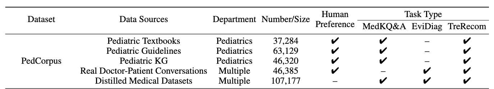

# PedCorpus

## Dataset Information

PedCorpus is a Chinese medical instruction dataset developed for pediatric applications. It supports medical knowledge question answering, evidence-based diagnosis, and treatment recommendation, with both single-turn and multi-turn dialogue formats. Data are drawn from pediatric textbooks, guidelines, a pediatric knowledge graph, doctor-patient conversations, and distilled medical datasets.

The introduction describes a 270K training release of approximately 344MB. The PediatricsGPT paper reports a constructed corpus of 300,295 instructions. These figures describe different reported scopes and should not be treated as an identical release count.

## Dataset Meta Information

| Task Type                       | Language | Train                       | Val | Test | File Format | Size                         |
|---------------------------------|----------|-----------------------------|-----|------|-------------|------------------------------|
| Medical QA / Instruction Tuning | Chinese  | 270K (introduction release) | -   | -    | .jsonl      | 344MB (introduction release) |

## Dataset Information Statistics

| Source                            | Instructions | Human Preference | Medical Knowledge QA | Evidence-based Diagnosis | Treatment Recommendation |
|-----------------------------------|--------------|------------------|----------------------|--------------------------|--------------------------|
| Pediatric Textbooks               | 37,284       | Yes              | Yes                  | No                       | Yes                      |
| Guidelines                        | 63,129       | Yes              | Yes                  | No                       | Yes                      |
| Pediatric Knowledge Graph         | 46,320       | Yes              | Yes                  | No                       | Yes                      |
| Real Doctor-patient Conversations | 46,385       | Yes              | No                   | Yes                      | Yes                      |
| Distilled Medical Datasets        | 107,177      | No               | Yes                  | Yes                      | Yes                      |
| Total                             | 300,295      | -                | -                    | -                        | -                        |

<div align="center">
    <a href="https://github.com/openmedlab/"></a>
</div>
<p style="text-align:center;font-size:10px;"><em>PedCorpus source composition, task coverage, and human preference annotations.</em></p>

## Dataset Example

Examples in the introduction cover pediatric knowledge questions, interpretation of examination findings, and consultations that build on an earlier doctor-patient exchange. A sample contains `instruction`, `input`, and `output`; multi-turn examples additionally include `history`, represented as previous user-response pairs. The question and answer content is in Chinese.

## File Structure

The introduction identifies a JSONL release and provides the sample fields described above, but does not specify filenames or a directory layout. Release information is linked from the official PediatricsGPT project and the original introduction's Hugging Face download location.

## Authors and Institutions

Dingkang Yang, Jinjie Wei, and Lihua Zhang (Fudan University, China)

The associated PediatricsGPT paper additionally lists Dongling Xiao, Shunli Wang, Tong Wu, Gang Li, Mingcheng Li, Shuaibing Wang, Jiawei Chen, Yue Jiang, Qingyao Xu, Ke Li, and Peng Zhai. Its participating institutions include Fudan University and Tencent Youtu Lab, China.

## Source Information

Official Website: https://github.com/ydk122024/PediatricsGPT

Download Link: https://huggingface.co/datasets/joejoe123/PedCorpus/tree/main

Article Address: https://arxiv.org/abs/2405.19266

Publication Date: 2024-05

## Citation

``` 
@article{yang2024pediatricsgpt,
  title={PediatricsGPT: Large Language Models as Chinese Medical Assistants for Pediatric Applications},
  author={Yang, Dingkang and Wei, Jinjie and Xiao, Dongling and Wang, Shunli and Wu, Tong and Li, Gang and Li, Mingcheng and Wang, Shuaibing and Chen, Jiawei and Jiang, Yue and Xu, Qingyao and Li, Ke and Zhai, Peng and Zhang, Lihua},
  journal={arXiv preprint arXiv:2405.19266},
  year={2024}
}
```

Original introduction article is [here](https://zhuanlan.zhihu.com/p/13674254220).
