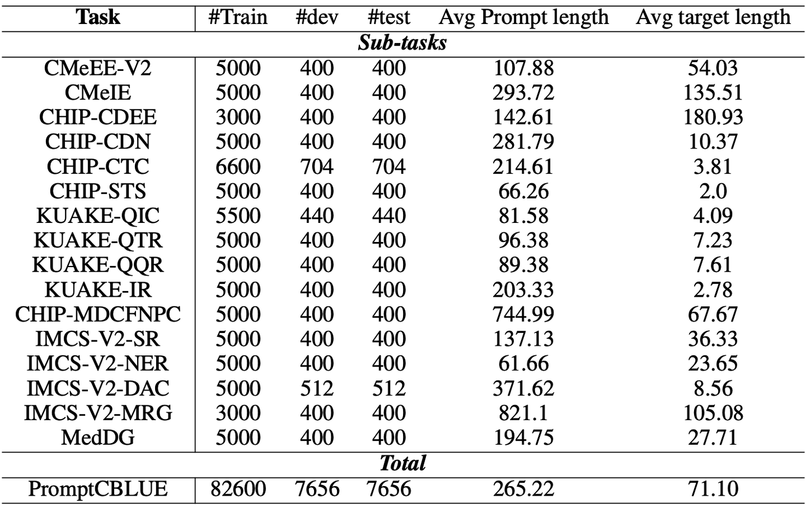

# PromptCBLUE

<div align="center">
    <a href="https://github.com/openmedlab/"></a>
</div>
<p style="text-align:center;font-size:10px;"><em></em></p>

## Dataset Information

PromptCBLUE reformulates Chinese biomedical language understanding tasks as prompts and text-generation targets for instruction tuning and evaluation. It extends CBLUE across five task groups: medical information extraction, medical text classification, medical natural language inference, symptom-status understanding, and medical text generation.

The source-described release contains 82,600 training examples, 7,656 development examples, and 7,656 test examples, for a total of 97,912. Tasks include entity and relation extraction, diagnosis normalization, clinical-trial criteria classification, query relevance, dialogue intent and symptom-status extraction, consultation summarization, and doctor-response generation.

## Dataset Meta Information

| Task Type                     | Language | Train | Val  | Test | File Format | Size                             |
|-------------------------------|----------|-------|------|------|-------------|----------------------------------|
| Multi-task Instruction Tuning | Chinese  | 82600 | 7656 | 7656 | .json       | Not reported in the introduction |

## Dataset Information Statistics

| Group                        | Source Tasks                                      |
|------------------------------|---------------------------------------------------|
| Information extraction       | CMeEE-V2; CMeIE; CHIP-CDEE; CHIP-CDN; IMCS-V2-NER |
| Text classification          | CHIP-CTC; KUAKE-QIC; IMCS-V2-DAC                  |
| Natural language inference   | CHIP-STS; KUAKE-QQR; KUAKE-IR; KUAKE-QTR          |
| Symptom-status understanding | IMCS-V2-SR; CHIP-MDCFNPC                          |
| Text generation              | IMCS-V2-MRG; MedDG                                |

<div align="center">
    <a href="https://github.com/openmedlab/"></a>
</div>
<p style="text-align:center;font-size:10px;"><em>Task-level data counts and average target lengths.</em></p>

## Dataset Example

Each task is expressed as a prompt paired with a target response. The response may contain extracted entities or relations, a category label, a symptom status, a consultation summary, or a dialogue reply. Average target lengths therefore depend on the task.

## File Structure

```
PromptCBLUE
|-- task1_train.json
|-- task1_dev.json
|-- task1_test.json
|-- ...
```

## Authors and Institutions

Wei Zhu (Intelligent Knowledge Management and Services Group, School of Computer Science and Technology, East China Normal University)

Xiaoling Wang (Intelligent Knowledge Management and Services Group, School of Computer Science and Technology, East China Normal University)

Huanran Zheng (Intelligent Knowledge Management and Services Group, School of Computer Science and Technology, East China Normal University)

Mosha Chen (Holoflow Digital Technology)

## Source Information

Official Website: https://github.com/michael-wzhu/PromptCBLUE

Download Link: https://tianchi.aliyun.com/competition/entrance/532132

Article Address: https://arxiv.org/pdf/2310.14151

Publication Date: 2023-10

## Citation

```
@misc{zhu2023promptcblue,
  title={PROMPTCBLUE: A Chinese Prompt Tuning Benchmark for the Medical Domain},
  author={Zhu, Wei and Wang, Xiaoling and Zheng, Huanran},
  year={2023},
  publisher = {GitHub},
  journal = {GitHub repository},
  howpublished = {\url{https://github.com/michael-wzhu/PromptCBLUE}},
}
```

Original introduction article is [here](https://zhuanlan.zhihu.com/p/697041342).
