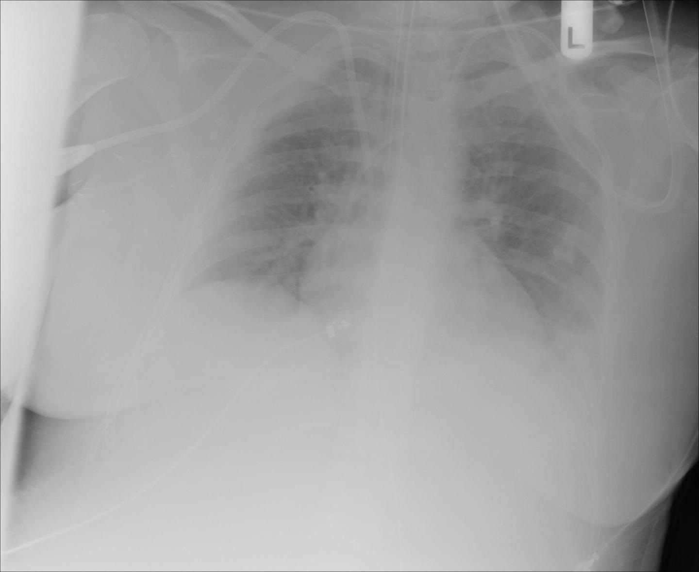
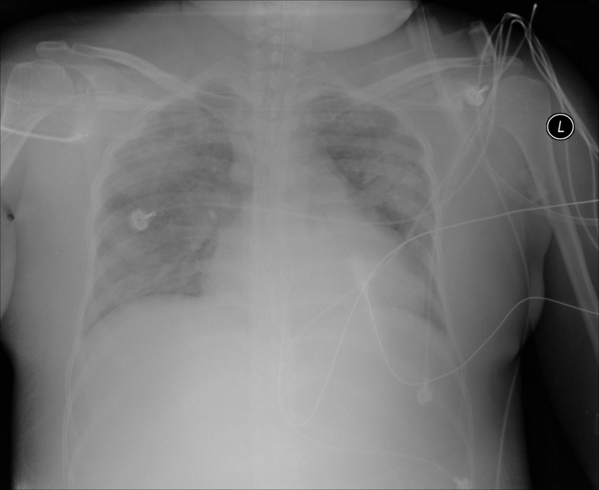
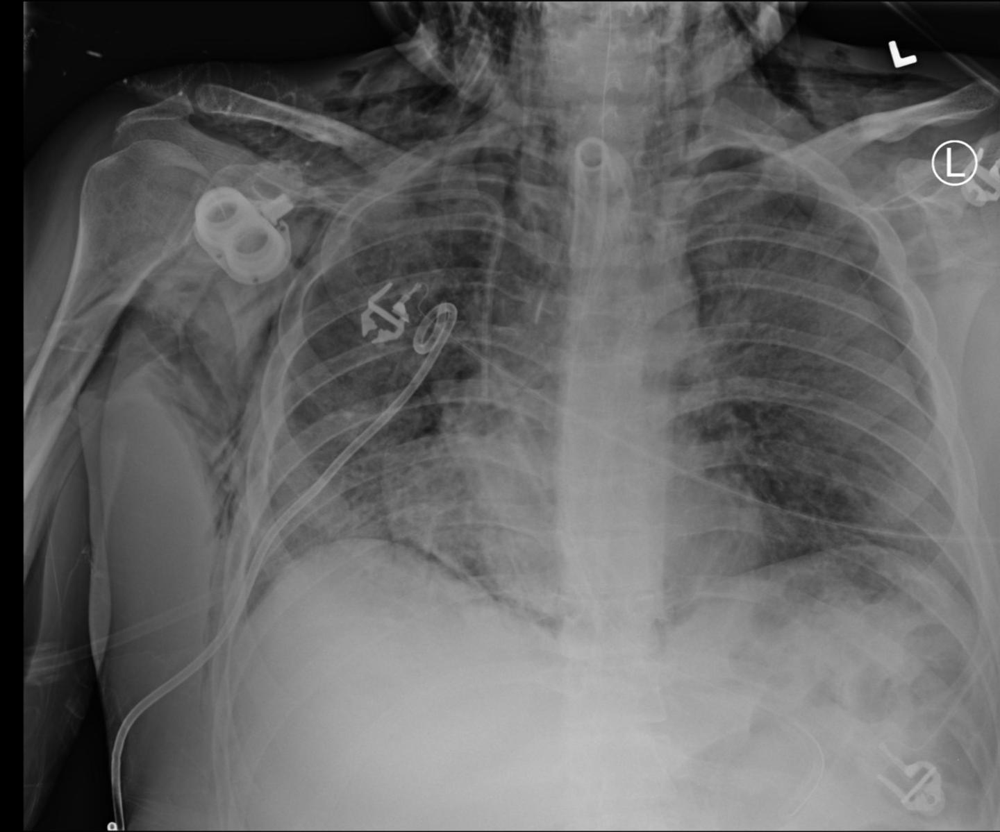
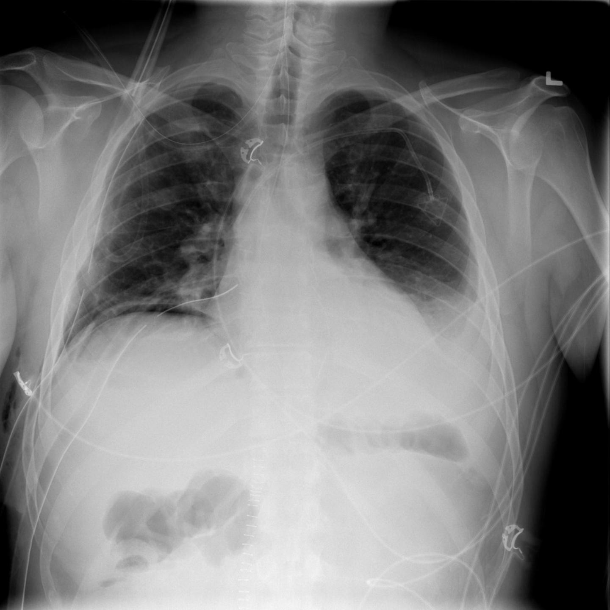

# RANZCR CLiP

<div align="center">
    <a href="https://github.com/openmedlab/"></a>
</div>
<p style="text-align:center;font-size:10px;"><em></em></p>

## Dataset Information

RANZCR CLiP supports detection and classification of catheter and line positions on chest radiographs. The introduction describes a collection of 33,665 images for training and testing, with 11 labels covering endotracheal tubes, nasogastric tubes, central venous catheters, and the presence of a Swan–Ganz catheter.

Placement is categorized as normal, borderline, or abnormal. Normal lines are appropriately positioned and require no adjustment; borderline lines could benefit from repositioning but can generally function in their current position; abnormal lines require immediate repositioning. Automatic assessment is intended to help clinicians identify malpositioned equipment promptly and reduce delays or errors during busy clinical workflows.

## Dataset Meta Information

| Dimensions | Modality | Task Type      | Anatomical Structures | Number of Categories | Data Volume | File Format |
|------------|----------|----------------|-----------------------|----------------------|-------------|-------------|
| 2D         | X-ray    | Classification | Catheters and lines   | 11                   | 33665       | .jpg        |

### Resolution Details

|        | size         |
|--------|--------------|
| min    | (2021, 2021) |
| median | (2282, 2687) |
| max    | (3056, 2544) |

## Label Information Statistics

Counts reported in the source introduction:

| Category                                                  | Count |
|-----------------------------------------------------------|-------|
| 0: endotracheal tube placement abnormal                   | 30    |
| 1: endotracheal tube placement borderline abnormal        | 585   |
| 2: endotracheal tube placement normal                     | 2536  |
| 3: nasogastric tube placement abnormal                    | 111   |
| 4: nasogastric tube placement borderline abnormal         | 219   |
| 5: nasogastric tube placement inconclusive due to imaging | 1028  |
| 6: nasogastric tube placement borderline normal           | 1870  |
| 7: central venous catheter placement abnormal             | 1206  |
| 8: central venous catheter placement borderline abnormal  | 2986  |
| 9: central venous catheter placement normal               | 7438  |
| 10: Swan Ganz Catheter Present                            | 157   |

## Visualization

<div align="center">
    <a href="https://github.com/openmedlab/"></a>
</div>
<p style="text-align:center;font-size:10px;"><em>Abnormal endotracheal tube placement.</em></p>

<div align="center">
    <a href="https://github.com/openmedlab/"></a>
</div>
<p style="text-align:center;font-size:10px;"><em>Borderline endotracheal tube placement.</em></p>

<div align="center">
    <a href="https://github.com/openmedlab/"></a>
</div>
<p style="text-align:center;font-size:10px;"><em>Normal endotracheal tube placement.</em></p>

<div align="center">
    <a href="https://github.com/openmedlab/"></a>
</div>
<p style="text-align:center;font-size:10px;"><em>Abnormal nasogastric tube placement.</em></p>

## File Structure

The source introduction shows this local layout; its example filenames use PNG, while its metadata table reports JPEG.

``` 
RANZCR CLiP
   ├── images/
   │ ├── xxx.png
   │ ├── xxx.png
   │ ├── xxx.png
   │ │            └── ...
   ├── train.txt
   ├── val.txt/
```

## Authors and Institutions

Meng Law (Alfred Health; Monash University)

Jennifer Tang (Melbourne Health)

Jarrel Seah, Adil Zia, and Andrew Dixon (Alfred Health)

George Shih (Weill Cornell Medicine)

Anouk Stein (MD.ai)

Sarah Dowd and RANZCR staff

## Source Information

Official Website: https://www.kaggle.com/competitions/ranzcr-clip-catheter-line-classification

Download Link: https://www.kaggle.com/competitions/ranzcr-clip-catheter-line-classification

Article Address: None

Publication Date: 2020-12-14

## Citation

``` 
Jarrel Seah, Jen, Maggie, Meng Law, Phil Culliton, and Sarah Dowd.
RANZCR CLiP - Catheter and Line Position Challenge.
https://kaggle.com/competitions/ranzcr-clip-catheter-line-classification, 2020. Kaggle.
```

Original introduction article is [here](https://zhuanlan.zhihu.com/p/8777945496).
