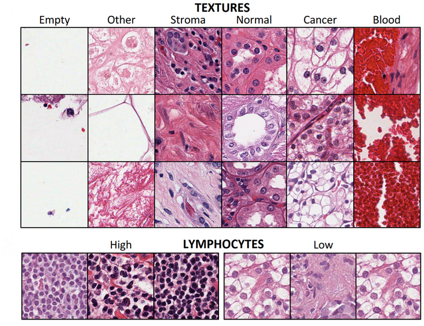

# RenalCell

<div align="center">
    <a href="https://github.com/openmedlab/"></a>
</div>
<p style="text-align:center;font-size:10px;"><em></em></p>

## Dataset Information

RenalCell provides histological image tiles from clear cell renal cell carcinoma (TCGA-KIRC) samples for tissue classification and lymphocyte density analysis. The tissue classification component contains 39,458 tiles of 300 × 300 pixels across six classes: cancer, normal renal tissue, blood, stroma, other tissue and empty background. The lymphocyte component contains 25,095 tiles with high or low lymphocyte density; most are 256 × 256 pixels, with some smaller tiles.

The annotations were reviewed to support automated analysis of tissue texture and immune infiltration in renal cell carcinoma.

## Dataset Meta Information

| Dimensions | Modality  | Task Type      | Anatomical Structures | Tissue Categories and Tile Count | Lymphocyte Categories and Tile Count | File Format |
|------------|-----------|----------------|-----------------------|----------------------------------|--------------------------------------|-------------|
| 2D         | pathology | Classification | Kidney                | 6, 39,458                        | 2, 25,095                            | .png        |

### Resolution Details

Tissue classification tiles: 300 × 300 pixels. Lymphocyte tiles: mostly 256 × 256 pixels, with some smaller tiles, as described in the official dataset record.

## Label Information Statistics

### Tissue Classification

| Category              | cancer | normal | blood | stroma | other | empty  |
|-----------------------|--------|--------|-------|--------|-------|--------|
| Case Count            | 11,755 | 6,313  | 544   | 3,027  | 6,210 | 11,609 |
| Percentage (computed) | 29.8%  | 16.0%  | 1.4%  | 7.7%   | 15.7% | 29.4%  |

### Lymphocyte Density Classification

| Category   | High lymphocyte density | Low lymphocyte density |
|------------|-------------------------|------------------------|
| Case Count | 5,003                   | 20,092                 |
| Coverage   | 19.9%                   | 80.1%                  |

Tissue percentages are calculated from the reported class counts and 39,458-tile total.

## Visualization

<div align="center">
    <a href="https://github.com/openmedlab/"></a>
</div>
<p style="text-align:center;font-size:10px;"><em>Visualization from the original paper.</em></p>

## File Structure

``` 
RenalCell/
├── tissue_classification.zip
├── binary_lymphocytes.zip
├── resnet18_tissue_classification_dataset_final.pth
└── resnet18_binary_lymphocytes_final.pth
```

## Authors and Institutions

Otso Brummer (Hematoscope Lab, Helsinki University Hospital&Hematology Research Unit Helsinki, University of Helsinki and Helsinki University, Hospital Comprehensive Cancer Center&Translational Immunology Research Program, University of Helsinki)

Petri Pölönen (Department of Pathology, St. Jude Children's Research Hospital, Memphis)

Satu Mustjoki (Hematology Research Unit Helsinki, University of Helsinki and Helsinki University, Hospital Comprehensive Cancer Center&Translational Immunology Research Program, University of Helsinki&iCAN Digital Precision Cancer Medicine Flagship&Department of Clinical Chemistry and Hematology, University of Helsinki)

Oscar Brück (Hematoscope Lab, Helsinki University Hospital&Hematology Research Unit Helsinki, University of Helsinki and Helsinki University, Hospital Comprehensive Cancer Center&Translational Immunology Research Program, University of Helsinki)

## Source Information

Official Website: https://zenodo.org/records/6528599

Download Link: https://zenodo.org/records/6528599

Article Address: https://www.biorxiv.org/content/10.1101/2022.08.15.503955v1.abstract

Publication Date: 2022

Archive Information: https://zenodo.org/records/6528599

## Citation

``` 
@article{brummer2022integrative,
  title={Integrative Analysis of Histological Textures and Lymphocyte Infiltration in Renal Cell Carcinoma using Deep Learning},
  author={Brummer, Otso and P{\"o}l{\"o}nen, Petri and Mustjoki, Satu and Br{\"u}ck, Oscar},
  journal={bioRxiv},
  pages={2022--08},
  year={2022},
  publisher={Cold Spring Harbor Laboratory}
}
```

Original introduction article is [here](https://zhuanlan.zhihu.com/p/6090221222).
