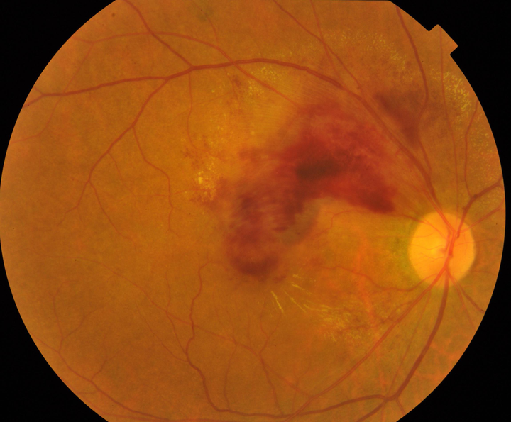
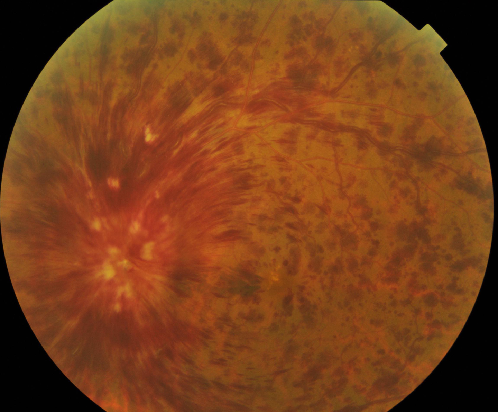
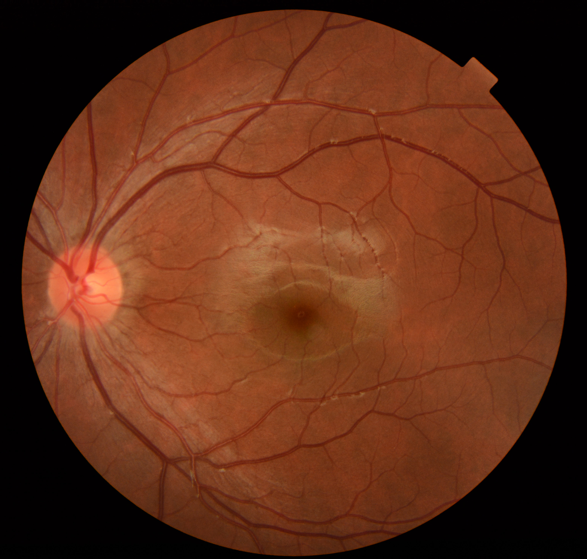
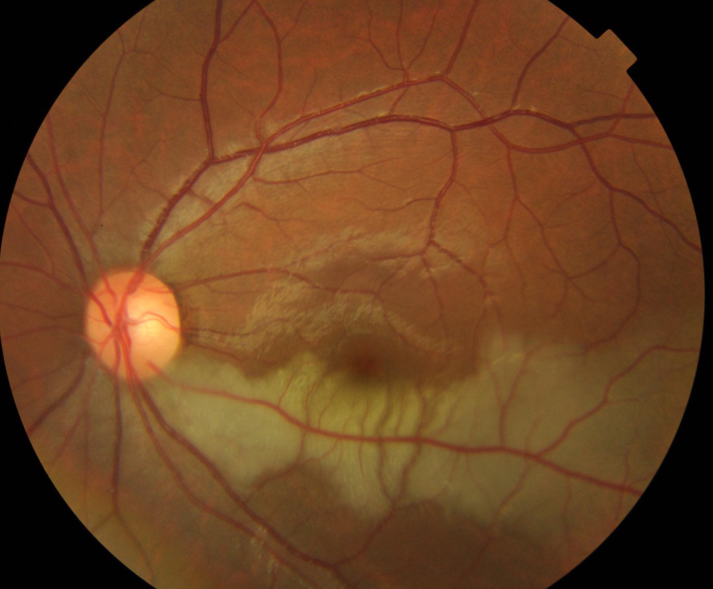

# Retinal Occlusion Dataset

<div align="center">
    <a href="https://github.com/openmedlab/"></a>
</div>
<p style="text-align:center;font-size:10px;"><em></em></p>

## Dataset Information

Retinal Occlusion Dataset contains 281 fundus photographs for four-class classification of retinal vascular occlusion. The classes are normal retina (label 0), branch retinal vein occlusion (BRVO, label 1), central retinal vein occlusion (CRVO, label 2) and retinal artery occlusion (RAO, label 3).

The collection provides image files and CSV labels for training and validation, supporting evaluation of image-based retinal occlusion classification.

## Dataset Meta Information

| Dimensions | Modality           | Task Type      | Anatomical Structures | Anatomical Area | Number of Categories | Data Volume | File Format |
|------------|--------------------|----------------|-----------------------|-----------------|----------------------|-------------|-------------|
| 2D         | Fundus photography | Classification | Retina                | Eye             | 4                    | 281         | png         |

### Resolution Details

| Dataset Statistics | size         |
|--------------------|--------------|
| min                | [1424, 2144] |
| median             | [1921,2544]  |
| max                | [2572, 3046] |

## Label Information Statistics

| Category  | Count |
|-----------|-------|
| Normal: 0 | 38    |
| BRVO: 1   | 153   |
| CRVO: 2   | 66    |
| RAO: 3    | 24    |

## Visualization

<div align="center">
    <a href="https://github.com/openmedlab/"></a>
</div>
<p style="text-align:center;font-size:10px;"><em>Branch retinal vein occlusion.</em></p>

<div align="center">
    <a href="https://github.com/openmedlab/"></a>
</div>
<p style="text-align:center;font-size:10px;"><em>Central retinal vein occlusion.</em></p>

<div align="center">
    <a href="https://github.com/openmedlab/"></a>
</div>
<p style="text-align:center;font-size:10px;"><em>Normal retina.</em></p>

<div align="center">
    <a href="https://github.com/openmedlab/"></a>
</div>
<p style="text-align:center;font-size:10px;"><em>Retinal artery occlusion.</em></p>

## File Structure

``` 
Retinal Occlusion Dataset
├── images
│   ├── XXX.png
│   ├── XXX.png
│   ├── ...
├── train_data.csv
├── val_data.csv
```

The images directory contains all images; train_data.csv and val_data.csv provide the training and validation labels.

## Authors and Institutions

Authors and institutions are not specified in the source introduction.

## Source Information

Official Website: https://www.kaggle.com/datasets/gracemariabinu/retinal-occlusion-dataset

Download Link: https://www.kaggle.com/datasets/gracemariabinu/retinal-occlusion-dataset

Article Address: Not provided in the source introduction.

Publication Date: 2013

## Citation

``` 
The source introduction does not provide a citation.
```

Original introduction article is [here](https://zhuanlan.zhihu.com/p/16273784411).
